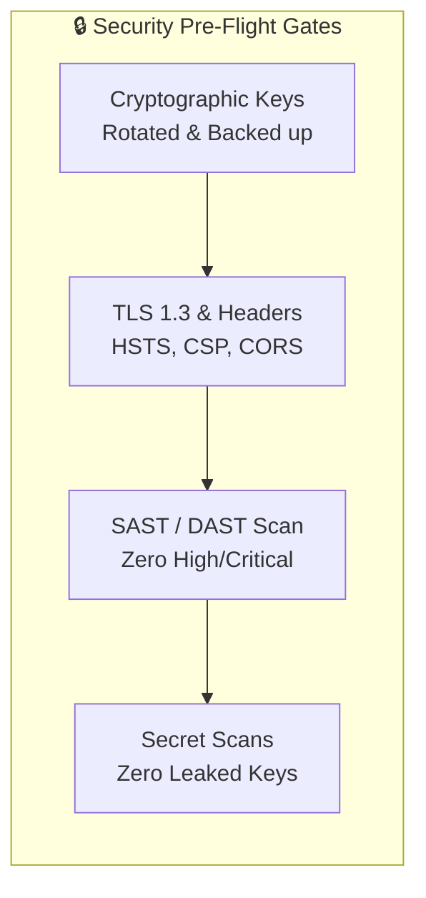

# System Revamp v2.0 — Production Deployment Checklists

  <strong>Pre-Flight Security Validation, Performance Baseline Gates, Capacity Planning Worksheet, and Executive Sign-Off Template</strong>

---

## 1. Release Governance & Go-Live Criteria

Deploying System Revamp v2.0 into production across computer labs, university departments, or enterprise branch offices requires rigorous pre-launch verification. Because the platform executes privileged actions on endpoints (installing updates, auditing drivers, querying Windows Registry, and hashing binaries), an unverified deployment poses security, performance, and operational risks.

This checklist establishes the mandatory sign-off gates required before any production cutover or promotion from staging.

---

## 2. Gate 1: Security Pre-Flight Validation (T-48h Before Launch)

All items in this section must be verified and checked off by the **Security Operations Lead (SecOps)** or **CISO delegate** at least 48 hours prior to production launch:

- [ ] **Master Signing Key Provisioned**: `DEVICE_SIGNING_KEY` has been generated with 256-bit CSPRNG entropy (`openssl rand -hex 32`) and is NOT using default fallback secrets.
- [ ] **Key Escrow & Backup Verified**: `DEVICE_SIGNING_KEY` has been encrypted and deposited into institutional secrets management (HashiCorp Vault / AWS Secrets Manager) or Shamir's Secret Sharing escrow vault.
- [ ] **JWT Admin Secret Rotated**: `SECRET_KEY` / `JWT_SECRET_KEY` has been rotated from development defaults; file permissions on `.env` and `server_data/.*_key` are strictly set to `0600` (`chmod 600`).
- [ ] **TLS 1.3 Encryption Enforced**: Reverse proxy terminates TLS with a valid certificate ($\ge 6\text{ months}$ validity); SSL Labs score $\ge \text{A+}$; legacy SSLv3/TLS 1.0/TLS 1.1 disabled.
- [ ] **HTTP Security Headers Configured**:
  - `Strict-Transport-Security: max-age=63072000; includeSubDomains; preload`
  - `Content-Security-Policy: default-src 'self'; script-src 'self'; style-src 'self' 'unsafe-inline'; font-src 'self'; img-src 'self' data:; connect-src 'self' https:; frame-ancestors 'none';`
  - `X-Content-Type-Options: nosniff`
  - `X-Frame-Options: DENY`
  - `Referrer-Policy: strict-origin-when-cross-origin`
- [ ] **CORS Origins Restricted**: Central Server CORS middleware restricted strictly to authorized Admin Console domain (`https://fleet.university.edu`); wildcard `*` disabled in production.
- [ ] **Secrets & Code Repository Sanitization**: Static repository scan completed using `git-secrets` / `trufflehog`; zero hardcoded API keys, private keys, or passwords in git history.
- [ ] **Static & Dynamic Analysis (SAST/DAST)**: Automated Semgrep / Bandit code scan passed with zero High or Critical vulnerabilities; zero SQL injection or XSS paths detected.
- [ ] **Database Least Privilege**: Database user account (`revamp`) holds only `SELECT, INSERT, UPDATE, DELETE` permissions; `SUPERUSER` privileges removed.
- [ ] **SuperAdmin Password Reset**: Initial default password (`Admin@123456`) has been replaced with a strong $\ge 16\text{-character}$ passphrase; 2FA TOTP is provisioned and active.

---

## 3. Gate 2: Performance Baseline & Capacity Planning

All items must be validated by the **Lead Systems Reliability Engineer (SRE)**:

### 3.1 Fleet Capacity Sizing Worksheet

| Sizing Dimension | Tier 1 (Small Lab) | Tier 2 (Department) | Tier 3 (Campus-wide) | Tier 4 (Enterprise Multi-Site) |
|---|---|---|---|---|
| **Target Fleet Size** | $1 – 200\text{ Workstations}$ | $200 – 1,000\text{ Workstations}$ | $1,000 – 5,000\text{ Workstations}$ | $5,000 – 10,000+\text{ Workstations}$ |
| **Server CPU / RAM** | $2\text{ vCPU} / 4\text{ GB RAM}$ | $4\text{ vCPU} / 8\text{ GB RAM}$ | $8\text{ vCPU} / 16\text{ GB RAM}$ | $16\text{ vCPU} / 32\text{ GB RAM}$ |
| **Database Engine** | SQLite (WAL Mode) | PostgreSQL (Standalone) | PostgreSQL + 1 Read Replica | PostgreSQL Cluster (Patroni + HAProxy) |
| **Agent Poll Interval** | $300\text{ seconds (5m)}$ | $300\text{ seconds (5m)}$ | $300\text{ seconds (5m)}$ | $600\text{ seconds (10m)}$ |
| **Ingestion RPS (Avg)** | $0.7\text{ req/s}$ | $3.3\text{ req/s}$ | $16.7\text{ req/s}$ | $16.7 – 33.3\text{ req/s}$ |
| **Disk Storage (90d)** | $10\text{ GB SSD}$ | $40\text{ GB SSD}$ | $200\text{ GB NVMe}$ | $500\text{ GB NVMe (RAID 10)}$ |

### 3.2 Performance Baseline Checklist
- [ ] **Synthetic Load Test (500 Concurrent Agents)**: Locust / k6 load test executed against `/api/v2/agent/heartbeat` and `/api/v2/agent/telemetry`; measured p95 latency $< 250\text{ms}$; zero 5xx error responses.
- [ ] **Stress Test (Fleet Reconnection Spike)**: Simulated 10,000 endpoints connecting within a 300-second window; verified that agent jitter backoff prevents server CPU saturation ($< 70\%$ peak CPU).
- [ ] **Database Index Optimization**: Verified existence and query planner usage of indexes on:
  - `devices(mac_address)`
  - `devices(org_id, site_id, lab_id)`
  - `host_scans(device_id, collected_at)`
  - `audit_logs(org_id, timestamp)`
  - `remediation_commands(device_id, status)`
- [ ] **Reverse Proxy SSE Tuning**: Reverse proxy (`Nginx`) configured with `proxy_buffering off` and `proxy_read_timeout 3600s` for long-lived Server-Sent Events (`/api/v2/exposure/stream/{id}`).
- [ ] **Rate Limiting Guard Active**: Nginx / FastAPI rate-limiting active on `/api/v2/auth/*` (15 req/min) and `/api/v2/agent/enroll` (10 req/min).

---

## 4. Gate 3: Operational & Monitoring Readiness

All items must be validated by the **Operations / DevOps Lead**:

- [ ] **Prometheus Metrics Active**: Scraper actively ingesting `/metrics`; metrics confirmed receiving data for `systemrevamp_fleet_online_count` and `systemrevamp_telemetry_ingestion_duration_seconds`.
- [ ] **Alertmanager Paging Configured**: Alert rules imported into Alertmanager; test page successfully triggered in PagerDuty / Slack for `FleetMassDisconnection` and `HighHmacSignatureFailures`.
- [ ] **Automated Backup Cron Verified**:
  - SQLite: Daily `VACUUM INTO` script tested and verified restorable.
  - PostgreSQL: Nightly `pg_dump` cron running, encrypted via AES-256-GCM, and shipped to remote S3/NFS backup bucket.
- [ ] **Retention Pruning Job Active**: Scheduled nightly cron job verified running to prune telemetry snapshots older than 90 days and threat cache older than 30 days.
- [ ] **DNS TTL Reduced**: DNS Record TTL for `fleet.university.edu` reduced to **60 seconds** to facilitate emergency IP failover.
- [ ] **Runbooks & Playbooks Accessible**: On-call engineering team has offline and read-only access to [`OPERATIONS_AND_RUNBOOK.md`](file:///c:/Users/Daksh%20Gehlot/OneDrive/Desktop/System%20Revamp/docs/OPERATIONS_AND_RUNBOOK.md) and [`INCIDENT_RESPONSE_PLAYBOOK.md`](file:///c:/Users/Daksh%20Gehlot/OneDrive/Desktop/System%20Revamp/docs/INCIDENT_RESPONSE_PLAYBOOK.md).
- [ ] **On-Call Primary & Secondary Roster Staffed**: 24/7 on-call duty roster staffed and validated in PagerDuty / Opsgenie.

---

## 5. Formal Stakeholder Sign-Off & Cutover Authorization

Production launch is authorized only when all required functional leaders have affixed their sign-off:

| Stakeholder Role | Printed Name | Signature / Sign-Off Token | Date Approved | Status |
|---|---|---|---|---|
| **Chief Information Security Officer (CISO)** | | | | `[ ] APPROVED` |
| **Lead Enterprise Architect** | | | | `[ ] APPROVED` |
| **Site Reliability Engineering Lead (SRE)** | | | | `[ ] APPROVED` |
| **Director of Campus IT / Lab Operations** | | | | `[ ] APPROVED` |

### Cutover Decision Protocol
- **Go Decision**: 100% of Gate 1, Gate 2, and Gate 3 items checked; all four executive sign-offs secured.
- **No-Go / Abort Decision**: Any single unmitigated Critical vulnerability in Gate 1; p95 latency $> 1000\text{ms}$ under load; or missing backup restore verification.
