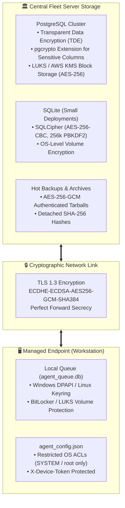

# System Revamp v2.0 — Encryption at Rest & Data Protection Standards

<p align="center">
  <strong>Comprehensive Security Standard for Storage Encryption, Data Retention Schedules, Student Data Minimization, and FERPA/GDPR/HIPAA Compliance</strong>
</p>

---

## 1. Regulatory Context & Scope

System Revamp v2.0 is engineered for institutional environments—particularly universities, academic computer labs, hospitals, and distributed enterprises. Because workstations in these environments may be utilized by students, faculty, healthcare professionals, or patients, the platform enforces strict data minimization, cryptographic storage protection, and statutory compliance:

- **Family Educational Rights and Privacy Act (FERPA)**: Protects student education records and institutional workstation identities.
- **General Data Protection Regulation (GDPR / UK GDPR)**: Governs privacy rights, lawful processing, and the Right to Erasure (Article 17).
- **Health Insurance Portability and Accountability Act (HIPAA Security Rule)**: Mandates encryption of electronic protected health information (ePHI) at rest and in transit.
- **National Institute of Standards and Technology (NIST SP 800-88 / 800-53)**: Establishes media sanitization and security controls.

---

## 2. Encryption at Rest Standards

All persistent data generated by System Revamp—including databases, local queue buffers, log files, offline intelligence bundles, and disaster recovery archives—must be encrypted at rest using industry-standard AES-256 cryptographic algorithms.



### 2.1 SQLite Encryption with SQLCipher (Default / Tier 1-2)
When running on SQLite, high-security enterprise environments must link the backend with **SQLCipher**:
- **Cipher**: AES-256-CBC with per-page initialization vectors (IV).
- **Key Derivation Function**: PBKDF2 with HMAC-SHA512 (minimum 256,000 iterations) or Argon2id.
- **Page Size**: 4096 bytes with 16-byte HMAC integrity validation per page.

```python
# Initializing encrypted SQLite database via SQLCipher
import sqlite3

def open_secure_database(db_path: str, encryption_key: str):
    conn = sqlite3.connect(db_path)
    # Execute SQLCipher PRAGMA directives
    conn.execute(f"PRAGMA key = \"{encryption_key}\";")
    conn.execute("PRAGMA cipher_page_size = 4096;")
    conn.execute("PRAGMA kdf_iter = 256000;")
    conn.execute("PRAGMA cipher_hmac_algorithm = HMAC_SHA512;")
    return conn
```

### 2.2 PostgreSQL Encryption (Enterprise / Tier 3-4)
For multi-server enterprise clusters:
1. **Underlying Volume Encryption**: Database volumes must be hosted on encrypted block storage (e.g., Linux LUKS `dm-crypt`, AWS EBS AES-256 encryption via AWS KMS, or Azure Managed Disks SSE).
2. **PostgreSQL Transparent Data Encryption (TDE)**: Enable cluster-level encryption where supported.
3. **Column-Level Cryptography (`pgcrypto`)**:
   Sensitive fields (such as 2FA TOTP secrets and enrollment seed keys) are encrypted using `pgp_sym_encrypt()`:
   ```sql
   -- Column encryption example using pgcrypto
   CREATE EXTENSION IF NOT EXISTS pgcrypto;
   
   INSERT INTO admin_users (email, totp_secret_encrypted)
   VALUES ('admin@university.edu', pgp_sym_encrypt('BASE32SECRETKEY', 'DATABASE_MASTER_PASSPHRASE'));
   ```

### 2.3 Backup Archive Encryption
All backup tarballs generated by automated cron jobs or manual export runbooks must be encrypted using AES-256-GCM before transfer off-site:

```bash
#!/usr/bin/env bash
# Encrypt backup archive with OpenSSL AES-256-GCM
openssl enc -aes-256-gcm -pbkdf2 -iter 100000 \
  -in /var/backups/system-revamp/fleet_20261024.db \
  -out /var/backups/system-revamp/fleet_20261024.db.enc \
  -pass file:/opt/system-revamp/.backup_passphrase
```

---

## 3. Data Retention & Purge Schedules

To prevent unbounded storage growth and comply with privacy statutes, System Revamp implements an automated retention policy:

| Data Category | Target Entity / Table | Mandatory Retention Window | Statutory / Operational Rationale | Automated Purge Action |
|---|---|---|---|---|
| **Administrative Audit Logs** | `audit_logs` | **7 Years** | FERPA compliance for academic institutions; SOX Section 802. | Preserved in immutable WORM (Write Once, Read Many) cold storage. |
| **Endpoint Telemetry Snapshots** | `telemetry_history`, `host_scans` | **90 Days** | Operational fleet diagnostics; privacy minimization. | Pruned daily via server scheduled task. |
| **Hardware Driver Error Logs** | `driver_events` | **90 Days** | Problem code diagnostic history. | Pruned when older than 90 days. |
| **Threat Intelligence Cache** | `virustotal_cache` | **30 Days** | Stale hash intelligence; prevents caching deprecated verdict statuses. | Truncated when TTL exceeds 30 days. |
| **Enrollment Tokens** | `enrollment_tokens` | **Expiry + 30 Days** | Security auditing of past provisioning cycles. | Hard-deleted 30 days post-expiration. |
| **Endpoint Queue Buffer** | `agent_queue.db` | **7 Days or 100 MB** | Local endpoint disk preservation. | FIFO truncation; oldest non-audit telemetry dropped if cap hit. |

### 3.1 Automated Retention Pruning Query
The Central Fleet Server executes an internal retention maintenance job nightly:

```sql
-- Nightly Data Retention Enforcement Script
BEGIN TRANSACTION;

-- 1. Purge telemetry snapshots older than 90 days
DELETE FROM host_telemetry 
WHERE collected_at < CURRENT_TIMESTAMP - INTERVAL '90 days';

-- 2. Purge stale threat intelligence records older than 30 days
DELETE FROM virustotal_cache 
WHERE last_checked_at < CURRENT_TIMESTAMP - INTERVAL '30 days';

-- 3. Purge expired enrollment tokens older than 30 days post-expiry
DELETE FROM enrollment_tokens 
WHERE expires_at < CURRENT_TIMESTAMP - INTERVAL '30 days';

COMMIT;
```

---

## 4. Student & Academic Data Minimization Principles

Academic computer labs host thousands of unique students weekly. System Revamp operates under the strict principle of **Zero Student Personal Data Collection**:

### 4.1 Workstation Naming & Identifier Anonymization
- **No Personal Identifiers in Hostnames**: Institutional administrators must not configure workstations with student usernames, student ID numbers, or individual email addresses.
- **Lab Nomenclature**: Endpoints must use generic, lab-oriented naming conventions:
  - *Compliant*: `ENG-CAD-LAB-PC01`, `LIB-COMMONS-WKS-12`, `CHEM-LAB-3B-04`
  - *Non-Compliant (Violation)*: `JOHN-DOE-LAPTOP`, `STU-10023481-PC`

### 4.2 Automated PII Scrubbing on CSV / API Exports
When administrators export compliance reports or CSV summaries via `/api/v2/admin/export/csv`:
1. Any field matching common PII patterns (email addresses, phone numbers, individual user profile directories like `C:\Users\jdoe123`) is stripped or masked.
2. Software inventory reporting captures global system packages (`C:\Program Files`, `HKLM\Software`) and explicitly excludes per-user temporary directories (`C:\Users\*\AppData\Local\Temp`).

### 4.3 Zero-Upload Threat Inspection Guarantee
The System Revamp Endpoint Agent conducts security and binary integrity analysis **entirely on the local host**:
- **Never Uploads Executables**: Executable files (`.exe`, `.dll`, `.sys`) and user documents (`.docx`, `.pdf`, `.py`) are **NEVER** transmitted over the network to the Central Server or any external cloud service.
- **Cryptographic Fingerprints Only**: The agent computes the cryptographic **SHA-256 hash** locally and checks the local Windows Authenticode digital signature.
- Only the 64-character SHA-256 hexadecimal string is transmitted to the server for threat evaluation.

---

## 5. GDPR & Privacy Compliance (Right to Erasure)

Under GDPR Article 17 ("Right to be Forgotten") and institutional privacy mandates:

1. **Decommissioned Machine Purge**:
   When a computer lab workstation is decommissioned, repurposed, or retired from the institution, administrators trigger an endpoint retirement call:
   ```bash
   curl -X DELETE "https://fleet.university.edu/api/v2/admin/devices/{device_id}" \
     -H "Authorization: Bearer <ADMIN_JWT>"
   ```
2. **Cascade Sanitization**:
   - The device record, all associated telemetry rows, PnP hardware records, and local tokens are permanently wiped from active operational tables.
   - An immutable event is written to `audit_logs` recording only the timestamp, administrative actor ID, and anonymized action (`DEVICE_PERMANENTLY_PURGED: hash(device_id)`).

---

## 6. Data in Transit (Transport Layer Security)

To guarantee end-to-end transport confidentiality and prevent on-path eavesdropping on campus Wi-Fi or LANs:
- **Mandatory TLS 1.3**: All communication between agents, central server, and administrative browsers must enforce TLS 1.3 (TLS 1.2 permitted only with PFS cipher suites).
- **Approved Cipher Suites**:
  - `TLS_AES_256_GCM_SHA384`
  - `TLS_CHACHA20_POLY1305_SHA256`
  - `TLS_AES_128_GCM_SHA256`
- **HTTP Strict Transport Security (HSTS)**:
  `Strict-Transport-Security: max-age=63072000; includeSubDomains; preload`
- **Inbound Endpoint Listening**: Exactly zero listening network sockets on managed workstations. All network sessions originate outbound from the endpoint.
