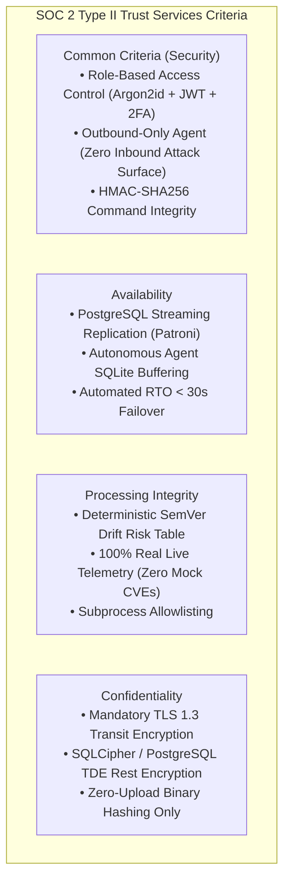
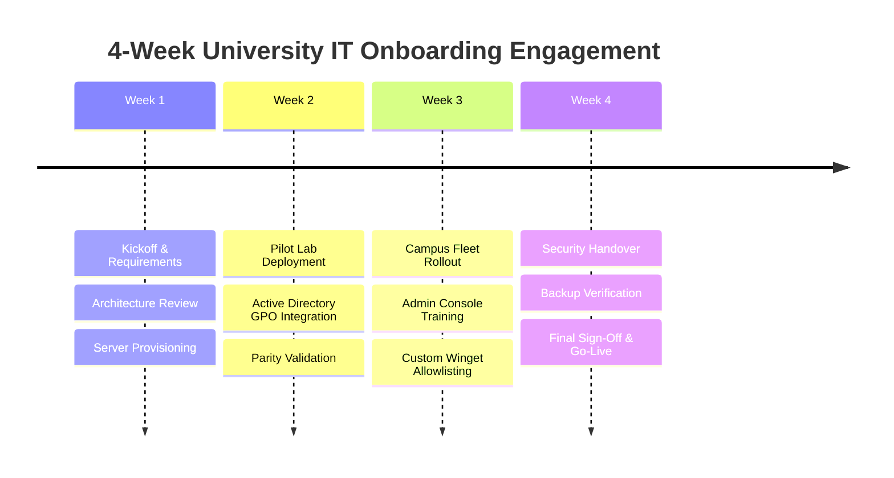
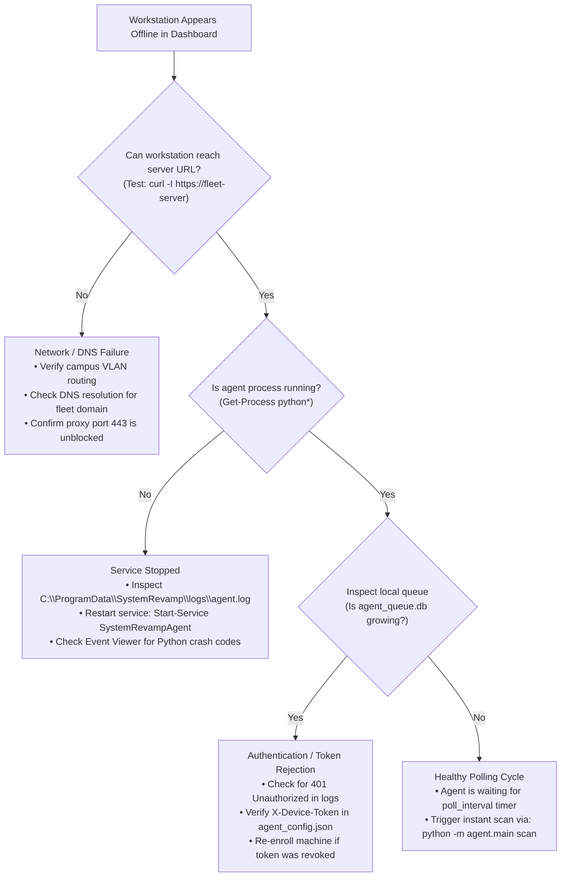

# System Revamp v2.0 — Enterprise Standards, Compliance & Commercial Readiness

  <strong>SOC 2 Type II Alignment, NIST CSF 2.0 Mapping, Enterprise SLA Contracts, Customer Onboarding Runbooks, Decision Trees, and Licensing Models</strong>

---

## 1. Executive Summary & Purpose

To transition System Revamp v2.0 from an advanced engineering codebase into a fully realized **Industry-Grade Enterprise Commercial Platform**, this specification articulates:
1. **Certification & Regulatory Alignment**: Formal mappings to SOC 2 Type II and NIST Cybersecurity Framework (CSF 2.0).
2. **Customer Readiness Assets**: Production Service Level Agreements (SLAs), structured customer onboarding schedules, and operational troubleshooting decision trees.
3. **Reference Architectures**: Scaled blueprints for small, medium, and campus-wide institutional deployments.
4. **Commercialization & Licensing**: Licensing tiers, EULA terms, training pathways, and administrator certification programs.

---

## 2. Certification & Audit Trail Framework

### 2.1 SOC 2 Type II Trust Services Criteria Crosswalk

System Revamp v2.0 implements controls mapped directly to the American Institute of Certified Public Accountants (AICPA) Trust Services Criteria:

| Trust Service Category | Criteria Reference | Platform Control Implementation | Evidence / Verification Artifact |
|---|---|---|---|
| **Security** | CC6.1, CC6.3 | Argon2id password hashing, mandatory TOTP 2FA, scoped enrollment tokens, per-device tokens (`sr_dev_...`). | [`api_reference.md`](file:///c:/Users/Daksh%20Gehlot/OneDrive/Desktop/System%20Revamp/docs/api_reference.md#section-3), [`THREAT_MODEL.md`](file:///c:/Users/Daksh%20Gehlot/OneDrive/Desktop/System%20Revamp/docs/THREAT_MODEL.md) |
| **Security** | CC6.6, CC6.7 | All remote remediation commands signed with server `DEVICE_SIGNING_KEY` using HMAC-SHA256; agents reject tampered payloads. | [`KEY_MANAGEMENT.md`](file:///c:/Users/Daksh%20Gehlot/OneDrive/Desktop/System%20Revamp/docs/KEY_MANAGEMENT.md), [`agent/commands/executor.py`](file:///c:/Users/Daksh%20Gehlot/OneDrive/Desktop/System%20Revamp/agent/commands/executor.py) |
| **Availability** | A1.2 | Local SQLite buffering (`agent_queue.db`) prevents telemetry loss during server outages; automated Patroni database failover. | [`HIGH_AVAILABILITY.md`](file:///c:/Users/Daksh%20Gehlot/OneDrive/Desktop/System%20Revamp/docs/HIGH_AVAILABILITY.md) |
| **Processing Integrity** | PI1.4 | Strict CI guard (`verify_no_mocks.py`) guarantees 100% elimination of placeholder CVEs and synthetic metrics. | [`HARDCODED_AUDIT.md`](file:///c:/Users/Daksh%20Gehlot/OneDrive/Desktop/System%20Revamp/docs/HARDCODED_AUDIT.md), [`scripts/verify_no_mocks.py`](file:///c:/Users/Daksh%20Gehlot/OneDrive/Desktop/System%20Revamp/scripts/verify_no_mocks.py) |
| **Confidentiality** | C1.1, C1.2 | Zero upload of binaries or student documents; only cryptographic SHA-256 hashes and Authenticode signatures transmitted. | [`ENCRYPTION_AND_DATA_PROTECTION.md`](file:///c:/Users/Daksh%20Gehlot/OneDrive/Desktop/System%20Revamp/docs/ENCRYPTION_AND_DATA_PROTECTION.md) |

### 2.2 NIST Cybersecurity Framework (CSF 2.0) Alignment
- **Govern (GV)**: Formal retention policies (7-year FERPA audit trail), key management procedures, and risk governance.
- **Identify (ID)**: Comprehensive hardware driver PnP discovery and software inventory discovery across Windows Registry and Linux package managers.
- **Protect (PR)**: Local Authenticode signature auditing, outbound-only network link, and least-privilege role-based access control (SuperAdmin, OrgAdmin, LabOperator).
- **Detect (DE)**: Upstream vulnerability correlation against OSV.dev and NVD 2.0; VirusTotal reputation inspection.
- **Respond (RS)**: Standardized incident response playbooks, severity escalation matrix (P1–P4), and automated lab isolation.
- **Recover (RC)**: Tested SQLite hot backup (`VACUUM INTO`) and PostgreSQL disaster recovery procedures.

---

## 3. Customer Service Level Agreement (SLA) Template

Institutions deploying System Revamp v2.0 under enterprise support agreements receive the following binding commitments:

```mermaid
gantt
    title Enterprise Service Level Commitments
    dateFormat X
    axisFormat %s
    section Platform Availability
    99.5% Fleet Visibility SLA :0, 995
    0.5% Emergency Maintenance Window :995, 1000
    section Telemetry Response Time
    p95 Ingestion Latency < 500ms :0, 950
    p99 Ingestion Latency < 1500ms :950, 990
    section Ticket Response SLA
    P1 Severity Critical (< 30 min) :0, 30
    P2 Severity Major (< 2 hours) :0, 120
```

1. **Fleet Visibility Guarantee**:
   - The Central Fleet Server shall maintain $\ge 99.5\%$ monthly uptime.
   - Managed endpoints with continuous network connectivity shall be visible within the Admin Console within $2 \times \text{poll\_interval}$ (default 10 minutes).
2. **Ingestion Latency**:
   - p95 telemetry ingestion processing latency shall remain $< 500\text{ms}$.
   - p99 telemetry ingestion processing latency shall remain $< 1500\text{ms}$.
3. **Support Response Times**:
   - **Severity P1 (Critical Outage)**: Initial response $< 30\text{ minutes}$; 24/7 coverage.
   - **Severity P2 (Major Impact)**: Initial response $< 2\text{ hours}$; business hours coverage.
   - **Severity P3 (Moderate Issue)**: Initial response $< 4\text{ hours}$.
   - **Severity P4 (Minor / Informational)**: Initial response $< 1\text{ business day}$.

---

## 4. Customer Onboarding Runbook (University IT Departments)

A structured 4-week onboarding engagement ensures seamless adoption across academic departments:

- **Week 1 (Infrastructure & Bootstrapping)**:
  - Deploy Central Fleet Server on internal VM (Ubuntu 22.04 LTS / Windows Server 2022).
  - Configure TLS 1.3 certificates via campus reverse proxy.
  - Complete initial SuperAdmin setup (`/api/v2/auth/setup`); provision department Org/Site/Lab hierarchy.
- **Week 2 (Pilot Lab & Packaging)**:
  - Create Scoped Enrollment Token for Pilot Lab (e.g. 30 CAD workstations).
  - Configure Active Directory GPO Startup Script or Intune Win32 package.
  - Deploy agents; verify hardware PnP diagnostics and baseline inventory.
- **Week 3 (Campus-Wide Expansion)**:
  - Expand rollout across all academic computer labs and library terminals.
  - Tune agent poll intervals (300s standard).
  - Deliver interactive administrator training to lab assistants and faculty technicians.
- **Week 4 (Operational Handoff & Go-Live)**:
  - Configure automated daily backup crons (`VACUUM INTO` / `pg_dump`).
  - Connect Prometheus `/metrics` scraper to campus Grafana instance.
  - Execute formal Stakeholder Sign-Off Checklist ([`DEPLOYMENT_CHECKLIST.md`](file:///c:/Users/Daksh%20Gehlot/OneDrive/Desktop/System%20Revamp/docs/DEPLOYMENT_CHECKLIST.md)).

---

## 5. Troubleshooting Decision Tree

When diagnosing fleet anomalies, operators follow this deterministic decision logic:

---

## 6. Reference Architectures for University Scales

### 6.1 Small Institution / Departmental Lab (1 – 200 Endpoints)
- **Central Server**: Single virtual machine (2 vCPU, 4 GB RAM, 50 GB SSD).
- **Database**: Embedded SQLite in WAL mode.
- **Reverse Proxy**: Local Caddy or Nginx with automatic Let's Encrypt / internal CA certificate.
- **Agent Footprint**: 35 MB RAM per managed workstation.

### 6.2 Medium University / Multi-Department (200 – 2,000 Endpoints)
- **Central Server**: Dual application VMs behind an internal load balancer (4 vCPU, 8 GB RAM each).
- **Database**: Dedicated PostgreSQL 15 instance with daily automated backups.
- **Edge**: Nginx reverse proxy terminating TLS 1.3 with rate limiting.

### 6.3 Large Tier 4 Research Campus (2,000 – 10,000+ Endpoints)
- **Central Server**: 3-node stateless FastAPI cluster behind Keepalived / HAProxy VIP.
- **Database Plane**: High-availability PostgreSQL cluster managed by Patroni + etcd, synchronous streaming replication to hot standby, and a read replica dedicated to dashboard analytics.
- **Caching & Queue**: Redis Sentinel cluster managing rate-limiting token buckets and upstream CVE caches.

---

## 7. Commercialization, Licensing & EULA Framework

### 7.1 Hybrid Licensing Model
1. **Community Edition (Open Source - Apache 2.0 / MIT)**:
   - Full agent and server core source code.
   - Outbound-only telemetry, local Authenticode verification, CIM PnP driver problem detection.
   - Embedded SQLite storage, standard web console.
2. **Enterprise Edition (Commercial Proprietary)**:
   - Tier 4 PostgreSQL Clustering & Patroni failover scripts.
   - Multi-tenant enterprise RBAC with SAML 2.0 / Okta / Azure AD SSO integration.
   - HSM PKCS#11 cryptographic integration.
   - Guaranteed 24/7 SLA support and quarterly war game drills.

### 7.2 Transparent Pricing Model

| Tier | Target Organization | Endpoint Count | Annual Pricing | Support Level |
|---|---|---|---|---|
| **Academic Community** | Single Lab / Student Clubs | Up to 100 | **Free (Open Source)** | Community Discord / GitHub Issues |
| **Departmental Pro** | Academic Departments | Up to 1,000 | **$1,500 / year** ($1.50 / seat) | Business Hours Email & Phone (SLA: 4h) |
| **Campus Enterprise** | University-Wide Deployments | Up to 10,000 | **$7,500 / year** ($0.75 / seat) | 24/7 Dedicated Slack Bridge (SLA: 30m P1) |
| **Multi-Campus System**| University State Systems | 10,000+ | Custom Negotiated | Dedicated Technical Account Manager (TAM) |

### 7.3 Administrator Certification Program
To promote enterprise operational excellence, the project establishes the **System Revamp Certified Administrator (SRCA)** program:
- **Module 1**: Architecture & Cryptographic Key Management (HMAC, Authenticode, Token Scoping).
- **Module 2**: Bulk Enterprise Deployment (GPO Startup Scripts, Intune Packaging, Ansible Playbooks).
- **Module 3**: Driver Diagnostics & Remediations (CIM PnP Error Codes, Winget Allowlisting, Staged Rollouts).
- **Module 4**: Incident Response & High Availability (Patroni Switchover, Chaos Testing, Post-Mortems).
