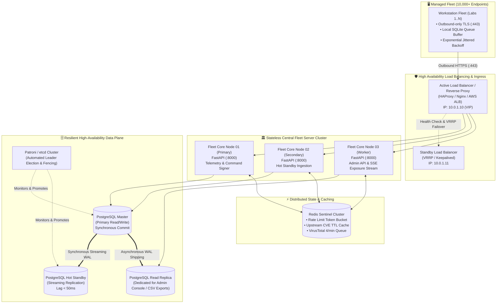
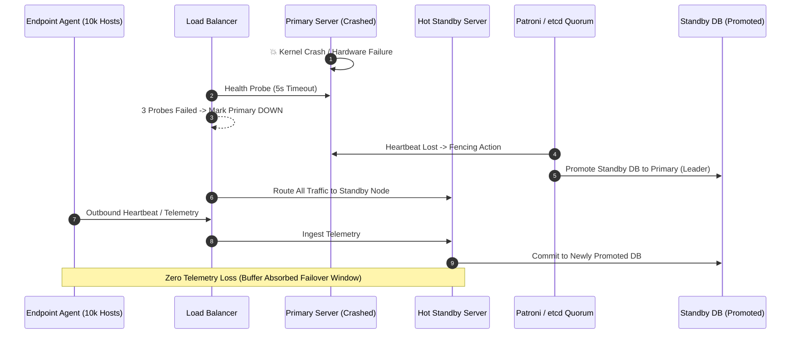

# System Revamp v2.0 — High Availability, Clustering & Failover

<p align="center">
  <strong>High-Availability Architecture, PostgreSQL Streaming Replication, Hot Standby Switchover, Load Balancing, and Tier 4 Enterprise Sizing</strong>
</p>

---

## 1. Enterprise Sizing & Availability Objectives

System Revamp v2.0 scales from small computer labs (50–500 endpoints) up to Tier 4 university campuses and enterprise networks exceeding **10,000 concurrent managed endpoints**. At enterprise scale, downtime halts telemetry ingestion, delays critical vulnerability detection, and prevents emergency remediation commands.

This document defines the high-availability clustering topology, automated failover procedures, database replication standards, and disaster recovery architectures designed to meet the following Service Level Agreements (SLAs):

- **Recovery Time Objective (RTO)**: $< 30\text{ seconds}$ for automated failover.
- **Recovery Point Objective (RPO)**: $< 5\text{ seconds}$ of telemetry state loss under abrupt server failure.
- **Platform Availability Target**: **99.95%** uptime (excluding pre-scheduled maintenance windows).

---

## 2. Tier 4 Scaling Topology (>10,000 Endpoints)

In a Tier 4 enterprise deployment, the architecture separates the public edge ingress, application stateless worker nodes, database replication cluster, and background analytical reporting.



---

## 3. High Availability Subsystem Components

### 3.1 Load Balancing & Reverse Proxy (Ingress Plane)
- **VIP Failover via Keepalived**: Two identical reverse proxy nodes (Nginx or HAProxy) share a Virtual IP (VIP) using Virtual Router Redundancy Protocol (VRRP). If the active proxy fails, the backup assumes the VIP within 2 seconds.
- **Health Probing**: The load balancer continuously probes backend nodes every 5 seconds:
  ```http
  GET /api/v2/auth/setup-status HTTP/1.1
  Host: fleet.university.edu
  ```
  Nodes returning non-200 responses or exceeding 1,000ms latency are automatically removed from the active pool.
- **Connection Draining**: When a backend server is taken down for maintenance, existing SSE streams and long-running telemetry batches are allowed 30 seconds to drain gracefully before connections terminate.

### 3.2 Relational Database High Availability (PostgreSQL + Patroni)
- **Streaming Replication**: PostgreSQL master streams Write-Ahead Logs (WAL) continuously to the Hot Standby.
- **Synchronous Replication for Audit**:
  ```ini
  # postgresql.conf
  synchronous_commit = on
  synchronous_standby_names = 'FIRST 1 (pg_standby_01)'
  wal_level = replica
  max_wal_senders = 10
  wal_keep_size = 4096MB
  ```
  This guarantees that all administrative commands and security events are acknowledged on at least two physical nodes before returning success.
- **Patroni Quorum & Split-Brain Fencing**: An odd-numbered etcd cluster (3 or 5 nodes) maintains distributed consensus. If the primary PostgreSQL node loses network connectivity, Patroni fences the failed master (STONITH / software isolation) and promotes the hot standby within 15 seconds.

### 3.3 Read Replica Slicing for Administrative Queries
Large fleet scans across 10,000+ endpoints generate complex analytical queries (e.g. searching for CVEs across 50,000 installed software versions or computing fleet-wide compliance metrics).
- **Read-Write Separation**: The Central Fleet Server directs all telemetry ingestion and command dispatches to the Primary DB, while routing Admin Console dashboard queries and CSV report generation to the Read Replica pool.
- **Replication Lag Guard**: The server inspects `pg_last_xact_replay_timestamp()`. If the read replica's lag exceeds **500ms**, the server transparently falls back to querying the primary to prevent stale dashboard readings.

---

## 4. Automated Failover Procedure



### 4.1 Step-by-Step Automated Failover Lifecycle
1. **Failure Detection (0–10s)**:
   - Primary server ceases responding to health checks.
   - Load balancer health check fails 2 consecutive probes ($2 \times 5\text{s} = 10\text{s}$).
2. **Database Promotion & Fencing (10–20s)**:
   - Patroni recognizes primary heartbeat expiration.
   - Patroni issues a fence signal to isolate the failed primary node, preventing split-brain writes.
   - Hot Standby PostgreSQL node is promoted to Read-Write leader.
3. **Traffic Rerouting (20–25s)**:
   - Load balancer marks the standby server node active.
   - Incoming agent requests and admin console sessions are transparently served by the new primary.
4. **Endpoint Telemetry Reconciliation (25–30s)**:
   - Total failover duration: **$\le 30$ seconds**.
   - Endpoint agents buffered events locally in SQLite during the 30-second window; they flush buffered rows upon successful connection.

---

## 5. Agent Resilience & Offline Queue Buffering

Managed endpoints must never depend on synchronous server availability. System Revamp agents feature native local fault tolerance:

### 5.1 Local SQLite Buffering (`agent_queue.db`)
When an endpoint agent attempts to submit a telemetry snapshot or heartbeat and the server is unreachable (HTTP 502, 503, connection timeout, or DNS failure):
1. The transaction is intercepted by the agent's transport layer.
2. The payload is serialized and inserted into the local `agent_queue.db` with a timestamp and sequence ID:
   ```sql
   INSERT INTO pending_telemetry (payload_json, created_at, retry_count)
   VALUES (?, CURRENT_TIMESTAMP, 0);
   ```
3. The local queue enforces an atomic FIFO buffer capped at **100 MB** or **7 days** of history.

### 5.2 Exponential Jittered Backoff Algorithm
To prevent 10,000 endpoints from synchronizing their retry attempts and creating a **Thundering Herd DoS attack** against the recovered server, agents implement Decorrelated Jitter:

$$t_{\text{sleep}} = \min(t_{\text{max}}, \text{Uniform}(t_{\text{base}}, t_{\text{previous}} \times 3))$$

- **Base Interval**: 5 seconds.
- **Maximum Ceiling**: 300 seconds (5 minutes).
- **Result**: Fleet reconnection spreads smoothly over a 5-minute ramp curve, preventing CPU spikes on server restart.

---

## 6. Planned Maintenance Switchover Runbook

When performing zero-downtime maintenance (OS kernel upgrades, hardware replacement):

```bash
# 1. Verify replication status and confirm lag is under 10ms
ssh pg-master "psql -x -c 'SELECT client_addr, state, sync_state, replay_lag FROM pg_stat_replication;'"

# 2. Issue controlled graceful failover via Patroni
ssh patroni-01 "patroni_ctl -c /etc/patroni.yml switchover --master pg-master --candidate pg-standby --scheduled now"

# 3. Confirm standby promotion
ssh patroni-01 "patroni_ctl -c /etc/patroni.yml list"

# 4. Drain and upgrade original master node
sudo systemctl stop postgresql
# ... Perform OS / software maintenance ...
sudo systemctl start postgresql

# 5. Rejoin original master as standby
ssh patroni-01 "patroni_ctl -c /etc/patroni.yml reinit system-revamp-cluster pg-master"
```
