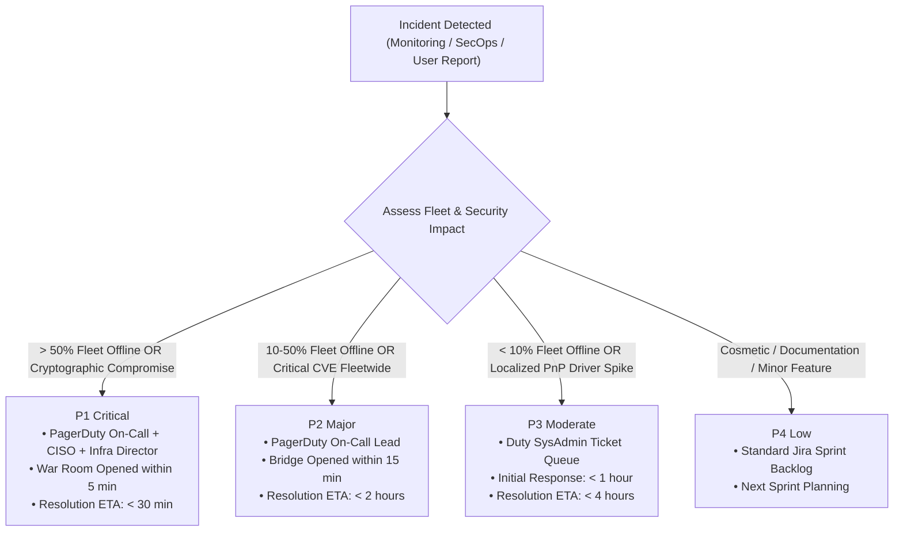
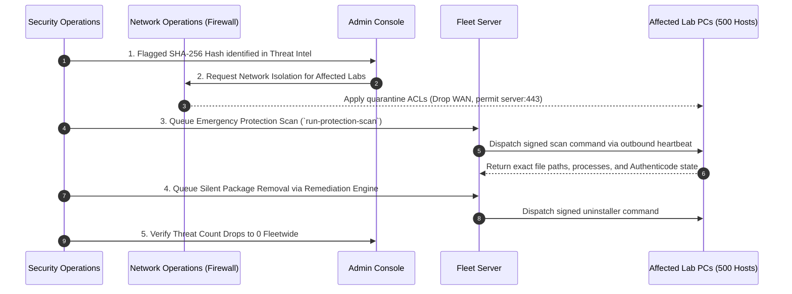

# System Revamp v2.0 — Incident Response & War Games Playbook

<p align="center">
  <strong>Operational Incident Playbooks, Severity Escalation Matrix, Blameless Post-Mortem Templates, and Quarterly War Game Drills</strong>
</p>

---

## 1. Incident Command System (ICS) & Scope

System Revamp v2.0 oversees fleet-wide workstation integrity across university computer labs and enterprise networks. When security threats (malicious binary hashes, unsigned drivers, ransomware outbreaks) or operational outages (server crash, database lockup, telemetry backpressure) occur, immediate coordinated action is mandatory.

This playbook establishes the operational command hierarchy, severity levels, detailed incident workflows, communication templates, and quarterly war game drills to maintain platform resilience.

---

## 2. Severity Classification & Escalation Matrix



| Severity | Impact Criteria | Escalation Target | SLA Acknowledgment | SLA Resolution Target |
|---|---|---|---|---|
| **P1 — Critical** | $> 50\%$ fleet offline; server down; active cryptographic key leak; confirmed ransomware execution. | On-Call Lead + Incident Commander + CISO + Lead SRE | **$< 5$ Minutes** | **$< 30$ Minutes** |
| **P2 — Major** | $10–50\%$ fleet offline; upstream CVE connectors failing; unpatched CVSS $\ge 9.0$ detected fleetwide. | On-Call SRE + SecOps Team | **$< 15$ Minutes** | **$< 2$ Hours** |
| **P3 — Moderate** | $< 10\%$ fleet offline; single computer lab disconnected; non-critical PnP driver error spike. | Primary Duty Administrator | **$< 1$ Hour** | **$< 4$ Hours** |
| **P4 — Low** | Minor cosmetic UI anomaly; documentation ambiguity; single workstation enrollment retry. | Helpdesk / Sprint Queue | **$< 8$ Hours** | Next Sprint |

---

## 3. Incident Command Roles & Responsibilities

During a P1 or P2 incident, the following roles are assigned immediately:

1. **Incident Commander (IC)**:
   - Holds ultimate authority over mitigation decisions, rollout approvals, and emergency commands.
   - Shields the engineering team from external executive inquiries.
2. **Technical Lead (SRE / Systems Lead)**:
   - Investigates telemetry, analyzes server logs, inspects database locks, and directs hot fixes.
3. **Communications Lead (Comms)**:
   - Drafts status page updates, notifies faculty/department heads, and coordinates with legal counsel if student data exposure is suspected.
4. **Scribe**:
   - Maintains real-time chronological log of all hypotheses, configuration changes, and CLI commands executed during the bridge.

---

## 4. Critical Operational Playbooks

### 4.1 Playbook A: Malicious Payloads / Unsigned Binaries Detected Fleetwide



1. **Phase 1: Identification & Scoping**:
   - Navigate to **Threat Intelligence** in the Admin Console.
   - Filter by the flagged SHA-256 hash or Authenticode status `Unsigned` / `Invalid`.
   - Export affected workstation list to CSV via `/api/v2/admin/export/csv`.
2. **Phase 2: Network Containment**:
   - Instruct Network Operations to apply the **Lab Quarantine ACL** to the affected lab subnets.
   - *Rule*: Workstations must remain able to establish outbound TLS connections to the Central Fleet Server (`port 443`), but are blocked from lateral LAN movement and internet access.
3. **Phase 3: Executive & Legal Notification**:
   - Dispatch Incident Notification Template (Section 6.1) to CISO, Legal Counsel, and Department Heads within 15 minutes.
4. **Phase 4: Remote Remediation**:
   - From the **Remediation Console**, select the affected endpoints.
   - Queue a cryptographic `run-protection-scan` command to confirm file system locations.
   - Dispatch an approved uninstaller command or quarantine script signed with `DEVICE_SIGNING_KEY`.
5. **Phase 5: Post-Remediation Verification**:
   - Verify that the target SHA-256 hash disappears from active fleet telemetry.
   - Lift lab network quarantine after two consecutive clean scan cycles.

---

### 4.2 Playbook B: Mass Fleet Ingestion Backpressure / Server Overload

1. **Phase 1: Ingestion Pipeline Triage**:
   - Inspect Prometheus metric `systemrevamp_ingestion_queue_depth`.
   - If queue depth exceeds 500, check CPU and disk I/O on the primary database node.
2. **Phase 2: Stagger Agent Polling Intervals**:
   - Under sudden campus power recovery (e.g., 5,000 PCs booting simultaneously), avoid server saturation by dynamically adjusting the poll interval via Admin API:
     ```bash
     curl -X PATCH https://fleet.university.edu/api/v2/admin/config \
       -H "Authorization: Bearer <ADMIN_JWT>" \
       -H "Content-Type: application/json" \
       -d '{"poll_interval_seconds": 600}'
     ```
   - *Result*: Workstations automatically relax heartbeat frequency from 5m to 10m, instantly halving ingestion pressure.
3. **Phase 3: Scaling Database Workers**:
   - If PostgreSQL connections are saturated, scale connection pooler capacity or enable temporary read replica query redirection.

---

### 4.3 Playbook C: Central Server Cryptographic Key Compromise

If `DEVICE_SIGNING_KEY` or `JWT_SECRET_KEY` is leaked:
1. **Declare P1 Critical Incident immediately**.
2. Block public ingress to port 443 at the firewall to prevent unauthorized adversary command queuing.
3. Execute the emergency key re-generation runbook documented in [`KEY_MANAGEMENT.md`](file:///c:/Users/Daksh%20Gehlot/OneDrive/Desktop/System%20Revamp/docs/KEY_MANAGEMENT.md).
4. Deploy the updated `DEVICE_SIGNING_KEY` to all managed endpoints via Active Directory GPO startup script or Microsoft Intune out-of-band push.
5. Invalidate all active administrative sessions and force 2FA re-authentication.

---

## 5. Post-Incident Review (Blameless Post-Mortem)

Every P1 and P2 incident requires a formal blameless post-mortem within **48 hours** of resolution.

### 5.1 Blameless Post-Mortem Template

```markdown
# Incident Post-Mortem: [Title of Incident]
**Date**: YYYY-MM-DD | **Incident ID**: INC-XXXX | **Severity**: P1/P2
**Incident Commander**: [Name] | **Technical Lead**: [Name] | **Scribe**: [Name]

## 1. Executive Summary
- Brief 2-3 sentence overview of the incident, impact, and final resolution.
- Fleet impact: [X] workstations affected for [Y] minutes.

## 2. Chronological Timeline (All times in UTC)
- HH:MM - First automated Prometheus alert fired (`FleetMassDisconnection`).
- HH:MM - Incident bridge opened; IC paged.
- HH:MM - Root cause identified as campus DNS gateway failure.
- HH:MM - Mitigation applied (failover to secondary DNS).
- HH:MM - Fleet availability restored to 99.8%; bridge stood down.

## 3. Root Cause Analysis (The 5 Whys)
1. Why did the agent fleet report offline? -> They could not resolve the server hostname.
2. Why could they not resolve the hostname? -> The internal DNS server stopped responding.
3. Why did the DNS server stop responding? -> Its disk partition ran out of inodes.
4. Why did it run out of inodes? -> An unrotated debug query log consumed the filesystem.
5. Why was the debug log unrotated? -> A temporary configuration edit from last week lacked logrotate rules.

## 4. What Went Well
- Endpoint agents buffered telemetry locally in SQLite without dropping a single audit event.
- Alertmanager paged the on-call engineer within 90 seconds of metric degradation.

## 5. Where We Were Vulnerable
- Lack of external synthetic DNS health probes delayed root cause confirmation by 10 minutes.

## 6. Action Items & Preventive Countermeasures
| Action Item | Owner | Priority | Target Date | Tracking Ticket |
|---|---|---|---|---|
| Deploy automated logrotate check on DNS nodes | SRE Lead | P1 | YYYY-MM-DD | OPS-1042 |
| Add synthetic DNS ping to Prometheus | DevOps | P2 | YYYY-MM-DD | MON-209 |
```

---

## 6. Communication Templates

### 6.1 Internal Executive Notification (Email / Slack)
```text
SUBJECT: [INCIDENT ALERT - P1] Unscheduled Outage / Threat Detection on Fleet Server

Team,

At 14:15 UTC, the System Revamp Fleet Platform detected an anomaly affecting [Lab Name / Fleet Segment]:
- Severity: P1 (Critical)
- Impact: Approximately 350 workstations in Engineering Lab B are currently isolated.
- Current Status: Network quarantine applied. Zero student personal data has been exposed.
- Action Underway: SecOps is deploying signed remediation packages to neutralize an unsigned driver binary.
- Next Update: 14:45 UTC (or within 30 minutes).

Incident Bridge: https://meet.university.edu/incident-bridge-alpha
Incident Commander: Jane Doe, SRE Lead
```

### 6.2 Public / Faculty Status Page Announcement
```text
Investigating: We are currently investigating degraded connectivity on managed computer lab workstations in Block A.
Workstation local software and student logins remain functional; automated software telemetry synchronization is temporarily paused.
Our engineering team is actively working to resolve the upstream networking issue. Next update in 30 minutes.
```

---

## 7. War Games & Tabletop Simulation Exercises

To ensure engineering and support teams remain proficient with these runbooks, the institution conducts **Quarterly War Game Simulations**:

| Quarter | Drill Name | Scenario Injected | Primary Learning Objective |
|---|---|---|---|
| **Q1** | **Operation Black Ice** | Complete campus core switch failure lasting 4 hours. | Verify agent SQLite queue buffering, FIFO cap, and smooth jittered recovery upon reconnection. |
| **Q2** | **Red Storm** | Zero-day malware binary hash identified across 500 lab workstations. | Practice network quarantine, CSV export, and bulk `run-protection-scan` command dispatch. |
| **Q3** | **Key Vault Compromise** | Simulated leakage of `DEVICE_SIGNING_KEY` on a public code repository. | Execute full emergency key revocation and GPO out-of-band re-keying within 30 minutes. |
| **Q4** | **Database Lockout** | Uncontrolled process crash on primary PostgreSQL node during peak exam week. | Validate Patroni automated failover and verify zero telemetry loss across secondary cluster. |
