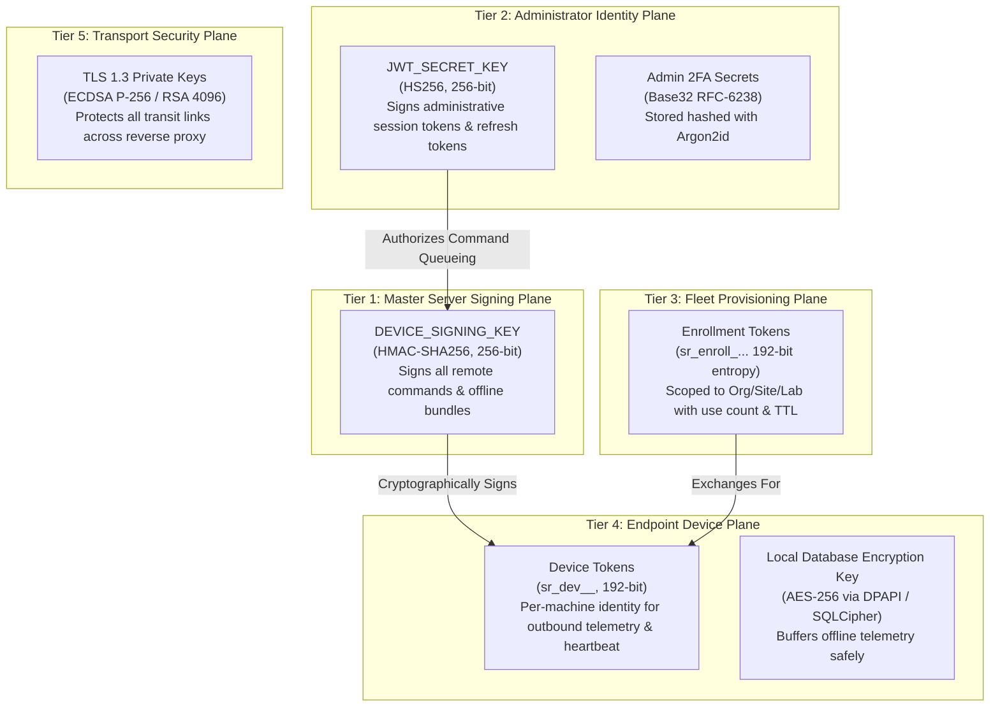
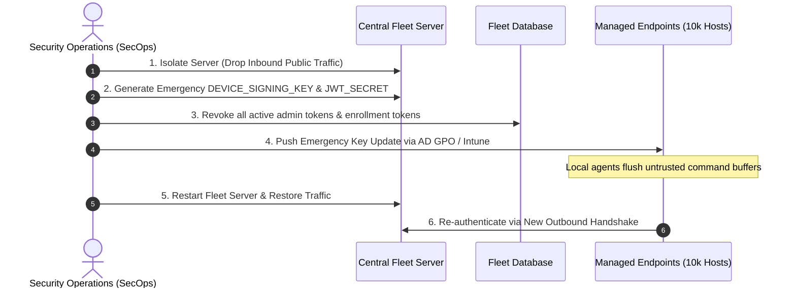

# System Revamp v2.0 — Cryptographic Key Management & Rotation

<p align="center">
  <strong>Authoritative Specification for Cryptographic Keys, Secret Storage, Disaster Recovery, HSM Integration, and Rotation SOPs</strong>
</p>

---

## 1. Executive Summary & Security Objectives

System Revamp v2.0 orchestrates endpoint intelligence, driver diagnostics, and automated software remediation across distributed enterprise fleets and academic computer labs. Because the central server issues authoritative commands (such as silent package updates via `winget` and driver repairs via `pnputil`), cryptographic integrity is paramount.

This specification establishes the lifecycle, hierarchy, generation, storage, escrow, and rotation procedures for all cryptographic keys within the platform, ensuring resilience against credential compromise, adversary on-path tampering, and disaster scenarios.

---

## 2. Cryptographic Key Hierarchy

The platform implements a defense-in-depth key hierarchy with strict separation of privilege across five cryptographic tiers:



### 2.1 Key Specifications

| Key Identifier | Location | Cryptographic Algorithm | Entropy / Key Length | Primary Purpose |
|---|---|---|---|---|
| `DEVICE_SIGNING_KEY` | Central Server (`.env` / Secret Store) | HMAC-SHA256 | 256 bits (32 bytes hex) | Signs command payloads and offline intelligence bundles. Endpoints reject any command lacking a valid signature. |
| `JWT_SECRET_KEY` (`SECRET_KEY`) | Central Server (`.env` / Secret Store) | HMAC-SHA256 (`HS256`) | 256 bits (32 bytes hex) | Signs short-lived Admin JWTs (60m) and refresh tokens (7d). |
| `Admin 2FA Secret` | Central Server Database (`admin_users`) | Base32 HMAC-SHA1 (TOTP) | 160 bits (20 bytes) | Two-Factor Authentication seeds per administrator. |
| `Enrollment Token` | Central Server Database (`enrollment_tokens`) | CSPRNG URL-Safe Hex | 192 bits (24 bytes hex) | Temporary, scoped credential used during initial endpoint bootstrapping. |
| `Device Token` | Endpoint (`agent_config.json`) & Server DB | CSPRNG URL-Safe Hex | 192 bits (24 bytes hex) | Permanent per-device identity bearer token (`X-Device-Token`). |
| `Local Queue Key` | Endpoint OS Secret Store | AES-256-GCM / DPAPI | 256 bits | Protects `agent_queue.db` on disk during offline caching. |

---

## 3. Key Generation & Secure Storage

### 3.1 Cryptographic Randomness Standards
All server and agent secrets must be generated using an operating-system backed cryptographically secure pseudo-random number generator (CSPRNG):

- **Production Shell**:
  ```bash
  openssl rand -hex 32
  ```
- **Automated Python Provisioning**:
  ```python
  import secrets
  key = secrets.token_hex(32)  # 256-bit cryptographic entropy
  ```

### 3.2 Server-Side Storage Standards
1. **Local Filesystem Storage (Tier 1 & 2 Deployments)**:
   - Stored in `/opt/system-revamp/.env` or `/opt/system-revamp/server_data/.device_signing_key`.
   - File permissions must be strictly set to `0600` (read/write only by the dedicated `revamp` service user):
     ```bash
     chmod 600 /opt/system-revamp/.env /opt/system-revamp/server_data/.*_key
     chown revamp:revamp /opt/system-revamp/.env /opt/system-revamp/server_data/.*_key
     ```
   - Underlying filesystem must utilize Operating System volume encryption (LUKS on Linux, BitLocker on Windows Server).

2. **Enterprise Secrets Manager Integration (Tier 3 & 4 Deployments)**:
   - For enterprise Kubernetes or multi-node clusters, secrets must not reside on disk. The Central Server supports dynamic runtime injection via:
     - **HashiCorp Vault**: Read via AppRole auth from path `secret/data/system-revamp/keys`.
     - **AWS Secrets Manager**: Injected via AWS IAM role task definitions.
     - **Azure Key Vault**: Managed Identity injection into environment variables.

### 3.3 Hardware Security Module (HSM) Guidance
For high-assurance installations (banking, defense, critical academic research):
- Utilize a dedicated HSM (e.g., YubiHSM 2, AWS CloudHSM, or Thales Luna) via the **PKCS#11** cryptographic token interface.
- The `DEVICE_SIGNING_KEY` never leaves the tamper-resistant hardware boundary; HMAC-SHA256 digest calculations are performed directly on the HSM cryptographic coprocessor.

---

## 4. Key Escrow, Backup & Disaster Recovery

Loss of the `DEVICE_SIGNING_KEY` renders the central server unable to dispatch remediation commands to existing enrolled agents without re-enrolling the entire fleet. To prevent catastrophic lockout, organizations must maintain a secure key escrow protocol.

### 4.1 Split-Knowledge Escrow (Shamir's Secret Sharing)
Organizations deploying Tier 3 or Tier 4 fleets must split the `DEVICE_SIGNING_KEY` using Shamir's Secret Sharing (M-of-N threshold scheme, typically 3-of-5):
- **Custodian 1**: Chief Information Security Officer (CISO)
- **Custodian 2**: Director of Enterprise Infrastructure / IT
- **Custodian 3**: Lead Systems Reliability Engineer (SRE)
- **Custodian 4**: University Registrar / Compliance Officer
- **Custodian 5**: Physical Off-Site Safety Deposit Vault

Any 3 custodians must present their physical key shares to reconstruct the master signing key during disaster recovery.

### 4.2 Cold Storage Offline Vault Runbook
1. Export the master environment configuration:
   ```bash
   tar -czf - /opt/system-revamp/.env /opt/system-revamp/server_data/.*_key | \
     gpg --symmetric --cipher-algo AES256 --armor > system_revamp_keys_escrow.asc
   ```
2. Store the encrypted ASCII armored file on dual write-once optical media (M-DISC DVD) or hardware-encrypted USB tokens.
3. Deposit media in fireproof, access-controlled security safes in two geographically separate physical locations.

---

## 5. Cryptographic Rotation Procedures

### 5.1 Routine Rotation Schedule
- `JWT_SECRET_KEY`: Rotated every **90 days**.
- `DEVICE_SIGNING_KEY`: Rotated every **365 days** (or immediately upon suspected compromise).
- `Enrollment Tokens`: Auto-expire after **72 hours** (maximum allowable TTL: 30 days).
- `Device Tokens`: Re-keyed dynamically during annual agent re-registration.

### 5.2 Zero-Downtime `JWT_SECRET_KEY` Rotation
Rotating `JWT_SECRET_KEY` invalidates active web console sessions without affecting endpoint background daemons:

```bash
# 1. Generate new 256-bit secret
NEW_JWT_SECRET=$(openssl rand -hex 32)

# 2. Update server .env configuration
sed -i "s/^SECRET_KEY=.*/SECRET_KEY=${NEW_JWT_SECRET}/" /opt/system-revamp/.env

# 3. Reload server process gracefully
sudo systemctl reload system-revamp-server || sudo systemctl restart system-revamp-server
```
*Impact*: Active administrators will be prompted to re-authenticate at their next API call. Endpoint agents continue operating without interruption.

### 5.3 Overlapping Dual-Key `DEVICE_SIGNING_KEY` Rotation
To prevent fleet-wide communication dropouts, `DEVICE_SIGNING_KEY` rotation uses an **overlapping grace period**:

1. **Phase 1 (Preparation)**:
   - Configure Central Server with `DEVICE_SIGNING_KEY_NEW` and `DEVICE_SIGNING_KEY_PRIMARY`.
   - The server begins signing commands with `DEVICE_SIGNING_KEY_NEW`, but accepts agent responses verified with either key.
2. **Phase 2 (Agent Fleet Update)**:
   - Push updated public key/secret to agent configurations via GPO or silent remote update.
   - Endpoint agents accept signatures from either the current key or the next key.
3. **Phase 3 (Cutover & Decommission)**:
   - After 100% of online agents confirm receipt of the new key, promote `DEVICE_SIGNING_KEY_NEW` to primary.
   - Securely purge the legacy key from server and memory.

---

## 6. Emergency Revocation Protocol (Compromise Scenario)

In the event that the server `.env` file or host filesystem is compromised:



1. **Server Isolation**:
   Immediately block external access to port 443 at the firewall/load balancer to prevent adversary command queuing.
2. **Secret Revocation**:
   Wipe `server_data/.jwt_secret` and `server_data/.device_signing_key`.
   Generate new secrets with `openssl rand -hex 32`.
3. **Database Token Invalidation**:
   Execute SQL revocation to expire all active enrollment tokens and invalidate admin sessions:
   ```sql
   UPDATE enrollment_tokens SET expires_at = CURRENT_TIMESTAMP WHERE expires_at > CURRENT_TIMESTAMP;
   UPDATE admin_users SET is_active = FALSE WHERE role != 'SuperAdmin';
   ```
4. **Agent Out-of-Band Re-Keying**:
   Deploy the updated `DEVICE_SIGNING_KEY` via Active Directory GPO startup script or Microsoft Intune PowerShell script.
5. **Audit Reconciliation**:
   Export and review the server audit log (`server_data/fleet.db` or PostgreSQL `audit_logs`) for any commands queued during the breach window. Revoke any pending commands before re-enabling agent traffic.
