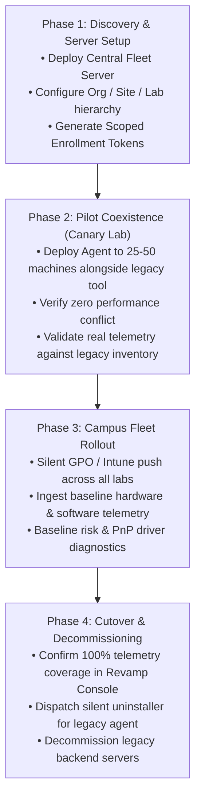

# System Revamp v2.0 — Legacy Fleet Migration & Replacement Guide

<p align="center">
  <strong>Strategic Migration Framework for Replacing Legacy Management Tools (Altiris, Intune, SCCM, JumpCloud) and Upgrading from System Revamp v1.0</strong>
</p>

---

## 1. Migration Scope & Executive Summary

Many higher education computer labs and corporate IT departments operate legacy, monolithic, or cost-prohibitive fleet management software. Common legacy solutions include:
- **Symantec / Broadcom Altiris (Client Management Suite)**: Heavy agent footprint, complex SQL Server backend, high maintenance overhead.
- **Microsoft Intune / SCCM (MECM)**: Excellent for policy compliance, but lacks native CIM PnP driver problem code diagnostics, keyless CVE intelligence, and air-gapped lab synchronization.
- **JumpCloud / Jamf**: Cloud-centric MDMs with high per-seat recurring subscription fees.
- **System Revamp v1.0 (Legacy Standalone)**: 4 separate microservices on ports 8000–8003, lack of multi-tenancy, and synthetic CVE attack simulations.

System Revamp v2.0 is designed as a **modern, lightweight, outbound-only fleet platform** that can either completely replace legacy tools or coexist seamlessly alongside existing MDM solutions.

---

## 2. Legacy Migration Matrix

| Legacy Solution | Primary Replacement Driver | System Revamp v2.0 Advantage | Migration Strategy |
|---|---|---|---|
| **Symantec Altiris** | End-of-life concerns, heavy local resource utilization, high licensing renewal costs. | Lightweight Python daemon (<35 MB RAM), zero open listening ports, modern web console. | Phased Agent Co-existence $\rightarrow$ Silent GPO Cutover $\rightarrow$ Altiris Agent Uninstall. |
| **Microsoft SCCM / MECM** | High infrastructure complexity (site servers, distribution points, SQL clusters). | Rapid zero-dependency setup (SQLite/PostgreSQL), real-time SSE vulnerability streaming. | Hybrid Coexistence: Use SCCM to deploy System Revamp, transition lab telemetry to Revamp. |
| **Microsoft Intune** | Limited visibility into low-level CIM PnP hardware faults; cloud dependency in air-gapped labs. | Offline air-gapped signed bundle sync; native Windows CIM PnP diagnostic engine. | Intune Win32 App deployment $\rightarrow$ Deep hardware & vulnerability monitoring in Revamp. |
| **JumpCloud** | High per-endpoint recurring SaaS licensing cost ($3–$9 / device / month). | Self-hosted, 100% open architecture, zero per-seat licensing fees for university computer labs. | GPO / Scripted enrollment $\rightarrow$ Revamp Central Server adoption. |
| **System Revamp v1.0** | Standalone single-machine tool; port conflicts (8000–8003); lack of multi-tenancy. | Unified Central Server (:8000), multi-tenant Org/Site/Lab model, real CVE matching. | Full platform upgrade; deploy v2.0 agent via PowerShell script. |

---

## 3. Four-Phase Phased Migration Workflow

To ensure continuous computer lab operations with zero downtime for students and faculty, migrations follow a structured four-phase lifecycle:



---

## 4. Replacing Symantec / Broadcom Altiris

### 4.1 Step 1: Deploy System Revamp Agent Alongside Altiris
Altiris uses the Symantec Management Agent (`AeXNSAgent.exe`). Deploy System Revamp silently using Altiris's own Software Delivery task or Active Directory GPO:

```powershell
# Silent GPO / Altiris Task Script
$ServerUrl = "https://fleet.university.edu"
$EnrollToken = "sr_enroll_your_token_here"
$ScriptUrl = "https://fleet.university.edu/api/v2/offline/install-agent.ps1"

Invoke-WebRequest -Uri $ScriptUrl -OutFile "$env:TEMP\install-agent.ps1"
& powershell.exe -ExecutionPolicy Bypass -File "$env:TEMP\install-agent.ps1" -ServerUrl $ServerUrl -EnrollToken $EnrollToken
```

### 4.2 Step 2: Validate Inventory Parity
Compare inventory reports between Altiris and System Revamp:
1. In System Revamp Admin Console, navigate to **Reports $\rightarrow$ Compliance Export**.
2. Download the RFC-4180 CSV export.
3. Cross-reference total machine counts, installed software versions, and MAC addresses against the Altiris Database.

### 4.3 Step 3: Silent Altiris Agent Decommissioning
Once Revamp achieves 100% fleet visibility, dispatch a remote remediation command or GPO script to cleanly uninstall the Altiris agent:

```powershell
# Silent Altiris Agent Uninstaller
$AltirisUninstall = "${env:ProgramFiles}\Altiris\Altiris Agent\AeXAgentActivate.exe"
if (Test-Path $AltirisUninstall) {
    Start-Process -FilePath $AltirisUninstall -ArgumentList "/uninstall" -Wait -NoNewWindow
}
```

---

## 5. Coexistence & Integration with Microsoft Intune

Many universities use Microsoft Intune for mobile device management (MDM) and BitLocker key escrow, but require System Revamp for:
- Detecting PnP hardware driver error codes (e.g., Code 28 missing graphics driver on student CAD workstations).
- Real-time SemVer vulnerability drift analysis and zero-upload binary hash checks.
- Air-gapped network synchronization for isolated research laboratories.

### 5.1 Packaging System Revamp for Intune (Win32 App)
1. Wrap the System Revamp installer files (`install-agent.ps1`, `agent/`, `requirements.txt`) using the **Microsoft Win32 Content Prep Tool** (`IntuneWinAppUtil.exe`):
   ```cmd
   IntuneWinAppUtil.exe -c .\installer\windows -s install-agent.ps1 -o .\intune_package
   ```
2. In **Microsoft Endpoint Manager (Intune)**:
   - **App Type**: Windows app (Win32)
   - **Install Command**:
     ```powershell
     powershell.exe -ExecutionPolicy Bypass -File install-agent.ps1 -ServerUrl https://fleet.university.edu -EnrollToken sr_enroll_...
     ```
   - **Uninstall Command**:
     ```powershell
     powershell.exe -ExecutionPolicy Bypass -Command "Stop-Process -Name python* -ErrorAction SilentlyContinue; Remove-Item -Recurse -Force 'C:\ProgramData\SystemRevamp'"
     ```
   - **Detection Rule**: File exists `C:\ProgramData\SystemRevamp\agent_config.json`.

---

## 6. Upgrading from System Revamp v1.0 to v2.0

If an institution previously deployed legacy System Revamp v1.0:

### 6.1 Architectural Differences
- **Legacy v1.0**: 4 individual FastAPI microservices running on ports 8000, 8001, 8002, 8003. No central database; simulated mock CVEs; no multi-tenant organizational structure.
- **Modern v2.0**: Consolidated Central Fleet Server on port 8000, lightweight background endpoint daemon (`agent/`), multi-tenant Org/Site/Lab model, and authentic upstream vulnerability matching (OSV.dev + NVD 2.0).

### 6.2 Cutover Steps
1. **Stop Legacy Services**: Terminate any running v1.0 Python microservice processes or Docker Compose stacks.
2. **Launch v2.0 Central Server**:
   ```bash
   pip install -r requirements.txt
   python -m server.main
   ```
3. **Seed Administrative Hierarchy**:
   Access `http://<SERVER_IP>:8000/api/v2/auth/setup` and create your organization, site, and labs.
4. **Deploy v2.0 Agent Daemons**:
   Deploy the v2.0 agent package using the GPO script or silent installer. Legacy endpoint databases are safely replaced with the new `agent_queue.db` local buffer.
