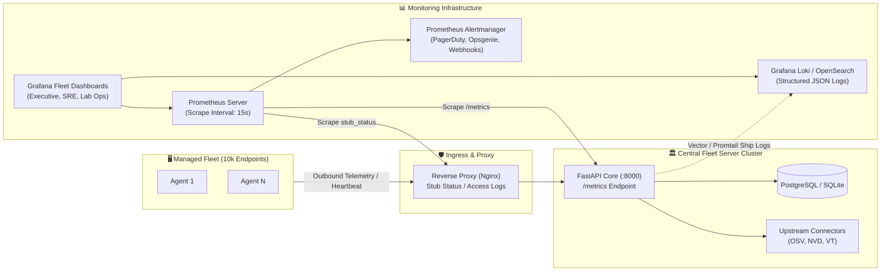

# System Revamp v2.0 — Monitoring, Metrics & Observability

<p align="center">
  <strong>Production Telemetry Monitoring, Prometheus Metrics, Grafana Dashboards, Alerting Rules, and Log Aggregation</strong>
</p>

---

## 1. Observability Architecture & Telemetry Pipeline

System Revamp v2.0 monitors thousands of distributed endpoints across academic computer labs and enterprise facilities. Maintaining platform health requires end-to-end visibility across:
1. **Endpoint Agent Health**: Heartbeat frequency, local queue depth, and scan execution latency.
2. **Central Ingestion Pipeline**: Ingestion throughput, queue saturation, and HMAC signature validation rates.
3. **Storage & Database Engine**: SQLite WAL write contention, PostgreSQL query latency, and connection pool states.
4. **Upstream Connectors**: API rate limits, HTTP status codes, and cache hit ratios for OSV.dev, NVD 2.0, endoflife.date, and VirusTotal.
5. **Administrative Plane**: Active SSE streaming sessions, 2FA auth attempts, and command execution lifecycles.



---

## 2. Key Metrics Exposed by Central Server

The Central Fleet Server exposes a standardized `/metrics` endpoint compatible with Prometheus, OpenTelemetry Collector, and Datadog agents.

### 2.1 Core Metrics Catalog

| Metric Name | Type | Labels / Dimensions | Description & Thresholds |
|---|---|---|---|
| `systemrevamp_fleet_total_count` | Gauge | `org_id`, `site_id`, `lab_id` | Total number of registered endpoints in database. |
| `systemrevamp_fleet_online_count` | Gauge | `org_id`, `site_id`, `lab_id` | Number of endpoints reporting a heartbeat within the last 5 minutes. |
| `systemrevamp_fleet_availability_ratio` | Gauge | `lab_id` | Ratio of online endpoints vs total registered ($\text{online} / \text{total}$). Target: $\ge 0.95$. |
| `systemrevamp_agent_heartbeat_duration_seconds` | Histogram | `status`, `handler` | Time taken to process agent heartbeat requests. p95 target: $< 250\text{ms}$. |
| `systemrevamp_telemetry_ingestion_duration_seconds` | Histogram | `endpoint_type` | Duration to ingest, parse, and commit full hardware/software telemetry payloads. p95: $< 500\text{ms}$. |
| `systemrevamp_ingestion_queue_depth` | Gauge | `queue_type` | Number of telemetry events awaiting processing in internal worker pool. |
| `systemrevamp_db_query_duration_seconds` | Histogram | `operation`, `table` | Database transaction duration. p95 target: $< 50\text{ms}$. |
| `systemrevamp_db_connection_pool_active` | Gauge | `pool_name` | Number of active database connections in use. |
| `systemrevamp_db_connection_pool_max` | Gauge | `pool_name` | Maximum capacity of the database connection pool. |
| `systemrevamp_connector_requests_total` | Counter | `service`, `http_status` | Upstream connector calls (OSV.dev, NVD, PyPI, endoflife.date). |
| `systemrevamp_connector_rate_limit_hits_total` | Counter | `service` | Number of times upstream rate limits were encountered. |
| `systemrevamp_virustotal_queue_depth` | Gauge | — | Number of pending binary hashes awaiting VirusTotal inspection (rate-limited at 4/min). |
| `systemrevamp_command_dispatched_total` | Counter | `command_type`, `status` | Remediation commands dispatched to agents (`queued`, `dispatched`, `completed`, `failed`). |
| `systemrevamp_hmac_verification_failures_total` | Counter | `source_ip` | Number of invalid HMAC signature submissions (potential attack indicator). |
| `systemrevamp_sse_active_streams` | Gauge | `route` | Number of concurrent active Server-Sent Events exposure streams. |

---

## 3. Prometheus Endpoints & Scraping Configuration

### 3.1 Central Server `/metrics` Endpoint
The Central Server exposes metrics at `http://127.0.0.1:8000/metrics`. In production, this path is restricted by the reverse proxy to internal monitoring subnets:

```nginx
# Nginx Configuration Snippet (/etc/nginx/conf.d/system-revamp.conf)
location /metrics {
    allow 10.0.0.0/8;       # Allow Prometheus scraper subnet
    allow 127.0.0.1;        # Allow localhost
    deny all;               # Block external public internet
    proxy_pass http://127.0.0.1:8000/metrics;
}
```

### 3.2 Prometheus Scrape Configuration (`prometheus.yml`)
```yaml
scrape_configs:
  - job_name: 'system-revamp-server'
    scrape_interval: 15s
    scrape_timeout: 10s
    metrics_path: '/metrics'
    static_configs:
      - targets: ['fleet-core-01.internal.university.edu:8000', 'fleet-core-02.internal.university.edu:8000']
        labels:
          environment: 'production'
          region: 'us-east'

  - job_name: 'system-revamp-proxy'
    scrape_interval: 15s
    metrics_path: '/stub_status'
    static_configs:
      - targets: ['fleet-proxy.internal.university.edu:8080']
```

---

## 4. Production Alerting Rules

Configured in Prometheus Alertmanager (`rules/system_revamp_alerts.yml`):

```yaml
groups:
  - name: SystemRevampCriticalAlerts
    rules:
      - alert: FleetMassDisconnection
        expr: (sum(systemrevamp_fleet_online_count) / sum(systemrevamp_fleet_total_count)) < 0.90
        for: 5m
        labels:
          severity: P1
          tier: operations
        annotations:
          summary: "Mass Fleet Outage: Over 10% of fleet offline"
          description: "Fleet availability has dropped to {{ $value | humanizePercentage }} (below 90% threshold for >5min). Check campus core networking and central reverse proxy."
          runbook_url: "https://docs.systemrevamp.internal/docs/INCIDENT_RESPONSE_PLAYBOOK.md#playbook-b"

      - alert: TelemetryIngestionQueueSaturated
        expr: systemrevamp_ingestion_queue_depth > 500
        for: 10m
        labels:
          severity: P2
          tier: backend
        annotations:
          summary: "Telemetry ingestion queue backlog high"
          description: "Internal ingestion queue has {{ $value }} pending items for >10m. Server may be disk I/O bound or SQLite WAL is locked."
          runbook_url: "https://docs.systemrevamp.internal/docs/OPERATIONS_AND_RUNBOOK.md#section-2"

      - alert: DatabasePoolExhaustion
        expr: (systemrevamp_db_connection_pool_active / systemrevamp_db_connection_pool_max) > 0.85
        for: 3m
        labels:
          severity: P2
          tier: database
        annotations:
          summary: "PostgreSQL database connection pool nearing exhaustion"
          description: "Active connections are at {{ $value | humanizePercentage }} of maximum capacity. Risk of dropped agent heartbeats."

      - alert: HighHmacSignatureFailures
        expr: rate(systemrevamp_hmac_verification_failures_total[5m]) > 2
        for: 2m
        labels:
          severity: P1
          tier: security
        annotations:
          summary: "Abnormal HMAC verification failure spike"
          description: "Central server is rejecting an elevated rate of command signatures or agent payloads ({{ $value }} failures/sec). Potential command replay or key mismatch."
          runbook_url: "https://docs.systemrevamp.internal/docs/KEY_MANAGEMENT.md#section-6"

      - alert: UpstreamConnectorRateLimitThrottled
        expr: rate(systemrevamp_connector_rate_limit_hits_total[10m]) > 0.1
        for: 5m
        labels:
          severity: P3
          tier: connectors
        annotations:
          summary: "Upstream vulnerability connectors hitting rate limits"
          description: "Rate limit throttling detected on upstream sources (OSV.dev or NVD 2.0). Fallback cache enabled."
```

---

## 5. Service Level Objectives (SLOs) & Error Budgets

The platform enforces three core enterprise SLOs:

```mermaid
gantt
    title System Revamp v2.0 Enterprise Service Level Objectives
    dateFormat X
    axisFormat %s
    section Fleet Visibility
    99.5% Heartbeat Ingestion Target :0, 995
    0.5% Allowed Outage Budget :995, 1000
    section Latency
    p95 < 500ms Ingestion :0, 950
    p99 < 1500ms Ingestion :950, 990
    section Availability
    99.9% REST API Uptime :0, 999
```



| Objective | Target | Measurement Window | Indicator (SLI) | Consequence of Budget Exhaustion |
|---|---|---|---|---|
| **Fleet Visibility** | **99.5%** | Rolling 30 Days | % of scheduled heartbeats received within $2 \times \text{poll\_interval}$. | Halt non-critical software rollouts; trigger network infrastructure review. |
| **Ingestion Latency** | **p95 < 500ms** | Rolling 7 Days | `systemrevamp_telemetry_ingestion_duration_seconds`. | Scale background worker pool; inspect database indexing. |
| **API Availability** | **99.9%** | Rolling 30 Days | Non-5xx HTTP responses on `/api/v2/*` endpoints. | Engineering focus shifts 100% to platform reliability; freeze feature releases. |

---

## 6. Grafana Dashboard Layout Blueprints

System Revamp ships standard Grafana dashboard blueprints divided into four functional views:

### Dashboard 1: Executive Fleet Overview
- **Row 1 (Top Gauges)**:
  - Overall Fleet Online Ratio (Gauge: Green $\ge 95\%$, Yellow $90-95\%$, Red $< 90\%$)
  - Total Monitored Endpoints (Stat)
  - Critical CVE Count Fleetwide (Stat: Red if $> 0$)
  - PnP Driver Problem Count (Stat: Yellow if $> 0$)
- **Row 2 (Geographic / Lab Heatmap)**:
  - Lab Health Matrix: Grid of all computer labs showing online/offline status and average risk score.
- **Row 3 (Remediation Status)**:
  - Active Staged Rollouts (Progress bars: Dry-Run, Pilot, General Availability).

### Dashboard 2: Ingestion & SRE Engine
- **Row 1 (Throughput & Latency)**:
  - Ingestion RPS (Graph: requests per second broken down by endpoint).
  - Ingestion Duration (p50, p95, p99 Latency Heatmap).
- **Row 2 (Internal Queues)**:
  - Ingestion Queue Depth (Time-series gauge).
  - VirusTotal Inspection Queue Depth (4/min rate-limited gauge).
- **Row 3 (Database Health)**:
  - Active Connection Pool vs Max Pool Size.
  - Transaction commit duration and SQLite lock wait times.

---

## 7. Centralized Log Aggregation & Redaction Strategy

### 7.1 Structured JSON Logging Standard
Central server and agent components output structured JSON formatted according to the OpenTelemetry / Elastic Common Schema:

```json
{
  "timestamp": "2026-10-24T16:45:00.123Z",
  "log_level": "INFO",
  "service": "system-revamp-server",
  "trace_id": "4bf92f3577b34da6a3ce929d0e0e4736",
  "caller": "server.app.api.agent_api:record_heartbeat",
  "device_id": "wks-eng-104",
  "org_id": "org_univ_01",
  "lab_id": "lab_eng_cad_01",
  "message": "Agent heartbeat processed successfully",
  "duration_ms": 42.8
}
```

### 7.2 Log Shipping Pipeline (Vector / Promtail / Loki)
- Central server logs are piped via systemd journal to **Vector** or **Promtail**.
- Ingestion target: **Grafana Loki** or **Elasticsearch / OpenSearch**.
- Retention: **30 days** for operational logs, **7 years** for compliance audit logs.

### 7.3 Cryptographic Token & PII Redaction Rules
To preserve privacy and prevent credential leakage into log indexes, all log handlers enforce regex masking before writing to stdout or disk:

```python
# Server Logging Sanitizer
import re

SENSITIVE_PATTERNS = [
    (re.compile(r'sr_dev_[a-zA-Z0-9_-]+'), 'sr_dev_[REDACTED]'),
    (re.compile(r'sr_enroll_[a-zA-Z0-9_-]+'), 'sr_enroll_[REDACTED]'),
    (re.compile(r'Bearer\s+[a-zA-Z0-9_\-\.]+'), 'Bearer [REDACTED_JWT]'),
    (re.compile(r'password["\']?\s*[:=]\s*["\'][^"\']+["\']'), 'password: "[REDACTED]"'),
]

def sanitize_log_message(msg: str) -> str:
    for pattern, replacement in SENSITIVE_PATTERNS:
        msg = pattern.sub(replacement, msg)
    return msg
```
