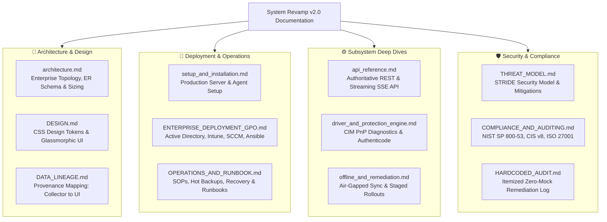

# System Revamp v2.0 — Enterprise Documentation Suite

  <strong>Complete Technical, Architectural, Security, Operational, and Compliance Specifications</strong>

---

## 1. Documentation Index & Sitemap

Welcome to the **System Revamp v2.0** authoritative documentation library. This documentation is structured into specialized manuals covering every aspect of the enterprise fleet platform from initial deployment to security auditing.

---

## 2. Document Catalog

| Document | Primary Audience | Key Contents & Purpose |
|---|---|---|
| [**Architecture Blueprint**](architecture.md) | Enterprise Architects, Lead Engineers | Multi-tier topology, outbound-only design, agent queue state machine, database ER diagrams, and sizing metrics. |
| [**Production Setup Guide**](setup_and_installation.md) | SysAdmins, DevOps Engineers | Server deployment (systemd / Nginx / SSL), database configuration (SQLite / PostgreSQL), and agent setup. |
| [**Enterprise Bulk Deployment**](ENTERPRISE_DEPLOYMENT_GPO.md) | Windows Domain Admins, IT Specialists | Bulk provisioning via Active Directory GPO startup scripts, Microsoft Intune Win32 apps, SCCM, and Ansible. |
| [**API Reference**](api_reference.md) | Backend & Integration Developers | Complete specification of all REST endpoints and SSE streams with request/response schemas and curl examples. |
| [**Driver & Protection Engine**](driver_and_protection_engine.md) | Security Analysts, Hardware Techs | CIM PnP hardware diagnostics, Microsoft Setup Class GUIDs, problem error codes, and local Authenticode verification. |
| [**Air-Gapped Sync & Remediation**](offline_and_remediation.md) | Air-Gap Operators, Lab Managers | Signed intelligence bundle export/import, LAN installer cache, dry-run simulation mode, and HMAC command dispatch. |
| [**Threat Model & Security**](THREAT_MODEL.md) | CISO, Security Engineers, Auditors | Formal STRIDE threat analysis, adversary capabilities, cryptographic key hierarchy, and attack countermeasures. |
| [**Operations & Runbook**](OPERATIONS_AND_RUNBOOK.md) | Site Reliability Engineers, Support | Daily health checks, SQLite hot backups (`VACUUM INTO`), log rotation, secret rotation, and incident playbooks. |
| [**Compliance & Standards**](COMPLIANCE_AND_AUDITING.md) | Compliance Officers, IT Auditors | Direct mapping crosswalk for NIST SP 800-53 Rev. 5, CIS Controls v8, ISO/IEC 27001:2022, and RFC-4180 CSV export. |
| [**Data Lineage & Provenance**](DATA_LINEAGE.md) | UI & Data Engineers | Field-by-field lineage mapping from native agent collectors through database tables to Admin Console widgets. |
| [**Design System Specification**](DESIGN.md) | Frontend Engineers, Designers | Authoritative CSS token hierarchy (`tokens.css`), color palette, zero-hard-edge rules, and typography. |
| [**Hardcoded Audit Log**](HARDCODED_AUDIT.md) | QA, Release Managers | Audit log confirming 100% elimination of placeholder CVEs, mock keywords, and synthetic telemetry. |

---

## 3. Core Architectural Commitments

1. **100% Real Telemetry**: Zero synthetic or mock metrics. Every row, status, CVE, and hardware error originates from live host inspection or real upstream databases.
2. **Outbound-Only Communication**: Managed endpoints never open inbound listening network sockets, eliminating firewall hole punching and endpoint attack surfaces.
3. **Cryptographic Integrity**: Command dispatches and offline synchronization bundles are signed with HMAC-SHA256 digests; all binary paths undergo local SHA-256 and Authenticode auditing.
4. **Resilient Local Queuing**: Agents buffer state in local SQLite databases during network partitions, preserving audit records across reboots and outages.
