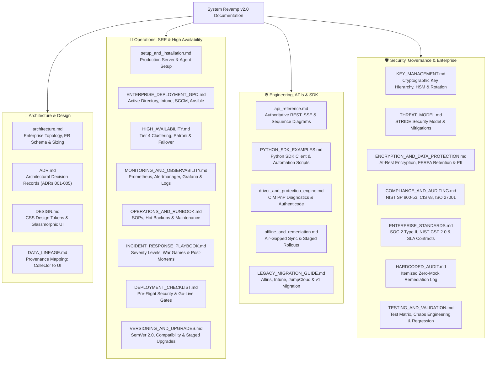

# System Revamp v2.0 — Enterprise Documentation Suite

  <strong>Complete Technical, Architectural, Security, Operational, and Compliance Specifications</strong>

---

## 1. Documentation Index & Sitemap

Welcome to the **System Revamp v2.0** authoritative documentation library. This documentation is structured into specialized manuals covering every aspect of the enterprise fleet platform from initial deployment to security auditing.

---

## 2. Document Catalog

| Document | Primary Audience | Key Contents & Purpose |
|---|---|---|
| [**Architecture Blueprint**](architecture.md) | Enterprise Architects, Lead Engineers | Multi-tier topology, outbound-only design, agent queue state machine, database ER diagrams, and sizing metrics. |
| [**Architecture Decision Records**](ADR.md) | Architects, Principal Engineers | Formal record of fundamental technical choices (outbound-only, hybrid DB, HMAC command signing, keyless CVE connectors, ephemeral SSE tickets). |
| [**Production Setup Guide**](setup_and_installation.md) | SysAdmins, DevOps Engineers | Server deployment (systemd / Nginx / SSL), database configuration (SQLite / PostgreSQL), and agent setup. |
| [**Enterprise Bulk Deployment**](ENTERPRISE_DEPLOYMENT_GPO.md) | Windows Domain Admins, IT Specialists | Bulk provisioning via Active Directory GPO startup scripts, Microsoft Intune Win32 apps, SCCM, and Ansible. |
| [**High Availability & Failover**](HIGH_AVAILABILITY.md) | SREs, Enterprise Cloud Architects | Tier 4 topology (>10k hosts), PostgreSQL Patroni streaming replication, RTO < 30s failover, load balancing, and jitter backoff. |
| [**Monitoring & Observability**](MONITORING_AND_OBSERVABILITY.md) | SREs, On-Call Engineers | Prometheus `/metrics`, Alertmanager P1-P3 rules, Grafana dashboard blueprints, SLOs/Error Budgets, and Loki log aggregation. |
| [**Operations & Runbook**](OPERATIONS_AND_RUNBOOK.md) | Site Reliability Engineers, Support | Daily health checks, SQLite hot backups (`VACUUM INTO`), log rotation, secret rotation, and incident SOPs. |
| [**Incident Response & War Games**](INCIDENT_RESPONSE_PLAYBOOK.md) | Incident Commanders, SecOps, CISO | Severity escalation matrix, fleet-wide malware playbooks, blameless post-mortem templates, comms, and quarterly war games. |
| [**Production Deployment Checklist**](DEPLOYMENT_CHECKLIST.md) | Release Managers, QA, CISO | Gate 1 (Security Pre-Flight), Gate 2 (Capacity Planning), Gate 3 (Operations), and Executive Sign-Off Template. |
| [**Versioning & Upgrades**](VERSIONING_AND_UPGRADES.md) | DevOps, Support Leads | Strict SemVer 2.0 semantics, client-server compatibility matrix, canary agent rollouts, watchdog auto-rollback, and blue-green server upgrades. |
| [**API Reference Manual**](api_reference.md) | Backend & Integration Developers | REST/SSE specifications, visual sequence diagrams, OpenAPI schemas, per-endpoint rate limits, and webhook integration. |
| [**Python SDK & Automation**](PYTHON_SDK_EXAMPLES.md) | DevOps, Scripting Engineers | Reusable Python SDK client wrapper, automated offline fleet checking, bulk remediation dispatch, and streaming SSE consumers. |
| [**Driver & Protection Engine**](driver_and_protection_engine.md) | Security Analysts, Hardware Techs | CIM PnP hardware diagnostics, Microsoft Setup Class GUIDs, problem error codes, and local Authenticode verification. |
| [**Air-Gapped Sync & Remediation**](offline_and_remediation.md) | Air-Gap Operators, Lab Managers | Signed intelligence bundle export/import, LAN installer cache, dry-run simulation mode, and HMAC command dispatch. |
| [**Legacy Migration & Cutover**](LEGACY_MIGRATION_GUIDE.md) | IT Directors, Systems Engineers | Strategic migration and replacement playbooks for Symantec Altiris, Microsoft Intune/SCCM coexistence, JumpCloud, and v1.0. |
| [**Cryptographic Key Management**](KEY_MANAGEMENT.md) | CISO, Cryptographic Engineers | Key hierarchy, 256-bit CSPRNG storage, HSM PKCS#11 guidance, Shamir secret sharing escrow, and zero-downtime rotation. |
| [**Encryption & Data Protection**](ENCRYPTION_AND_DATA_PROTECTION.md) | Compliance Officers, Privacy Counsel | SQLCipher, PostgreSQL TDE/pgcrypto, backup encryption, 7-year FERPA retention schedule, student data minimization, and GDPR. |
| [**Threat Model & Security**](THREAT_MODEL.md) | CISO, Security Engineers, Auditors | Formal STRIDE threat analysis, adversary capabilities, cryptographic key hierarchy, and attack countermeasures. |
| [**Compliance & Standards**](COMPLIANCE_AND_AUDITING.md) | Compliance Officers, IT Auditors | Direct mapping crosswalk for NIST SP 800-53 Rev. 5, CIS Controls v8, ISO/IEC 27001:2022, and RFC-4180 CSV export. |
| [**Enterprise Standards & SLA**](ENTERPRISE_STANDARDS.md) | Executives, IT Directors, Auditors | SOC 2 Type II alignment, NIST CSF 2.0 mapping, SLA contracts, 4-week customer onboarding runbook, troubleshooting tree, and licensing. |
| [**Testing & Validation**](TESTING_AND_VALIDATION.md) | QA Leads, Security Testers | Testing pyramid, unit test matrix, chaos engineering scenarios, security regression suites, and GitHub Actions CI. |
| [**Data Lineage & Provenance**](DATA_LINEAGE.md) | UI & Data Engineers | Field-by-field lineage mapping from native agent collectors through database tables to Admin Console widgets. |
| [**Design System Specification**](DESIGN.md) | Frontend Engineers, Designers | Authoritative CSS token hierarchy (`tokens.css`), color palette, zero-hard-edge rules, and typography. |
| [**Hardcoded Audit Log**](HARDCODED_AUDIT.md) | QA, Release Managers | Audit log confirming 100% elimination of placeholder CVEs, mock keywords, and synthetic telemetry. |

---

## 3. Operational Scenarios & Cross-Reference Index

Quickly navigate the documentation suite based on operational context and engineering requirements:

- **Deploying to air-gapped or classified computer labs?**
  $$\rightarrow \text{See: } \text{[offline\_and\_remediation.md](offline_and_remediation.md)} + \text{[KEY\_MANAGEMENT.md](KEY_MANAGEMENT.md)} + \text{[ENCRYPTION\_AND\_DATA\_PROTECTION.md](ENCRYPTION_AND_DATA_PROTECTION.md)}$$

- **Setting up production monitoring, Prometheus metrics & alerting?**
  $$\rightarrow \text{See: } \text{[MONITORING\_AND\_OBSERVABILITY.md](MONITORING_AND_OBSERVABILITY.md)} + \text{[OPERATIONS\_AND\_RUNBOOK.md](OPERATIONS_AND_RUNBOOK.md)}$$

- **Planning capacity and clustering for 10,000+ endpoints?**
  $$\rightarrow \text{See: } \text{[architecture.md](architecture.md) (Tier 4)} + \text{[HIGH\_AVAILABILITY.md](HIGH_AVAILABILITY.md)} + \text{[DEPLOYMENT\_CHECKLIST.md](DEPLOYMENT_CHECKLIST.md)}$$

- **Responding to an active security incident or threat outbreak?**
  $$\rightarrow \text{See: } \text{[INCIDENT\_RESPONSE\_PLAYBOOK.md](INCIDENT_RESPONSE_PLAYBOOK.md)} + \text{[KEY\_MANAGEMENT.md](KEY_MANAGEMENT.md)} + \text{[THREAT\_MODEL.md](THREAT_MODEL.md)}$$

- **Replacing legacy tools (Altiris, Intune, JumpCloud) or upgrading from v1.0?**
  $$\rightarrow \text{See: } \text{[LEGACY\_MIGRATION\_GUIDE.md](LEGACY_MIGRATION_GUIDE.md)} + \text{[ENTERPRISE\_DEPLOYMENT\_GPO.md](ENTERPRISE_DEPLOYMENT_GPO.md)}$$

- **Automating fleet operations, custom scripts, or CI/CD pipelines?**
  $$\rightarrow \text{See: } \text{[PYTHON\_SDK\_EXAMPLES.md](PYTHON_SDK_EXAMPLES.md)} + \text{[api\_reference.md](api_reference.md)}$$

- **Preparing for SOC 2 Type II, FERPA, or HIPAA security audit?**
  $$\rightarrow \text{See: } \text{[ENTERPRISE\_STANDARDS.md](ENTERPRISE_STANDARDS.md)} + \text{[COMPLIANCE\_AND\_AUDITING.md](COMPLIANCE_AND_AUDITING.md)} + \text{[ENCRYPTION\_AND\_DATA\_PROTECTION.md](ENCRYPTION_AND_DATA_PROTECTION.md)}$$

---

## 4. Platform Glossary & Domain Terminology

| Term | Technical Definition in System Revamp Platform |
|---|---|
| **Authenticode** | Microsoft code-signing technology using PKCS#7 digital signatures to verify binary publisher identity and tamper-free integrity. |
| **CIM (Common Information Model)** | Modern DMTF object-oriented management infrastructure in Windows (`Get-CimInstance`), replacing deprecated legacy WMI. |
| **PnP Error Code** | Hardware problem status reported by Windows Device Manager / CIM (e.g. Code 28: Missing Driver, Code 10: Device Failed to Start, Code 22: Disabled). |
| **Outbound-Only** | Architectural design where managed workstations never bind or listen on network sockets; all communication originates outbound over TLS to the server. |
| **WAL Mode (Write-Ahead Logging)** | SQLite concurrency mode allowing simultaneous readers without blocking writers, critical for concurrent telemetry ingestion under SQLite. |
| **Air-Gap Intelligence Bundle** | Cryptographically signed zip archive containing vulnerability feeds, installer mappings, and hashes, enabling disconnected lab updates. |
| **HMAC-SHA256 Command Signing** | Server-side signature appended to remote commands to guarantee authenticity and prevent command tampering or replay. |
| **Single-Use Ticket Token** | Ephemeral, 30-second token generated for browser SSE connections and immediately burned upon connection to prevent token leakage. |
| **Patroni** | High-availability template solution for PostgreSQL using etcd / Consul to provide automated leader election, fencing, and failover. |
| **Shamir's Secret Sharing** | Cryptographic threshold algorithm allowing a master secret to be split into $N$ parts, requiring a minimum of $M$ parts to reconstruct. |
