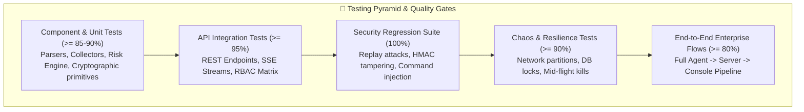
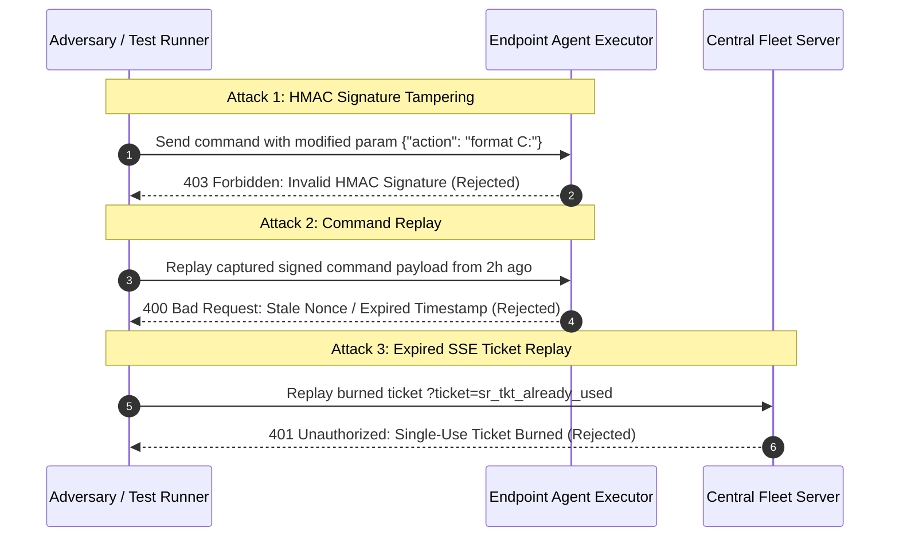

# System Revamp v2.0 — Testing Strategy, Coverage & Validation

<p align="center">
  <strong>Comprehensive Quality Assurance Framework, Unit Test Matrix, Integration Scenarios, Chaos Engineering, and Security Regression Suites</strong>
</p>

---

## 1. Quality Assurance Philosophy & Testing Pillars

System Revamp v2.0 operates as mission-critical enterprise software directly interfacing with endpoint hardware registries, operating system PnP drivers, and remote package execution subsystems (`winget`, `pnputil`). Defective builds or untested edge cases risk causing fleet-wide command execution failures, false-positive vulnerability reports, or endpoint boot issues.

The platform enforces four testing pillars:
1. **Zero Mock Telemetry in Production**: Runtime code never injects synthetic CVEs, dummy versions, or placeholder devices. Tests must validate real parser behaviors against genuine data structures.
2. **Deterministic Risk Verification**: Property-based fuzzing verifies that the SemVer version drift table always returns mathematical consistency regardless of input variation.
3. **High-Stress Chaos Resilience**: Chaos tests simulate network partitions, mid-flight process crashes, and database lock contention to verify self-healing recovery.
4. **Cryptographic Integrity & Regression Guard**: 100% of security attack surfaces (HMAC signature tampering, replay attacks, shell injection, path traversal) undergo automated continuous verification.

---

## 2. Comprehensive Test Matrix & Coverage Targets



| Component | Test Level | Target Coverage | Primary Tooling | Focus & Verification Criteria |
|---|---|---|---|---|
| **Endpoint Agent** | Unit | $\ge 85\%$ | `pytest`, `pytest-mock` | Registry collectors, CIM PnP driver diagnostics, local Authenticode verification, SQLite queue buffering. |
| **Central Server** | Unit | $\ge 90\%$ | `pytest`, `hypothesis` | Deterministic SemVer drift rules, CVE correlation logic, HMAC signature generation, role-based access control. |
| **API & Protocols** | Integration | $\ge 95\%$ | `pytest-asyncio`, `httpx` | REST endpoint contracts, agent enrollment handshake, heartbeat updates, SSE exposure stream token burning. |
| **Admin Console** | Component | $\ge 80\%$ | `Vitest`, React Testing Library | CSS token conformance, zero hard edges, responsive table pagination, CSV export triggers, zero emoji validation. |
| **Security Plane** | Regression | $\mathbf{100\%}$ | Custom Test Harness | HMAC signature tampering, command payload injection, replay attacks, expired ticket rejection, zip slip protection. |

---

## 3. Chaos Engineering & Resilience Tests

Chaos engineering tests validate that the fleet platform gracefully tolerates network failures, power cuts, and server outages without data corruption or administrative intervention.

### 3.1 Scenario 1: Server Process Killed Mid-Telemetry Ingestion
- **Chaos Injection**: Central server process is terminated (`SIGKILL` / `taskkill /F`) precisely as an endpoint agent begins transmitting a 500 KB hardware/software inventory payload.
- **Expected System Response**:
  1. The agent detects an abrupt TCP socket reset (`ConnectionResetError` / HTTP 502/503).
  2. The agent rolls back its internal transmission state and commits the entire serialized payload to the local `agent_queue.db`.
  3. Server database transactions are rolled back atomically; zero orphaned or partial rows exist.
  4. Upon server restoration, the agent successfully flushes the buffered telemetry with identical sequence IDs.

### 3.2 Scenario 2: 10-Minute Network Partition & Reconnection Storm
- **Chaos Injection**: Blackhole network routing drops all traffic between managed lab workstations and the Central Server reverse proxy for 600 seconds.
- **Expected System Response**:
  1. Agents enter offline fallback mode, buffering baseline scans and heartbeats in local SQLite storage.
  2. Retry loops apply exponential backoff with full jitter ($t = \text{Uniform}(5, \min(300, 3 \times t_{\text{prev}}))$).
  3. When connectivity is restored, incoming requests ramp up smoothly over 300 seconds rather than flooding the server in a synchronized spike.
  4. Server CPU utilization remains below 75% during recovery.

### 3.3 Scenario 3: Database Lock Contention (SQLite WAL & PostgreSQL)
- **Chaos Injection**: A simulated bulk analytical report executes an aggressive table lock or heavy read transaction while 50 agents concurrently submit telemetry heartbeats.
- **Expected System Response**:
  1. SQLite WAL mode maintains non-blocking concurrent readers and writers.
  2. Any SQLite `busy_timeout` is handled by application-level exponential retries.
  3. Under PostgreSQL, connection poolers queue pending writes without throwing `500 Internal Server Error`. Zero heartbeats are dropped.

### 3.4 Scenario 4: Local Endpoint Storage Exhaustion
- **Chaos Injection**: Endpoint hard drive free space drops below 50 MB while the endpoint is offline from the Central Server.
- **Expected System Response**:
  1. The agent's queue manager enforces a hard ceiling of 100 MB / 1,000 records on `agent_queue.db`.
  2. Non-audit telemetry snapshots are dropped via FIFO (oldest first).
  3. High-priority audit events (PnP driver failure alerts, detected unsigned binaries) are preserved at all costs.

---

## 4. Security Regression Test Suite

Security regression suites run on every commit in the CI/CD pipeline. Any failure immediately blocks release promotion.



### 4.1 Automated Security Test Implementations

#### Test 1: HMAC Signature Tampering & Metacharacter Injection
```python
# tests/security/test_command_injection_and_tampering.py
import pytest
from agent.commands.executor import verify_and_execute_command

def test_reject_tampered_command_parameters():
    valid_cmd_id = "cmd-1002"
    valid_type = "run-package-update"
    tampered_params = {"package_id": "Git.Git; calc.exe"} # Injected shell command
    invalid_signature = "bad_signature_hash_00000000000000000000000000000000"
    
    result = verify_and_execute_command(
        command_id=valid_cmd_id,
        command_type=valid_type,
        params=tampered_params,
        signature=invalid_signature,
        signing_key="test_signing_key_secret_256bit"
    )
    
    assert result["success"] is False
    assert "Invalid signature" in result["error"]
```

#### Test 2: Expired & Single-Use SSE Ticket Token Burning
```python
# tests/security/test_exposure_ticket_security.py
import pytest
from httpx import AsyncClient

@pytest.mark.asyncio
async def test_single_use_sse_ticket_cannot_be_replayed(async_client: AsyncClient, admin_token: str):
    # 1. Request ephemeral ticket
    res = await async_client.post(
        "/api/v2/exposure/ticket",
        headers={"Authorization": f"Bearer {admin_token}"}
    )
    assert res.status_code == 200
    ticket = res.json()["ticket"]
    
    # 2. First connection with ticket succeeds
    async with async_client.stream("GET", f"/api/v2/exposure/stream/sample-device?ticket={ticket}") as stream_res:
        assert stream_res.status_code == 200
        
    # 3. Attempt replay of the burned ticket immediately fails
    async with async_client.stream("GET", f"/api/v2/exposure/stream/sample-device?ticket={ticket}") as replay_res:
        assert replay_res.status_code == 401
```

#### Test 3: Path Traversal (Zip Slip) Protection on Offline Bundles
```python
# tests/security/test_bundle_traversal.py
import zipfile
import io
import pytest
from server.app.api.offline_api import extract_bundle_safely

def test_reject_path_traversal_in_bundle():
    # Construct malicious in-memory zip file attempting escape to /etc/cron.d
    zip_buffer = io.BytesIO()
    with zipfile.ZipFile(zip_buffer, "w") as zf:
        zf.writestr("../../etc/cron.d/malicious_job", "malicious payload")
        
    zip_buffer.seek(0)
    
    with pytest.raises(ValueError, match="Illegal relative path traversal detected"):
        extract_bundle_safely(zip_buffer, target_dir="/tmp/safe_bundle_extract")
```

---

## 5. Automated CI/CD Quality Pipeline (GitHub Actions)

Every Pull Request and release candidate triggers the automated verification pipeline:

```yaml
# .github/workflows/ci_pipeline.yml
name: System Revamp Quality & Security Pipeline

on:
  push:
    branches: [ main, develop ]
  pull_request:
    branches: [ main ]

jobs:
  validate-and-test:
    runs-on: windows-latest
    steps:
      - name: Checkout Code
        uses: actions/checkout@v4

      - name: Set up Python 3.11
        uses: actions/setup-python@v5
        with:
          python-version: '3.11'
          cache: 'pip'

      - name: Install Python Dependencies
        run: |
          python -m pip install --upgrade pip
          pip install -r requirements.txt
          pip install pytest pytest-cov pytest-asyncio httpx hypothesis

      - name: Run CI Guard (Verify Zero Mocks & UI Integrity)
        run: |
          python scripts/verify_no_mocks.py

      - name: Execute Pytest Suite with Coverage Check
        run: |
          pytest tests/ --cov=agent --cov=server --cov-fail-under=85 -v

      - name: Set up Node.js 18
        uses: actions/setup-node@v4
        with:
          node-version: '18'
          cache: 'npm'
          cache-dependency-path: frontend/package-lock.json

      - name: Install Frontend Dependencies & Run Linter
        run: |
          cd frontend
          npm ci
          npm run test:unit --if-present

      - name: Build Frontend Production Distribution
        run: |
          cd frontend
          npm run build
```
