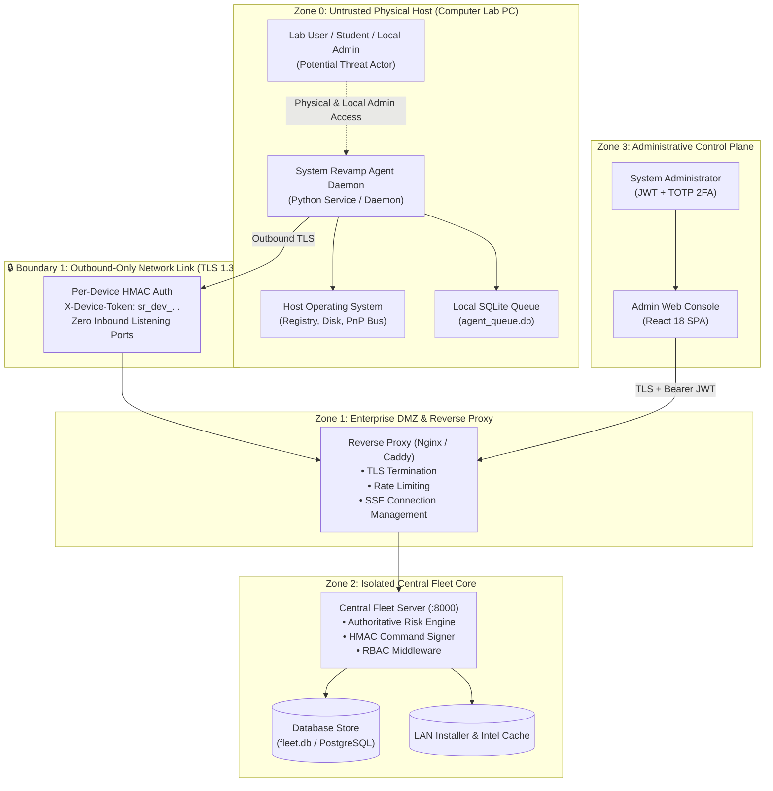

# System Revamp v2.0 — Threat Model & Security Architecture

  <strong>Formal STRIDE Security Analysis, Attack Vectors, Adversary Capabilities, and Cryptographic Countermeasures</strong>

---

## 1. Security Scope & Trust Boundaries

System Revamp v2.0 is engineered around an **untrusted endpoint assumption**. In university computer labs, academic workstations, and distributed enterprise branches, local users frequently hold physical access, may possess local administrative privileges, or may actively attempt to subvert monitoring daemons.

The platform establishes distinct cryptographic security perimeters:

---

## 2. Adversary Model & Threat Personas

| Threat Persona | Access Level | Objectives | Assumed Capabilities |
|---|---|---|---|
| **Malicious Student / Lab User** | Physical access, local workstation user account. | Disable monitoring, install unauthorized games/cracks, alter reports. | May run process killers, modify local configuration files, attempt local privilege escalation. |
| **Rogue / Compromised Endpoint Agent** | Local administrator on one lab workstation. | Forge telemetry, impersonate other workstations, flood the central server. | Can dump memory, extract local `agent_config.json`, replay captured tokens. |
| **Network On-Path Adversary (MitM)** | Positioned on campus LAN / Wi-Fi segment. | Intercept telemetry, inject malicious commands, alter upstream CVE data. | Can capture unencrypted packets, attempt DNS spoofing, manipulate network traffic. |
| **Compromised Sub-Admin (OrgAdmin/LabAdmin)** | Valid credentials for specific lab or organization. | Access other faculty machines, execute unauthorized commands fleetwide. | Has legitimate dashboard access; attempts horizontal privilege escalation. |

---

## 3. STRIDE Threat Analysis & Platform Mitigations

### 3.1 Spoofing (Identity Deception)

#### Threat: Agent Impersonation & Telemetry Forgery
- **Attack Vector**: An adversary extracts the agent's authentication token and attempts to send false telemetry claiming the machine is fully patched, or submits telemetry impersonating a different machine.
- **Platform Mitigations**:
  1. **Per-Device HMAC Tokens**: Every workstation receives an isolated, cryptographically random device token (`sr_dev_<device_id>_<entropy>`) upon enrollment. Tokens are generated using `secrets.token_hex(32)`.
  2. **Device ID Identity Binding**: The central server verifies that `report.device_id` in the JSON body strictly matches the `device_id` bound to the `X-Device-Token` header in the database. Cross-machine impersonation is rejected with HTTP `401 Unauthorized`.
  3. **One-Time Enrollment Tokens**: Enrollment tokens enforce strict `max_uses` limits and short calendar expirations (`expires_at`), preventing mass unauthorized enrollment.

#### Threat: Administrator Session Impersonation
- **Attack Vector**: Credential stuffing or token theft targeting administrator accounts.
- **Platform Mitigations**:
  1. **Argon2id & PBKDF2 Password Hashing**: Passwords are hashed with salt using memory-hard cryptographic algorithms.
  2. **Time-Based One-Time Passwords (TOTP 2FA)**: Two-factor authentication (RFC 6238) required on sensitive administrative accounts.
  3. **Short-Lived Access JWTs**: Access tokens expire after 60 minutes; refresh tokens enforce cryptographic rotation.

---

### 3.2 Tampering (Data Manipulation)

#### Threat: Command Injection into System Subprocesses
- **Attack Vector**: An adversary attempts to pass shell metacharacters (`;`, `&`, `|`, `$`, `` ` ``, `&&`) into remediation arguments to execute arbitrary PowerShell or Bash scripts on managed endpoints.
- **Platform Mitigations**:
  1. **Strict Command Allowlist**: Only 5 predefined commands are supported (`rescan`, `scan-drivers`, `enable-device`, `upgrade-package`, `run-protection-scan`).
  2. **Server-Side Parameter Sanitization**: The server regex scanner rejects any input containing shell metacharacters with HTTP `400 Bad Request`.
  3. **Cryptographic Command Signing**: Dispatched commands are signed with `HMAC-SHA256` using the server's `DEVICE_SIGNING_KEY`. The agent validates this signature before executing any handler.
  4. **Array-Based Execution (`shell=False`)**: The agent passes arguments as discrete array tokens via Python's `subprocess.run(args, shell=False)` with deterministic timeouts, completely bypassing shell interpretation.

#### Threat: Air-Gapped Intelligence Bundle Tampering
- **Attack Vector**: An adversary modifies the `manifest.json` file on a transfer USB drive to conceal CVEs or clear malicious hash reputations.
- **Platform Mitigations**:
  1. **Signed Bundles**: Bundles require a companion `signature.sig` containing an HMAC-SHA256 digest of the manifest bytes.
  2. **Strict Verification**: The air-gapped server verifies the signature against its local `DEVICE_SIGNING_KEY` before ingesting any records.

---

### 3.3 Repudiation (Denial of Actions)

#### Threat: Administrator Denies Disagreeable or Disruptive Command Dispatch
- **Attack Vector**: An operator dispatches an unapproved fleetwide reboot or software upgrade and deletes records to escape accountability.
- **Platform Mitigations**:
  1. **Append-Only Relational Audit Trail**: Every sensitive action (login, token creation, token revocation, command queuing, approval) is recorded in `audit_logs` with UTC timestamp, user ID, target ID, action name, and raw JSON details.
  2. **Cryptographic Signer Identity**: Queued commands permanently record `created_by` and `approved_by` administrator emails.

---

### 3.4 Information Disclosure (Data Leakage)

#### Threat: Leaking Proprietary Software or Secrets via Threat Scanners
- **Attack Vector**: An endpoint uploads executable binaries to public cloud scanners, inadvertently leaking university research code or private enterprise software.
- **Platform Mitigations**:
  1. **Zero-Upload Binary Verification**: Executable binaries never leave the endpoint. The agent streams the binary locally in 64KB chunks to calculate its SHA-256 hash. Only the 64-character hash string is transmitted to the server.
  2. **Local Authenticode Check**: The agent validates digital signatures locally using Microsoft APIs (`Get-AuthenticodeSignature`), determining validity without external network communication.
  3. **Zero Frontend Secrets**: The React Admin Console bundle contains zero API keys, database credentials, or signing secrets.

---

### 3.5 Denial of Service (DoS)

#### Threat: Agent Telemetry Flooding & Database Exhaustion
- **Attack Vector**: A compromised endpoint spams the server with massive telemetry payloads to exhaust disk space or lock SQLite.
- **Platform Mitigations**:
  1. **Payload Size Limits**: Reverse proxy and FastAPI middleware enforce strict payload limits (10MB max).
  2. **SQLite WAL Mode**: Write-Ahead Logging allows continuous concurrent reads while handling writes without database lockups.
  3. **Ephemeral SSE Ticket Tokens**: Real-time exposure streams require single-use 30-second ticket tokens (`/api/v2/exposure/token`) that burn immediately upon consumption, preventing connection pool exhaustion.

---

### 3.6 Elevation of Privilege (Unauthorized Access)

#### Threat: Horizontal or Vertical Tenant Escalation
- **Attack Vector**: A lab administrator for Lab A attempts to query or issue commands to endpoints in Lab B or another university faculty.
- **Platform Mitigations**:
  1. **Role-Based Access Control (RBAC)**: Strict role hierarchy (`SuperAdmin` > `OrgAdmin` > `LabAdmin` > `LabOperator`).
  2. **Multi-Tenant Scoping**: All database queries automatically filter by `user.org_id` and assigned `lab_id`. Non-SuperAdmins can never inspect or command resources outside their assigned tenant scope.
