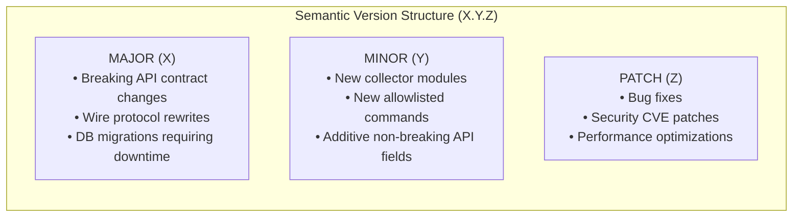
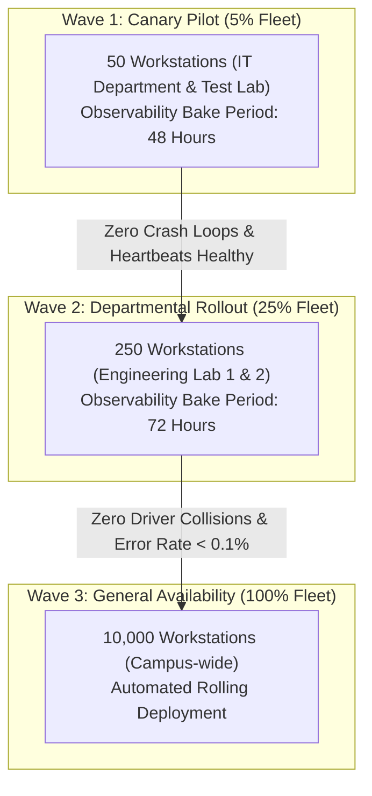
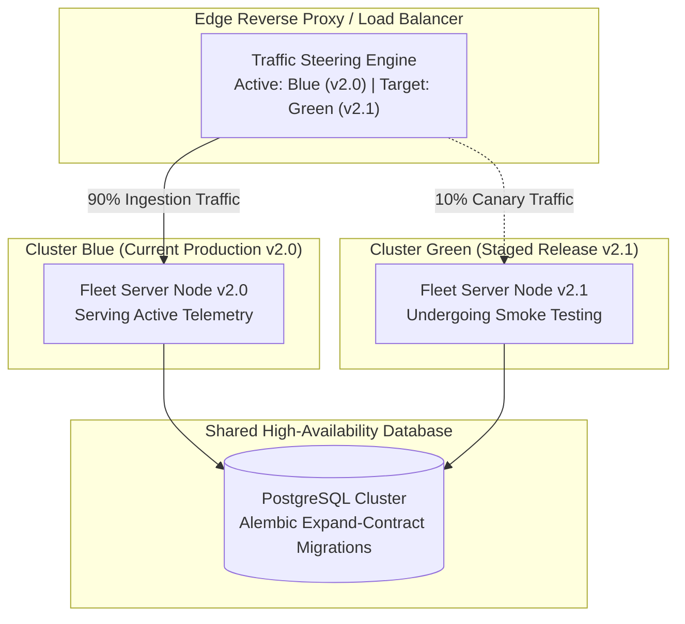

# System Revamp v2.0 — Versioning, Compatibility & Upgrade Strategy

<p align="center">
  <strong>Semantic Versioning Framework, Client-Server Compatibility Matrix, Staged Agent Rollouts, and Zero-Downtime Blue-Green Server Upgrades</strong>
</p>

---

## 1. Executive Overview & Guarantees

In distributed institutional fleets (such as universities with thousands of workstations spread across dozens of computer labs), synchronous upgrades of all endpoints are physically and operationally impossible. Laptops, lab PCs, and specialized research workstations frequently disconnect, undergo power management sleep, or sit behind isolated VLANs.

System Revamp v2.0 establishes a rigorous **Versioning and Lifecycle Management Strategy** to guarantee:
1. **Multi-Version Coexistence**: Central servers seamlessly support legacy agent versions without breaking telemetry ingestion.
2. **Deterministic Version Semantics**: Clear boundaries governing breaking changes, deprecation notices, and feature releases.
3. **Fail-Safe Agent Upgrades**: Autonomous rollback mechanics that prevent "bricked" agents if an update encounters local compatibility conflicts.
4. **Zero-Downtime Server Migrations**: Blue-green deployment patterns that maintain continuous telemetry ingestion during backend upgrades.

---

## 2. Semantic Versioning Specification (SemVer 2.0)

All components—including the Central Fleet Server, Endpoint Agent Daemons, React Admin Console, and CLI tools—strictly adhere to **Semantic Versioning 2.0.0** (`MAJOR.MINOR.PATCH`):



### 2.1 Release Classification Rules

| Version Increment | Definition | Server Impact | Endpoint Agent Impact | Deprecation Window |
|---|---|---|---|---|
| **MAJOR (v3.0.0)** | Incompatible API change, authentication schema rewrite, or wire protocol restructuring. | May require scheduled maintenance or database schema conversion. | Requires coordinated agent rollout; older agents cannot issue new commands. | Minimum **12 Months** formal notice before sunset. |
| **MINOR (v2.1.0)** | Backward-compatible functionality additions (e.g., new PnP hardware collectors, new Winget command flags). | Additive database columns; zero server downtime. | Fully backward compatible with existing v2.0 agents. | N/A (Backward compatible). |
| **PATCH (v2.0.1)** | Backward-compatible bug fixes, security hardening, or documentation corrections. | In-place rolling restart; zero downtime. | Drop-in binary update. | N/A. |

---

## 3. Client-Server Compatibility Matrix

The Central Fleet Server is engineered with **forward and backward tolerance**:

```mermaid
stateDiagram-v2
    [*] --> Handshake: Agent connects via /api/v2/agent/heartbeat
    Handshake --> FullyCompatible: Server Version == Agent Version (v2.1 <-> v2.1)
    Handshake --> ForwardCompatible: Server Version > Agent Version (Server v2.1 <-> Agent v2.0)
    Handshake --> UnsupportedCommands: Server Version < Agent Version (Server v2.0 <-> Agent v2.1)
    Handshake --> Rejected: Incompatible Major Version (Server v2.0 <-> Agent v1.0)
    
    ForwardCompatible --> IngestOK: Telemetry ingested; server suppresses unsupported command types
    UnsupportedCommands --> DegradedMode: Agent reports telemetry; server cannot issue new v2.1 commands
    Rejected --> ForceUpgrade: 426 Upgrade Required (Agent prompts local update)
```



### 3.1 Compatibility Reference Table

| Central Server Version | Endpoint Agent Version | Status | Operational Behavior |
|---|---|---|---|
| **v2.1.x** | **v2.1.x** | **Native** | All features, new commands, and advanced PnP telemetry supported. |
| **v2.1.x** | **v2.0.x** | **Compatible** | Fully supported. Server ingests baseline telemetry. If admin queues a v2.1-only command, the server suppresses dispatch and alerts the administrator. |
| **v2.0.x** | **v2.1.x** | **Degraded** | Agent reports baseline telemetry successfully. New collector fields unknown to server v2.0 are safely ignored. |
| **v2.x.x** | **v1.x.x** | **Incompatible** | Rejected with `426 Upgrade Required`. Legacy v1.0 microservice protocol cannot authenticate against v2.0 multi-tenant JWT/HMAC core. |

### 3.2 Protocol Deprecation & Sunset Policy
When an API endpoint or telemetry field is scheduled for retirement:
1. **Sunset Header**: The server returns an RFC-8594 standard `Sunset` HTTP response header:
   ```http
   HTTP/1.1 200 OK
   Sunset: Wed, 11 Nov 2027 00:00:00 GMT
   Deprecation: @1731283200
   Link: <https://docs.systemrevamp.edu/docs/MIGRATION.md>; rel="sunset"
   ```
2. **Telemetry Warning**: The Admin Console flags any connected agents running deprecated protocols under **Fleet Health $\rightarrow$ Stale Agents**.
3. **Sunset Timeline**: Deprecated endpoints remain functional for a minimum of **12 months** before removal.

---

## 4. Staged Agent Auto-Upgrade Strategy

To prevent a faulty update from knocking thousands of workstations offline simultaneously, agent updates are dispatched in **staged deployment waves**:



### 4.1 Cryptographic Binary Verification Prior to Execution
Before an endpoint agent installs an updated binary package:
1. **SHA-256 Digest Match**: The agent downloads the package from the server LAN cache and computes its local SHA-256 hash. If it does not match the server's signed manifest, the binary is deleted immediately.
2. **Authenticode Verification (Windows)**:
   The agent executes native Win32 API `WinVerifyTrust` to ensure the executable is signed by the institution's trusted code-signing certificate:
   ```powershell
   $Sig = Get-AuthenticodeSignature -FilePath "C:\ProgramData\SystemRevamp\update\agent_v2.1.exe"
   if ($Sig.Status -ne "Valid") {
       Remove-Item -Path "C:\ProgramData\SystemRevamp\update\agent_v2.1.exe"
       throw "Authenticode signature validation failed. Rejecting update."
   }
   ```

### 4.2 Autonomous Watchdog Rollback Mechanics
Each endpoint runs a lightweight supervisor watchdog (`SystemRevampWatchdog`):
- Upon applying an update, the supervisor writes `update_in_progress = true` to `agent_config.json`.
- If the new agent process crashes on startup or fails to complete **3 consecutive heartbeats** (15 minutes), the watchdog automatically:
  1. Kills the failing v2.1 process.
  2. Restores the backup v2.0 binary from `C:\ProgramData\SystemRevamp\bin_backup\`.
  3. Restarts the proven v2.0 daemon.
  4. Transmits an emergency diagnostic telemetry event: `AGENT_UPDATE_FAILED_WATCHDOG_ROLLBACK`.

---

## 5. Zero-Downtime Server Blue-Green Upgrade

Enterprise server updates utilize a Blue-Green deployment model behind the Nginx / AWS ALB reverse proxy:



### 5.1 Step-by-Step Blue-Green Procedure

1. **Step 1: Database Migration (Expand Phase)**:
   - Apply non-breaking database schema changes using Alembic:
     ```bash
     alembic upgrade head
     ```
   - *Rule*: New columns must be nullable or possess defaults so that legacy Blue (v2.0) servers continue writing without error.
2. **Step 2: Deploy Green Cluster (v2.1)**:
   - Launch the new v2.1 server cluster on secondary ports or containers.
   - Run health checks:
     ```bash
     curl -f https://green.internal.fleet.university.edu/api/v2/auth/setup-status
     ```
3. **Step 3: Canary Traffic Redirection (10%)**:
   - Update reverse proxy routing to direct 10% of agent traffic to Green:
     ```nginx
     split_clients "${remote_addr}" $upstream_fleet {
         10%     fleet_green;
         *       fleet_blue;
     }
     ```
   - Monitor error budgets and Prometheus metrics for 15 minutes.
4. **Step 4: Full Traffic Cutover (100%)**:
   - Redirect 100% of traffic to Green.
   - Maintain the Blue cluster in hot standby for **15 minutes**.
5. **Step 5: Database Contract Phase**:
   - After confirming zero regression, decommission Blue and purge deprecated database columns if required.
