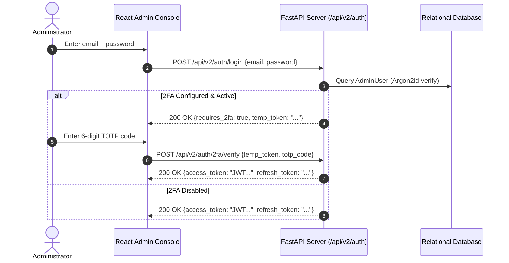
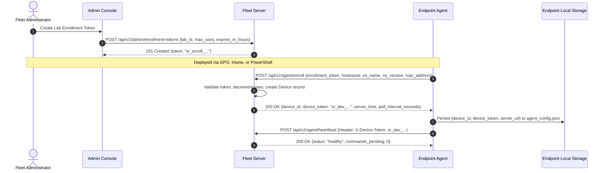
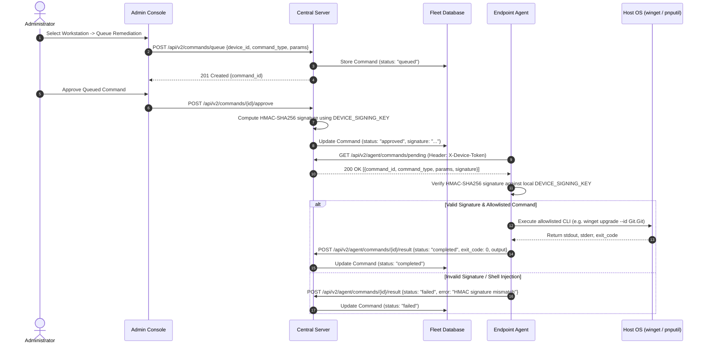

# System Revamp v2.0 — Authoritative API Reference Manual

<p align="center">
  <strong>Complete RESTful and Server-Sent Event (SSE) Specification for Enterprise Fleet Management</strong>
</p>

---

## 1. Global Architecture & Protocol Standards

The System Revamp v2.0 Central Fleet Server exposes a high-performance RESTful API and streaming SSE interface engineered with strict multi-tenancy, cryptographic payload verification, deterministic risk evaluation, and zero synthetic telemetry.

### 1.1 Base URLs

| Environment | Protocol | Base URI |
|---|---|---|
| **Production Fleet Core** | HTTPS | `https://<fleet-server-domain>/api/v2` |
| **Local Development / Lab Ingestion** | HTTP | `http://127.0.0.1:8000/api/v2` |

### 1.2 Authentication & Security Schemes

System Revamp employs three distinct authentication schemes depending on the caller context:

| Authentication Scheme | Header / Parameter | Token Format | Target Context |
|---|---|---|---|
| **Admin Bearer Token** | `Authorization: Bearer <JWT>` | Signed JWT (`HS256`, 1-hour access TTL) | Administrative console, management scripts, automation pipelines. |
| **Endpoint Device Token** | `X-Device-Token: <DEVICE_TOKEN>` | `sr_dev_<device_id>_<entropy>` | Background agent daemons transmitting telemetry, heartbeats, and polling commands. |
| **Ephemeral Ticket Token** | Query parameter `?ticket=<TICKET>` | Ephemeral 30-second single-use token | Browser SSE streaming sessions (`/api/v2/exposure/stream/{id}`). Burned upon connection. |

### 1.3 Standard HTTP Status Codes

| Code | Status | Meaning in System Revamp Platform |
|---|---|---|
| `200` | OK | Request succeeded; payload returned in body. |
| `201` | Created | Resource successfully created (e.g. organization, site, enrollment token). |
| `204` | No Content | Action succeeded with empty response body. |
| `400` | Bad Request | Malformed payload, shell metacharacter detected in parameters, or illegal state transition. |
| `401` | Unauthorized | Missing, expired, or invalid JWT access token or `X-Device-Token`. |
| `403` | Forbidden | Insufficient role privilege (e.g. `LabOperator` attempting `SuperAdmin` action) or account deactivated. |
| `404` | Not Found | Requested device, lab, command, or token does not exist in tenant scope. |
| `422` | Unprocessable Entity | Pydantic validation failure (e.g. missing required field, invalid data type). |
| `500` | Internal Server Error | Unhandled backend exception. |

### 1.4 Standard Error Response Schema

All error responses strictly conform to the standard RFC-7807 JSON error model:

```json
{
  "detail": "Descriptive human-readable explanation of error condition"
}
```

Validation errors (`422 Unprocessable Entity`) return Pydantic field-level traces:
```json
{
  "detail": [
    {
      "loc": ["body", "admin_password"],
      "msg": "field required",
      "type": "value_error.missing"
    }
  ]
}
```

### 1.5 Cryptographic Command Signature Specification

Remediation commands queued by administrators and dispatched to endpoints are cryptographically signed using the server's private `DEVICE_SIGNING_KEY` with HMAC-SHA256. Endpoint agents strictly verify this signature before executing any subprocess.

**HMAC Payload String Construction**:
$$\text{Signature} = \text{HMAC-SHA256}(\text{DEVICE\_SIGNING\_KEY}, \text{command\_id} + \text{command\_type} + \text{params\_json\_sorted})$$

**Verification in Python (Agent-Side)**:
```python
import hmac, hashlib, json

def verify_command_signature(command_id: str, command_type: str, params: dict, received_sig: str, signing_key: str) -> bool:
    params_sorted_json = json.dumps(params, sort_keys=True)
    payload = f"{command_id}:{command_type}:{params_sorted_json}".encode("utf-8")
    expected_sig = hmac.new(signing_key.encode("utf-8"), payload, hashlib.sha256).hexdigest()
    return hmac.compare_digest(expected_sig, received_sig)
### 1.6 End-to-End Visual Sequence Diagrams

#### 1.6.1 Administrator Authentication & 2FA Workflow


#### 1.6.2 Endpoint Enrollment & Provisioning Workflow


#### 1.6.3 Remote Command Dispatch, HMAC Signing & Remediation Pipeline


---

## 2. Table of Contents

- [1. Global Architecture & Protocol Standards](#1-global-architecture--protocol-standards)
  - [1.6 End-to-End Visual Sequence Diagrams](#16-end-to-end-visual-sequence-diagrams)
- [3. Administrator Authentication API (`/api/v2/auth`)](#3-administrator-authentication-api-apiv2auth)
  - [3.1 Check Initial Setup Status](#31-check-initial-setup-status)
  - [3.2 Initial Setup & SuperAdmin Bootstrapping](#32-initial-setup--superadmin-bootstrapping)
  - [3.3 Administrator Login](#33-administrator-login)
  - [3.4 Token Refresh](#34-token-refresh)
  - [3.5 2FA TOTP Provisioning](#35-2fa-totp-provisioning)
  - [3.6 2FA TOTP Verification & Activation](#36-2fa-totp-verification--activation)
  - [3.7 Current User Profile](#37-current-user-profile)
- [4. Endpoint Agent Communication API (`/api/v2/agent`)](#4-endpoint-agent-communication-api-apiv2agent)
  - [4.1 Device Enrollment](#41-device-enrollment)
  - [4.2 Agent Heartbeat](#42-agent-heartbeat)
  - [4.3 Telemetry Ingestion](#43-telemetry-ingestion)
  - [4.4 Poll Dispatched Commands](#44-poll-dispatched-commands)
  - [4.5 Report Command Execution Result](#45-report-command-execution-result)
- [5. Administrative Fleet Management API (`/api/v2/admin`)](#5-administrative-fleet-management-api-apiv2admin)
  - [5.1 Organizations Management (`/orgs`)](#51-organizations-management-orgs)
  - [5.2 Sites Management (`/sites`)](#52-sites-management-sites)
  - [5.3 Computer Labs Management (`/labs`)](#53-computer-labs-management-labs)
  - [5.4 Organizational Hierarchy Tree (`/hierarchy`)](#54-organizational-hierarchy-tree-hierarchy)
  - [5.5 Enrollment Tokens Management (`/enrollment-tokens`)](#55-enrollment-tokens-management-enrollment-tokens)
  - [5.6 Fleet Overview KPIs (`/fleet/overview`)](#56-fleet-overview-kpis-fleetoverview)
  - [5.7 Managed Devices Directory (`/devices`)](#57-managed-devices-directory-devices)
  - [5.8 Single Device Deep Inspection (`/devices/{id}`)](#58-single-device-deep-inspection-devicesid)
  - [5.9 Fleet-Wide Software Aggregation (`/fleet/software`)](#59-fleet-wide-software-aggregation-fleetsoftware)
  - [5.10 Fleet-Wide Hardware Drivers Aggregation (`/fleet/drivers`)](#510-fleet-wide-hardware-drivers-aggregation-fleetdrivers)
  - [5.11 Compliance Posture Audit Report (`/reports/compliance`)](#511-compliance-posture-audit-report-reportscompliance)
  - [5.12 Compliance CSV Export Stream (`/reports/export`)](#512-compliance-csv-export-stream-reportsexport)
  - [5.13 Central Audit Trail Logs (`/audit-logs`)](#513-central-audit-trail-logs-audit-logs)
- [6. Command Dispatch & Remediation API (`/api/v2/commands`)](#6-command-dispatch--remediation-api-apiv2commands)
  - [6.1 Queue Remediation Command](#61-queue-remediation-command)
  - [6.2 Approve or Reject Queued Command](#62-approve-or-reject-queued-command)
  - [6.3 List Command History](#63-list-command-history)
- [7. Exposure Assessment & Streaming SSE API (`/api/v2/exposure`)](#7-exposure-assessment--streaming-sse-api-apiv2exposure)
  - [7.1 Issue Single-Use SSE Ticket Token](#71-issue-single-use-sse-ticket-token)
  - [7.2 Real-Time Exposure Assessment Stream](#72-real-time-exposure-assessment-stream)
- [8. Air-Gapped Sync & Installer Cache API (`/api/v2/offline`)](#8-air-gapped-sync--installer-cache-api-apiv2offline)
  - [8.1 Export Signed Intelligence Bundle](#81-export-signed-intelligence-bundle)
  - [8.2 Import Verified Intelligence Bundle](#82-import-verified-intelligence-bundle)
  - [8.3 Upload LAN Installer Binary](#83-upload-lan-installer-binary)
  - [8.4 List Cached Installers](#84-list-cached-installers)
- [9. Threat Intelligence API (`/api/v2/threats`)](#9-threat-intelligence-api-apiv2threats)
  - [9.1 Threat Intelligence Overview](#91-threat-intelligence-overview)
  - [9.2 Process Pending VirusTotal Queue](#92-process-pending-virustotal-queue)
- [10. API Stability, Rate Limits & Integration Guarantees](#10-api-stability-rate-limits--integration-guarantees)
  - [10.1 API Versioning Strategy](#101-api-versioning-strategy)
  - [10.2 Breaking Change Notification Policy](#102-breaking-change-notification-policy)
  - [10.3 Authoritative Rate Limits per Endpoint](#103-authoritative-rate-limits-per-endpoint)
  - [10.4 OpenAPI Schema & Interactive Documentation](#104-openapi-schema--interactive-documentation)
  - [10.5 Webhook & Third-Party Integration Framework](#105-webhook--third-party-integration-framework)

---

## 3. Administrator Authentication API (`/api/v2/auth`)

### 3.1 Check Initial Setup Status
`GET /api/v2/auth/setup-status`

- **Role Requirement**: None (Public)
- **Description**: Returns whether the server requires initial setup. When `setup_required` is `true`, the setup wizard is rendered in the UI.

#### Response `200 OK`
```json
{
  "setup_required": false,
  "admin_count": 1,
  "app_name": "System Revamp Fleet Server",
  "app_version": "2.0.0"
}
```

#### cURL Example
```bash
curl -X GET "https://fleet.university.edu/api/v2/auth/setup-status"
```

---

### 3.2 Initial Setup & SuperAdmin Bootstrapping
`POST /api/v2/auth/setup`

- **Role Requirement**: None (Only permitted when `admin_count == 0`)
- **Description**: Creates the root Organization, default Site ("Main Campus"), default Lab ("Default Lab"), and the first `SuperAdmin` account.

#### Request Headers
| Header | Type | Required | Description |
|---|---|---|---|
| `Content-Type` | string | Yes | `application/json` |

#### Request Body
| Field | Type | Required | Description | Constraints |
|---|---|---|---|---|
| `org_name` | string | Yes | Name of root institution/organization. | Minimum 1 character. |
| `admin_email` | string | Yes | Email address of initial SuperAdmin. | Valid email format. |
| `admin_password` | string | Yes | Password for initial SuperAdmin. | Minimum 8 characters. |
| `admin_name` | string | No | Display name of SuperAdmin. | Default: `"Fleet Administrator"`. |

```json
{
  "org_name": "Department of Computer Science",
  "admin_email": "admin@university.edu",
  "admin_password": "SuperSecretPassword!2026",
  "admin_name": "Lead Infrastructure Architect"
}
```

#### Response `200 OK`
```json
{
  "access_token": "eyJhbGciOiJIUzI1NiIsInR5cCI6IkpXVCJ9...",
  "refresh_token": "eyJhbGciOiJIUzI1NiIsInR5cCI6IkpXVCJ9...",
  "token_type": "bearer",
  "expires_in": 3600,
  "user": {
    "id": "1c7d24a9-82a1-4cf1-90b4-3a21e784a91b",
    "email": "admin@university.edu",
    "name": "Lead Infrastructure Architect",
    "role": "SuperAdmin",
    "org_id": "8a01f56b-324c-47ea-9502-d98124efb123",
    "totp_enabled": false
  }
}
```

#### Error Responses
- `400 Bad Request`: `{"detail": "Initial setup has already been completed. Use /api/v2/auth/login to sign in."}`
- `400 Bad Request`: `{"detail": "Admin password must be at least 8 characters long."}`

#### cURL Example
```bash
curl -X POST "https://fleet.university.edu/api/v2/auth/setup" \
  -H "Content-Type: application/json" \
  -d '{
    "org_name": "Department of Computer Science",
    "admin_email": "admin@university.edu",
    "admin_password": "SuperSecretPassword!2026",
    "admin_name": "Lead Infrastructure Architect"
  }'
```

---

### 3.3 Administrator Login
`POST /api/v2/auth/login`

- **Role Requirement**: None (Public)
- **Description**: Authenticates admin credentials using salted PBKDF2-SHA256. If 2FA TOTP is enabled on the account, the 6-digit `totp_code` is verified.

#### Request Body
| Field | Type | Required | Description |
|---|---|---|---|
| `email` | string | Yes | Registered admin email address. |
| `password` | string | Yes | Plaintext password. |
| `totp_code` | string | Conditional | 6-digit TOTP code (Required if `totp_enabled == true`). |

```json
{
  "email": "admin@university.edu",
  "password": "SuperSecretPassword!2026",
  "totp_code": "849201"
}
```

#### Response `200 OK`
```json
{
  "access_token": "eyJhbGciOiJIUzI1NiIsInR5cCI6IkpXVCJ9...",
  "refresh_token": "eyJhbGciOiJIUzI1NiIsInR5cCI6IkpXVCJ9...",
  "token_type": "bearer",
  "expires_in": 3600,
  "user": {
    "id": "1c7d24a9-82a1-4cf1-90b4-3a21e784a91b",
    "email": "admin@university.edu",
    "name": "Lead Infrastructure Architect",
    "role": "SuperAdmin",
    "org_id": "8a01f56b-324c-47ea-9502-d98124efb123",
    "totp_enabled": true
  }
}
```

#### Error Responses
- `401 Unauthorized`: `{"detail": "Invalid email or password"}`
- `401 Unauthorized`: `{"detail": "TOTP 2FA code is required"}`
- `401 Unauthorized`: `{"detail": "Invalid 2FA TOTP code"}`
- `403 Forbidden`: `{"detail": "Account is deactivated"}`

---

### 3.4 Token Refresh
`POST /api/v2/auth/refresh`

- **Role Requirement**: None
- **Description**: Exchanges a valid refresh token for a newly issued access token and rotating refresh token.

#### Request Body
```json
{
  "refresh_token": "eyJhbGciOiJIUzI1NiIsInR5cCI6IkpXVCJ9..."
}
```

#### Response `200 OK`
Returns a refreshed `TokenResponse` with a fresh 60-minute access token.

---

### 3.5 2FA TOTP Provisioning
`POST /api/v2/auth/totp/setup`

- **Role Requirement**: Authenticated Admin (`get_current_admin`)
- **Description**: Generates a cryptographically random Base32 TOTP secret key and standard `otpauth://` provisioning URI.

#### Response `200 OK`
```json
{
  "secret": "JBSWY3DPEHPK3PXP",
  "provisioning_uri": "otpauth://totp/System%20Revamp%20Fleet:admin@university.edu?secret=JBSWY3DPEHPK3PXP&issuer=System+Revamp+Fleet"
}
```

---

### 3.6 2FA TOTP Verification & Activation
`POST /api/v2/auth/totp/verify`

- **Role Requirement**: Authenticated Admin (`get_current_admin`)
- **Description**: Confirms that the administrator has configured their authenticator app by validating a live 6-digit code.

#### Request Body
```json
{
  "totp_code": "492018"
}
```

#### Response `200 OK`
```json
{
  "message": "2FA TOTP successfully enabled"
}
```

---

### 3.7 Current User Profile
`GET /api/v2/auth/me`

- **Role Requirement**: Authenticated Admin (`get_current_admin`)
- **Description**: Retrieves current administrator profile, role, and tenant scoping.

#### Response `200 OK`
```json
{
  "id": "1c7d24a9-82a1-4cf1-90b4-3a21e784a91b",
  "org_id": "8a01f56b-324c-47ea-9502-d98124efb123",
  "email": "admin@university.edu",
  "name": "Lead Infrastructure Architect",
  "role": "SuperAdmin",
  "totp_enabled": true,
  "is_active": true,
  "created_at": "2026-10-01T10:00:00Z"
}
```

---

## 4. Endpoint Agent Communication API (`/api/v2/agent`)

All agent endpoints are strictly outbound-only from managed workstations. Agents never listen on inbound network sockets.

### 4.1 Device Enrollment
`POST /api/v2/agent/enroll`

- **Role Requirement**: Valid one-time enrollment token (`enrollment_token`).
- **Description**: Exchanges a lab-scoped enrollment token for a permanent, dedicated device token (`sr_dev_<id>_<entropy>`). Decrements the token's remaining uses.

#### Request Body
| Field | Type | Required | Description |
|---|---|---|---|
| `enrollment_token` | string | Yes | Plaintext enrollment token (`sr_enroll_...`). |
| `hostname` | string | Yes | Computer hostname (e.g. `ENG-LAB-042`). |
| `os_name` | string | Yes | Host OS (e.g. `Windows`, `Linux`). |
| `os_version` | string | Yes | OS version string (e.g. `11 (22631)`). |
| `os_build` | string | No | OS build number. |
| `ip_address` | string | No | Current local IPv4 address. |
| `mac_address` | string | No | Hardware MAC address. |
| `agent_version` | string | No | Agent binary version (Default: `"2.0.0"`). |

```json
{
  "enrollment_token": "sr_enroll_9f8e7d6c5b4a3210...",
  "hostname": "ENG-LAB-042",
  "os_name": "Windows",
  "os_version": "11 Pro (22631)",
  "ip_address": "10.0.14.42",
  "mac_address": "00:1A:2B:3C:4D:5E",
  "agent_version": "2.0.0"
}
```

#### Response `200 OK`
```json
{
  "device_id": "4a719d2e-6f81-4b77-90c2-e192748a0912",
  "device_token": "sr_dev_4a719d2e-6f81-4b77-90c2-e192748a0912_8f1e2d3c4b5a60718293a4b5c6d7e8f9",
  "org_id": "8a01f56b-324c-47ea-9502-d98124efb123",
  "lab_id": "f290d18e-4a11-47bb-8c01-729481aa0123",
  "poll_interval_seconds": 300,
  "server_time": "2026-10-22T00:00:00Z"
}
```

#### Error Responses
- `401 Unauthorized`: `{"detail": "Invalid or expired enrollment token"}`
- `401 Unauthorized`: `{"detail": "Enrollment token has reached its maximum usage limit"}`

---

### 4.2 Agent Heartbeat
`POST /api/v2/agent/heartbeat`

- **Authentication**: `X-Device-Token: sr_dev_<id>_<entropy>`
- **Description**: Lightweight keep-alive transmitted every 60–300 seconds. Updates online status, current IP address, and resource telemetry.

#### Request Headers
| Header | Value | Description |
|---|---|---|
| `X-Device-Token` | `sr_dev_...` | Permanent device token acquired during enrollment. |

#### Request Body
```json
{
  "device_id": "4a719d2e-6f81-4b77-90c2-e192748a0912",
  "ip_address": "10.0.14.42",
  "uptime_seconds": 86400,
  "cpu_percent": 14.2,
  "ram_used_percent": 42.8,
  "disk_free_gb": 342.5
}
```

#### Response `200 OK`
```json
{
  "status": "ok",
  "timestamp": "2026-10-22T00:05:00Z"
}
```

---

### 4.3 Telemetry Ingestion
`POST /api/v2/agent/telemetry`

- **Authentication**: `X-Device-Token: sr_dev_<id>_<entropy>`
- **Description**: Ingests comprehensive hardware specs, installed software registries, Authenticode signature audits, and PnP driver problem codes. Evaluates SemVer drift and schedules VirusTotal checks automatically.

#### Request Body
```json
{
  "device_id": "4a719d2e-6f81-4b77-90c2-e192748a0912",
  "snapshot_type": "full",
  "software": [
    {
      "name": "Node.js",
      "version": "18.12.1",
      "publisher": "OpenJS Foundation",
      "install_path": "C:\\Program Files\\nodejs\\node.exe",
      "binary_sha256": "8f3b927c4d5e6a107382947192837465abcde901234567890abcdef123456789",
      "signature_status": "Valid",
      "signer_name": "OpenJS Foundation",
      "winget_id": "OpenJS.NodeJS"
    }
  ],
  "drivers": [
    {
      "device_name": "Intel Wi-Fi 6 AX201 160MHz",
      "device_id_pnp": "PCI\\VEN_8086&DEV_06F0&SUBSYS_00748086",
      "device_class_guid": "{4d36e972-e325-11ce-bfc1-08002be10318}",
      "error_code": 10,
      "reason": "This device cannot start.",
      "impact": "High",
      "risk_score": 75,
      "status": "Error",
      "manufacturer": "Intel Corporation",
      "is_disabled": false
    }
  ],
  "system_metrics": {
    "cpu_model": "13th Gen Intel(R) Core(TM) i7-13700",
    "cpu_cores": 16,
    "ram_total_gb": 32.0,
    "disk_total_gb": 512.0,
    "disk_free_gb": 342.5,
    "uptime_seconds": 86400
  }
}
```

#### Response `200 OK`
```json
{
  "success": true,
  "processed_software": 1,
  "processed_drivers": 1,
  "critical_risks": 1,
  "message": "Telemetry processed successfully"
}
```

---

### 4.4 Poll Dispatched Commands
`GET /api/v2/agent/commands`

- **Authentication**: `X-Device-Token: sr_dev_<id>_<entropy>`
- **Description**: Polled by the agent every 300 seconds (or upon explicit rescan notification). Returns all pending commands scoped to this device, its assigned lab, or fleetwide.

#### Response `200 OK`
```json
[
  {
    "id": "cmd-8821a-491a-4b02-8c11-921048a12345",
    "command_type": "upgrade-package",
    "params": {
      "package_id": "OpenJS.NodeJS"
    },
    "signature": "3a91f8c4e0b2d17a94c1e820...",
    "dry_run": false
  }
]
```

---

### 4.5 Report Command Execution Result
`POST /api/v2/agent/commands/result`

- **Authentication**: `X-Device-Token: sr_dev_<id>_<entropy>`
- **Description**: Transmits execution outcome, exit code, and terminal stdout/stderr logs. Updates the command status to `completed` or `failed`.

#### Request Body
```json
{
  "command_id": "cmd-8821a-491a-4b02-8c11-921048a12345",
  "device_id": "4a719d2e-6f81-4b77-90c2-e192748a0912",
  "status": "completed",
  "result": {
    "returncode": 0,
    "package_id": "OpenJS.NodeJS"
  },
  "execution_log": "Successfully installed OpenJS.NodeJS v22.9.0\nCompleted in 14.2s."
}
```

#### Response `200 OK`
```json
{
  "status": "acknowledged"
}
```

---

## 5. Administrative Fleet Management API (`/api/v2/admin`)

Requires `Authorization: Bearer <JWT>` with appropriate role privileges (`SuperAdmin`, `OrgAdmin`, `LabAdmin`, `LabOperator`).

### 5.1 Organizations Management (`/orgs`)
- **`GET /api/v2/admin/orgs`**: Lists all organizations (SuperAdmin) or caller's assigned organization.
- **`POST /api/v2/admin/orgs`**: Creates a new tenant organization (`SuperAdmin` only).

#### Request Body (`POST /api/v2/admin/orgs`)
```json
{
  "name": "Faculty of Engineering & Technology"
}
```

---

### 5.2 Sites Management (`/sites`)
- **`GET /api/v2/admin/sites?org_id=<id>`**: Lists physical campus locations / buildings.
- **`POST /api/v2/admin/sites`**: Creates a site (`SuperAdmin`, `OrgAdmin`).

#### Request Body (`POST /api/v2/admin/sites`)
```json
{
  "org_id": "8a01f56b-324c-47ea-9502-d98124efb123",
  "name": "North Campus Research Complex",
  "location": "Building 4, Sector 7"
}
```

---

### 5.3 Computer Labs Management (`/labs`)
- **`GET /api/v2/admin/labs?site_id=<id>`**: Lists computer laboratories, classrooms, and workstation clusters.
- **`POST /api/v2/admin/labs`**: Creates a computer lab (`SuperAdmin`, `OrgAdmin`).

#### Request Body (`POST /api/v2/admin/labs`)
```json
{
  "site_id": "s-9012a-...",
  "name": "Computer Graphics & Rendering Lab 304",
  "network_subnet": "10.14.30.0/24"
}
```

---

### 5.4 Organizational Hierarchy Tree (`/hierarchy`)
- **`GET /api/v2/admin/hierarchy`**: Returns complete nested JSON tree: `Organization -> Sites -> Labs -> Devices count & online status`.

#### Response `200 OK`
```json
[
  {
    "id": "8a01f56b-...",
    "name": "Department of Computer Science",
    "sites": [
      {
        "id": "s-9012a-...",
        "name": "Turing Engineering Hall",
        "location": "North Wing",
        "labs": [
          {
            "id": "f290d18e-...",
            "name": "Lab 101 - Systems Programming",
            "network_subnet": "10.0.14.0/24",
            "device_count": 32,
            "online_count": 31
          }
        ]
      }
    ]
  }
]
```

---

### 5.5 Enrollment Tokens Management (`/enrollment-tokens`)
- **`POST /api/v2/admin/enrollment-tokens`**: Generates a scoped, multi-use enrollment token. The raw token string is returned **only once** upon creation.
- **`GET /api/v2/admin/enrollment-tokens`**: Lists active tokens without revealing raw secrets.
- **`DELETE /api/v2/admin/enrollment-tokens/{token_id}`**: Revokes a token immediately.

#### Request Body (`POST /api/v2/admin/enrollment-tokens`)
```json
{
  "org_id": "8a01f56b-324c-47ea-9502-d98124efb123",
  "lab_id": "f290d18e-4a11-47bb-8c01-729481aa0123",
  "name": "Lab 304 Fall 2026 Batch Rollout",
  "expires_days": 14,
  "max_uses": 60
}
```

#### Response `200 OK`
```json
{
  "id": "tok-9102-491a-8c11-901284a12345",
  "token": "sr_enroll_9f8e7d6c5b4a3210fe8d7c6b5a43...",
  "name": "Lab 304 Fall 2026 Batch Rollout",
  "expires_at": "2026-11-05T00:00:00Z",
  "max_uses": 60,
  "used_count": 0,
  "is_revoked": false
}
```

---

### 5.6 Fleet Overview KPIs (`/fleet/overview`)
- **`GET /api/v2/admin/fleet/overview`**: Authoritative fleet-wide metrics for high-level executive dashboards.

#### Response `200 OK`
```json
{
  "total_devices": 128,
  "online_devices": 124,
  "offline_devices": 4,
  "compliance_percent": 94.5,
  "critical_risk_devices": 7,
  "high_risk_devices": 18,
  "top_outdated_apps": [
    {
      "app_name": "Node.js",
      "latest_version": "22.9.0",
      "risk_level": "Critical",
      "affected_devices": 28
    }
  ],
  "top_missing_drivers": [
    {
      "device_name": "Intel Wi-Fi 6 AX201 160MHz",
      "impact": "High",
      "affected_devices": 3
    }
  ],
  "threats_flagged": 0,
  "source": "fleet_telemetry",
  "fetched_at": "2026-10-22T00:00:00Z",
  "stale": false,
  "status_message": "Fleet telemetry active (128 devices)"
}
```

---

### 5.7 Managed Devices Directory (`/devices`)
- **`GET /api/v2/admin/devices`**: Lists enrolled workstations with filters.
- **Query Parameters**:
  - `lab_id` (string, optional): Filter by computer lab UUID.
  - `status_filter` (string, optional): `"online"` or `"offline"`.

---

### 5.8 Single Device Deep Inspection (`/devices/{id}`)
- **`GET /api/v2/admin/devices/{device_id}`**: Deep hardware, software, driver, and command audit for a single machine.

#### Response `200 OK`
```json
{
  "id": "4a719d2e-6f81-4b77-90c2-e192748a0912",
  "hostname": "ENG-LAB-042",
  "os_name": "Windows",
  "os_version": "11 Pro (22631)",
  "ip_address": "10.0.14.42",
  "mac_address": "00:1A:2B:3C:4D:5E",
  "is_online": true,
  "last_heartbeat": "2026-10-22T00:05:00Z",
  "agent_version": "2.0.0",
  "lab_name": "Systems Programming Lab 101",
  "site_name": "Turing Engineering Hall",
  "org_name": "Department of Computer Science",
  "system_metrics": {
    "cpu_model": "13th Gen Intel(R) Core(TM) i7-13700",
    "cpu_cores": 16,
    "ram_total_gb": 32.0,
    "disk_total_gb": 512.0,
    "disk_free_gb": 342.5,
    "uptime_seconds": 86400
  },
  "software": [
    {
      "id": "sw-901-...",
      "name": "Node.js",
      "version": "18.12.1",
      "latest_version": "22.9.0",
      "risk_level": "Critical",
      "publisher": "OpenJS Foundation",
      "signature_status": "Valid",
      "signer_name": "OpenJS Foundation",
      "binary_sha256": "8f3b927c4d5e6a107382947192837465abcde901234567890abcdef123456789",
      "version_source": "endoflife.date",
      "version_fetched_at": "2026-10-22T00:00:00Z",
      "is_stale": false
    }
  ],
  "drivers": [
    {
      "id": "drv-401-...",
      "name": "Intel Wi-Fi 6 AX201 160MHz",
      "status": "Error",
      "impact": "High",
      "risk_score": 75,
      "error_code": 10,
      "reason": "This device cannot start.",
      "manufacturer": "Intel Corporation",
      "is_disabled": false,
      "device_class_guid": "{4d36e972-e325-11ce-bfc1-08002be10318}",
      "source": "pnp_entity",
      "is_stale": false
    }
  ],
  "recent_commands": []
}
```

---

### 5.9 Fleet-Wide Software Aggregation (`/fleet/software`)
- **`GET /api/v2/admin/fleet/software`**: Aggregates all software installed across the fleet. Groups by application name, determines the highest risk level, and identifies all affected hostnames.
- **Query Parameters**:
  - `risk_filter` (string, optional): `"all"`, `"Critical"`, `"High"`, `"Medium"`, `"Low"`.

---

### 5.10 Fleet-Wide Hardware Drivers Aggregation (`/fleet/drivers`)
- **`GET /api/v2/admin/fleet/drivers`**: Aggregates all PnP hardware devices with problem codes across the fleet. Groups by `device_name` and `error_code`.
- **Query Parameters**:
  - `errors_only` (boolean, optional, default: `true`).

---

### 5.11 Compliance Posture Audit Report (`/reports/compliance`)
- **`GET /api/v2/admin/reports/compliance`**: Generates real fleet compliance posture metrics, risk breakdown (critical, high, medium, clean), and per-workstation summary rows.

---

### 5.12 Compliance CSV Export Stream (`/reports/export`)
- **`GET /api/v2/admin/reports/export`**: Streams a live RFC-4180 CSV export download.
- **Query Parameters**:
  - `report_type` (string, required): `"compliance"`, `"software"`, or `"drivers"`.

#### Response Headers
```http
HTTP/1.1 200 OK
Content-Type: text/csv; charset=utf-8
Content-Disposition: attachment; filename="SystemRevamp_Compliance_Report_2026-10-22.csv"
```

---

### 5.13 Central Audit Trail Logs (`/audit-logs`)
- **`GET /api/v2/admin/audit-logs`**: Immutable administrative audit logs recording user logins, token creation, command queuing, and approvals.
- **Query Parameters**:
  - `limit` (integer, optional, default: `50`).

---

## 6. Command Dispatch & Remediation API (`/api/v2/commands`)

### 6.1 Queue Remediation Command
`POST /api/v2/commands/queue`

- **Role Requirement**: `SuperAdmin`, `OrgAdmin`, `LabAdmin`.
- **Description**: Queues a validated command against an allowlist. Supports dry-run simulation mode and multi-stage approval requirements. Cryptographically signs the payload with `DEVICE_SIGNING_KEY`.

#### Allowed Command Types
- `rescan`: Requests immediate hardware & software inventory collection.
- `scan-drivers`: Invokes native `pnputil /scan-devices`.
- `enable-device`: Invokes `Enable-PnpDevice -InstanceId <device_id>`.
- `upgrade-package`: Dispatches unattended upgrade via Windows Package Manager (`winget`).
- `run-protection-scan`: Performs SHA-256 and Authenticode validation across binaries.

#### Request Body
| Field | Type | Required | Description | Constraints |
|---|---|---|---|---|
| `target_type` | string | Yes | Scope of target (`"device"`, `"lab"`, `"fleet"`). | Must be valid target type. |
| `target_id` | string | Yes | UUID of target device, lab, or org. | Valid UUID string. |
| `command_type` | string | Yes | Command identifier from allowlist. | Strict allowlist check. |
| `params` | object | No | Key-value arguments. | Shell metacharacters rejected. |
| `dry_run` | boolean | No | Simulate without altering state. | Default: `false`. |
| `requires_approval` | boolean | No | Require secondary admin sign-off. | Default: `false`. |

```json
{
  "target_type": "device",
  "target_id": "4a719d2e-6f81-4b77-90c2-e192748a0912",
  "command_type": "upgrade-package",
  "params": {
    "package_id": "OpenJS.NodeJS"
  },
  "dry_run": true,
  "requires_approval": false
}
```

#### Response `200 OK`
```json
{
  "command_id": "cmd-8821a-491a-4b02-8c11-921048a12345",
  "status": "approved",
  "signature": "3a91f8c4e0b2d17a94c1e8201284...",
  "dry_run": true,
  "message": "Command 'upgrade-package' queued successfully."
}
```

#### Error Responses
- `400 Bad Request`: `{"detail": "Parameter contains illegal shell metacharacters: ; | ` $ > < \n \r &&"}`
- `400 Bad Request`: `{"detail": "Command 'evil-cmd' is not in the allowed command whitelist: [...]"}`

---

### 6.2 Approve or Reject Queued Command
`POST /api/v2/commands/approve`

- **Role Requirement**: `SuperAdmin`, `OrgAdmin`.
- **Description**: Evaluates and approves or rejects a command in `pending` state.

#### Request Body
```json
{
  "command_id": "cmd-8821a-491a-4b02-8c11-921048a12345",
  "approved": true
}
```

#### Response `200 OK`
```json
{
  "command_id": "cmd-8821a-491a-4b02-8c11-921048a12345",
  "status": "approved",
  "message": "Command is now approved"
}
```

---

### 6.3 List Command History
`GET /api/v2/commands/list` (alias: `/api/v2/commands/history`)

- **Role Requirement**: Authenticated Admin (`get_current_admin`).
- **Query Parameters**:
  - `status_filter` (string, optional): `"pending"`, `"approved"`, `"completed"`, `"failed"`, `"rejected"`.
  - `limit` (integer, optional, default: `50`).

---

## 7. Exposure Assessment & Streaming SSE API (`/api/v2/exposure`)

### 7.1 Issue Single-Use SSE Ticket Token
`POST /api/v2/exposure/token`

- **Role Requirement**: Authenticated Admin (`get_current_admin`).
- **Description**: Issues a short-lived (30-second), single-use cryptographic ticket token permitting an SSE stream connection without exposing long-lived bearer tokens in query strings.

#### Query Parameters
| Parameter | Type | Required | Description |
|---|---|---|---|
| `device_id` | string | Yes | UUID of target workstation. |

#### Response `200 OK`
```json
{
  "ticket": "sr_tick_a89102c4b5d6e7f8a9b0c1d2e3f4a5b6",
  "expires_in": 30
}
```

---

### 7.2 Real-Time Exposure Assessment Stream
`GET /api/v2/exposure/stream/{device_id}?ticket=<ticket>`

- **Authentication**: Ephemeral Ticket Token via `?ticket=<ticket>`
- **Response Format**: `text/event-stream`
- **Description**: Streams live vulnerability evaluation events matching installed software on the target workstation against OSV.dev and NVD 2.0 databases.

#### Protocol Framing Example
```http
HTTP/1.1 200 OK
Content-Type: text/event-stream
Cache-Control: no-cache
Connection: keep-alive

data: {"step": 1, "progress": 10, "level": "INFO", "message": "Starting Exposure Assessment on ENG-LAB-042..."}

data: {"step": 2, "progress": 30, "level": "INFO", "message": "Analyzing 48 installed packages against OSV.dev & National Vulnerability Database (NVD)..."}

data: {"step": 3, "progress": 60, "level": "WARN", "message": "Identified CVE-2023-32002 in Node.js v18.12.1 (CVSS 8.1) via osv.dev - Fixed in 18.17.1", "source": "osv.dev", "cve_id": "CVE-2023-32002"}

data: {"step": 4, "progress": 90, "level": "INFO", "message": "Synthesizing exploit mitigation and remediation guidance..."}

event: summary
data: {"device_id": "4a719d2e-...", "hostname": "ENG-LAB-042", "total_packages_audited": 48, "vulnerabilities_found": [{"cve_id": "CVE-2023-32002", "cvss_score": 8.1, "fixed_in_version": "18.17.1"}], "sources": ["osv.dev", "nvd.nist.gov"], "fetched_at": "2026-10-22T00:00:00Z", "status": "Assessment Complete"}

event: end
data: {"done": true}
```

---

## 8. Air-Gapped Sync & Installer Cache API (`/api/v2/offline`)

### 8.1 Export Signed Intelligence Bundle
`GET /api/v2/offline/export-intelligence-bundle`

- **Role Requirement**: `SuperAdmin`, `OrgAdmin`.
- **Description**: Compiles known CVE catalogs, SemVer mappings, and threat reputations into an encrypted/signed ZIP bundle containing `manifest.json` and `signature.sig` (HMAC-SHA256).

#### Response Headers
```http
HTTP/1.1 200 OK
Content-Type: application/zip
Content-Disposition: attachment; filename="system_revamp_intel_bundle_20261022_000000.zip"
```

---

### 8.2 Import Verified Intelligence Bundle
`POST /api/v2/offline/import-intelligence-bundle`

- **Role Requirement**: `SuperAdmin`, `OrgAdmin`.
- **Description**: Ingests an intelligence bundle on an air-gapped server. Validates `signature.sig` against `manifest.json` using `DEVICE_SIGNING_KEY` before updating the local catalog.

#### Request Form Data
| Parameter | Type | Required | Description |
|---|---|---|---|
| `bundle_file` | file (ZIP) | Yes | Uploaded intelligence bundle ZIP archive. |

#### Response `200 OK`
```json
{
  "message": "Intelligence bundle verified and imported successfully.",
  "imported_vulnerabilities": 142,
  "imported_threat_records": 58
}
```

#### Error Responses
- `400 Bad Request`: `{"detail": "Invalid bundle structure: missing manifest or signature."}`
- `403 Forbidden`: `{"detail": "Bundle signature verification failed! Untrusted or tampered bundle."}`

---

### 8.3 Upload LAN Installer Binary
`POST /api/v2/offline/installers/upload`

- **Role Requirement**: `SuperAdmin`, `OrgAdmin`.
- **Description**: Stores an approved software installer binary in the server's local LAN cache. Calculates SHA-256 hash upon ingestion.

#### Request Form Data
| Field | Type | Required | Description |
|---|---|---|---|
| `app_name` | string | Yes | Application name (e.g. `"Node.js"`). |
| `version` | string | Yes | Exact version string (e.g. `"22.9.0"`). |
| `installer_file` | file | Yes | Executable or installer (`.msi`, `.exe`, `.deb`). |

#### Response `200 OK`
```json
{
  "message": "Installer for Node.js v22.9.0 uploaded and cached.",
  "sha256": "4b5c7e3f89012a3b4c5d6e7f8a9b0c1d2e3f4a5b6c7d8e9f0a1b2c3d4e5f6a7b",
  "filename": "node-v22.9.0-x64.msi"
}
```

---

### 8.4 List Cached Installers
`GET /api/v2/offline/installers`

- **Role Requirement**: Authenticated Admin (`get_current_admin`).
- **Description**: Lists all cached installation packages available for LAN deployment.

---

## 9. Threat Intelligence API (`/api/v2/threats`)

### 9.1 Threat Intelligence Overview
`GET /api/v2/threats/overview`

- **Role Requirement**: Authenticated Admin (`get_current_admin`).
- **Description**: Returns fleet-wide binary reputation statistics (clean, suspicious, malicious, pending VT queue) and lists all flagged binaries mapped to affected workstations.

#### Response `200 OK`
```json
{
  "total_unique_hashes": 340,
  "clean_hashes": 338,
  "suspicious_hashes": 2,
  "malicious_hashes": 0,
  "pending_vt_queue": 0,
  "flagged_threats": [],
  "vt_api_configured": true,
  "source": "virustotal_api",
  "fetched_at": "2026-10-22T00:00:00Z",
  "status_message": "VirusTotal reputation feed active"
}
```

---

### 9.2 Process Pending VirusTotal Queue
`POST /api/v2/threats/process-queue`

- **Role Requirement**: Authenticated Admin (`get_current_admin`).
- **Description**: Dispatches up to 4 pending binary SHA-256 hashes against the external VirusTotal API respecting the 4 req/min free-tier rate limit.

#### Response `200 OK`
```json
{
  "processed_count": 4,
  "source": "virustotal_api",
  "message": "Processed 4 hashes against VirusTotal queue"
}
```

---

## 10. API Stability, Rate Limits & Integration Guarantees

### 10.1 API Versioning Strategy

The System Revamp platform provides clear demarcations between production-stable interfaces and rapidly evolving experimental preview features:

| URI Namespace | Stability Classification | Support & Deprecation SLA | Intended Callers |
|---|---|---|---|
| `/api/v2/*` | **Production Stable** | Strict SLA: $\ge \mathbf{12\text{ months}}$ advance deprecation notice before breaking changes. Guaranteed backward compatibility. | Production Endpoint Agents, React Admin Console, Enterprise Automation Pipelines, SIEM Integrations. |
| `/api/v2-beta/*` | **Experimental / Preview** | No SLA: Schemas and endpoints subject to modification without notice. Features may be promoted or retired. | Developer early-access testing, laboratory evaluation environments. |

### 10.2 Breaking Change Notification Policy
System Revamp follows the principle of **Additive Evolution**:
1. **Non-Breaking Changes**: Adding new response fields, adding optional query parameters, or introducing new command handlers are considered non-breaking and are released in MINOR/PATCH versions.
2. **Breaking Changes**: Altering field data types, removing endpoints, or modifying authentication header structures are strictly confined to MAJOR version boundaries (e.g. `v3.0.0`).
3. **Sunset Notification**: Any deprecated endpoint returns the standard RFC-8594 headers:
   - `Sunset: <HTTP-date>`: Exact date of endpoint decommissioning.
   - `Deprecation: @<timestamp>`: Timestamp when deprecation was formalized.
   - `Link: <uri>; rel="sunset"`: Link to migration guidance in authoritative documentation.

### 10.3 Authoritative Rate Limits per Endpoint

To ensure high availability, prevent denial-of-service, and protect upstream threat intelligence feeds, the Central Server enforces token-bucket rate limiting:

| Endpoint Group | Target URIs | Rate Limit Threshold | Window / Scope | Response on Exceeded |
|---|---|---|---|---|
| **Admin Authentication** | `/api/v2/auth/login`, `/api/v2/auth/setup` | **15 requests / min** | Per IP Address | `429 Too Many Requests` |
| **Admin Management API** | `/api/v2/admin/*`, `/api/v2/commands/*` | **100 requests / min** | Per Admin JWT Token | `429 Too Many Requests` |
| **Agent Heartbeat** | `/api/v2/agent/heartbeat` | **1 request / min** (burst to 5) | Per Device Token (`X-Device-Token`) | `429 Too Many Requests` |
| **Agent Telemetry Ingestion**| `/api/v2/agent/telemetry` | **1 request / 5 min** | Per Device Token (`X-Device-Token`) | `429 Too Many Requests` |
| **Device Enrollment** | `/api/v2/agent/enroll` | **10 requests / min** | Per Origin IP Address | `429 Too Many Requests` |
| **Exposure SSE Tickets** | `/api/v2/exposure/ticket` | **10 requests / min** | Per Admin Token | `429 Too Many Requests` |
| **VirusTotal Threat Queue** | `/api/v2/threats/process-queue` | **4 requests / min** | Fleet-wide Global Queue | `429 Throttled (Internal Queue)` |

#### Rate Limit Response Headers
All HTTP responses include standard rate limit telemetry headers:
```http
HTTP/1.1 200 OK
X-RateLimit-Limit: 100
X-RateLimit-Remaining: 94
X-RateLimit-Reset: 1731283260
```
When a client exceeds its threshold:
```http
HTTP/1.1 429 Too Many Requests
Retry-After: 42
Content-Type: application/json

{
  "detail": "Rate limit exceeded. Try again in 42 seconds."
}
```

### 10.4 OpenAPI Schema & Interactive Documentation

The Central Fleet Server exposes a dynamic OpenAPI 3.1.0 specification generated directly from Pydantic schemas:

- **JSON Schema Endpoint**: `GET /api/v2/openapi.json`
- **Interactive Swagger UI**: `http://<SERVER_IP>:8000/api/v2/docs`
- **Interactive ReDoc**: `http://<SERVER_IP>:8000/api/v2/redoc`

#### Offline OpenAPI Generation CLI
To generate the schema file without running the network daemon (for CI/CD validation or SDK generation):
```bash
# Generate authoritative openapi.json
python -m server.generate_openapi
```
*Outputs to:* `server_data/openapi.json` and `docs/openapi.json`.

### 10.5 Webhook & Third-Party Integration Framework

Enterprise installations can configure outbound Webhook event subscriptions to stream high-priority security events to SIEM platforms (Splunk, Elastic, Microsoft Sentinel), ticketing platforms (ServiceNow, Jira), or alert channels (Slack, Microsoft Teams, PagerDuty).

#### 10.5.1 Subscribable Event Topics
- `threat.detected`: An unsigned or malicious SHA-256 hash was discovered on an endpoint.
- `driver.error`: A critical hardware device entered a PnP problem state (Code 10, Code 28, Code 22).
- `command.completed`: A remote remediation command finished execution on an endpoint.
- `fleet.availability_dropped`: More than 10% of a computer lab's workstations dropped offline.

#### 10.5.2 Webhook Payload Schema
Webhooks deliver JSON payloads via HTTP POST with an HMAC-SHA256 signature in the header:

```http
POST /webhook-receiver HTTP/1.1
Host: siem.university.edu
Content-Type: application/json
X-SystemRevamp-Event: threat.detected
X-SystemRevamp-Timestamp: 1731283200
X-SystemRevamp-Signature: 6d5e7f8a9b0c...

{
  "event_id": "evt-9042",
  "event_type": "threat.detected",
  "timestamp": "2026-10-24T16:30:00Z",
  "org_id": "org_univ_01",
  "site_id": "site_main_campus",
  "lab_id": "lab_eng_cad_01",
  "device_id": "wks-eng-104",
  "data": {
    "file_path": "C:\\Program Files\\OutdatedApp\\driver.sys",
    "sha256": "e3b0c44298fc1c149afbf4c8996fb92427ae41e4649b934ca495991b7852b855",
    "authenticode_status": "Unsigned",
    "action_recommended": "Isolate workstation and dispatch protection scan"
  }
}
```

#### 10.5.3 Validating Webhook Signatures
```python
import hmac, hashlib

def verify_webhook(raw_body: bytes, timestamp: str, signature: str, webhook_secret: str) -> bool:
    payload = f"{timestamp}.".encode("utf-8") + raw_body
    expected = hmac.new(webhook_secret.encode("utf-8"), payload, hashlib.sha256).hexdigest()
    return hmac.compare_digest(expected, signature)
```

