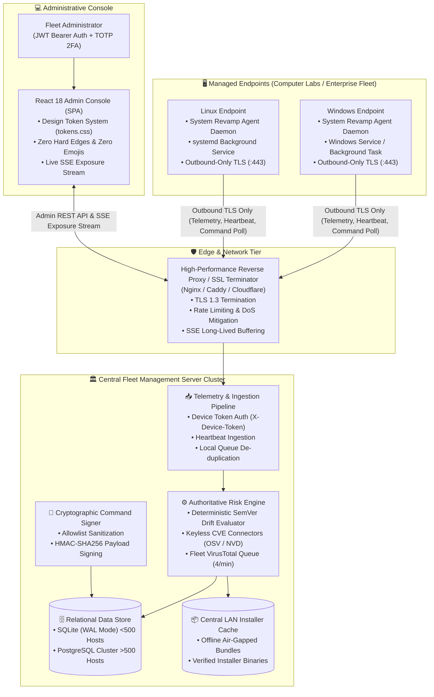
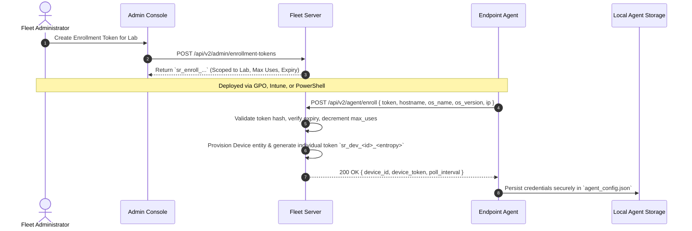
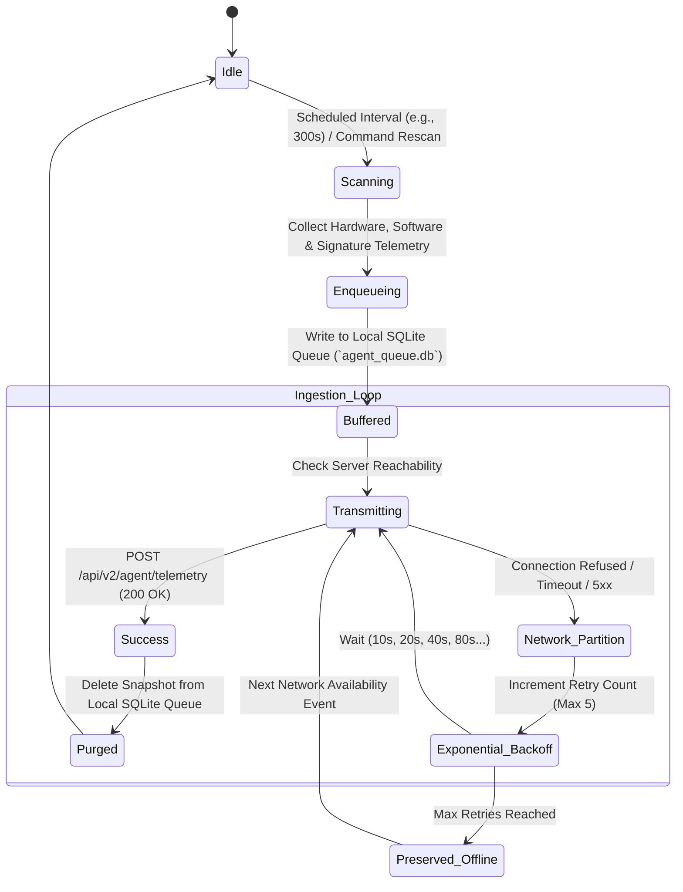
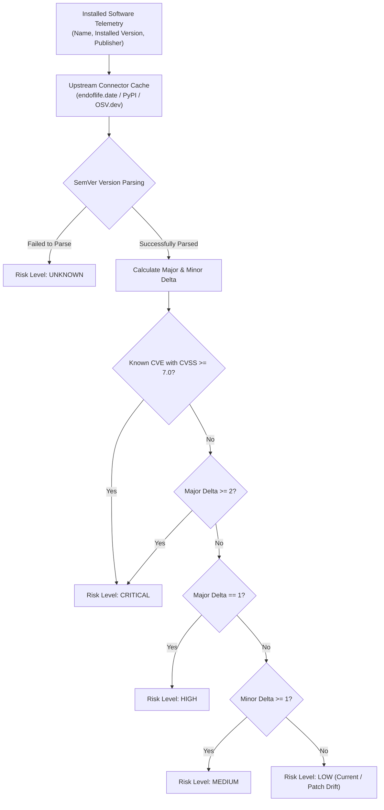
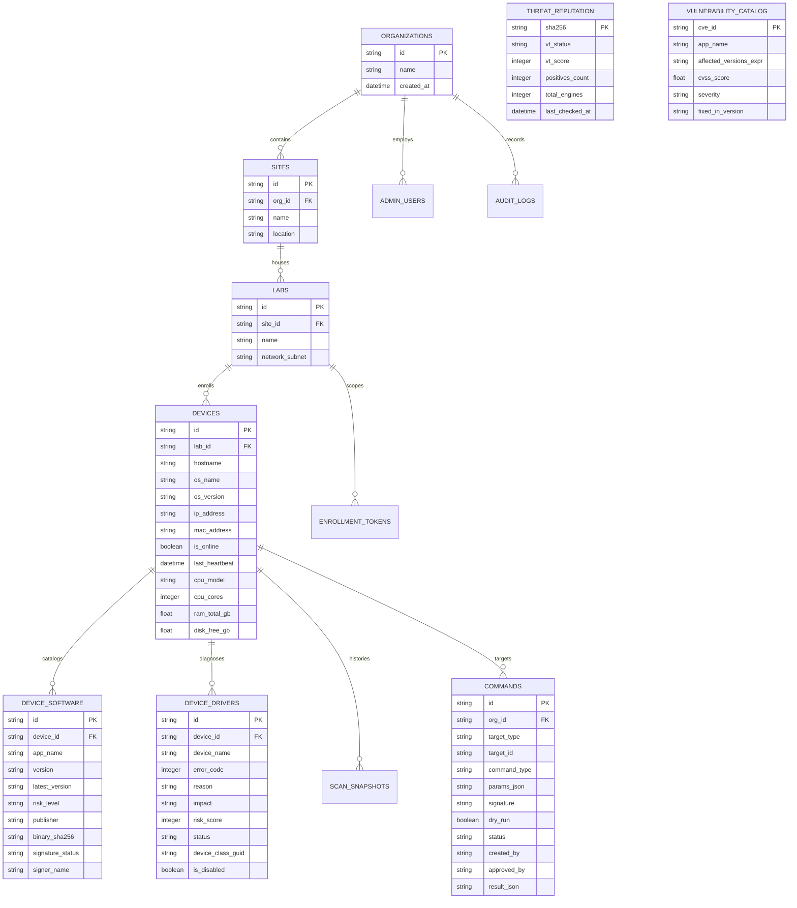

# System Revamp v2.0 — Architecture & System Design Blueprint

  <strong>Enterprise Fleet-Managed Endpoint Intelligence, PnP Driver Diagnostics, Binary Integrity & Vulnerability Platform</strong>

---

## 1. System Overview & Enterprise Architecture

**System Revamp v2.0** is an enterprise-scale endpoint intelligence, hardware diagnostics, and automated remediation platform engineered for university computer labs, academic workstations, and large corporate fleets (from 1 to 10,000+ endpoints).

The platform uses an **outbound-only background agent daemon** running across managed endpoints that continuously streams hardware health, software inventory, binary code signatures, and PnP driver problem codes to a centralized **Fleet Management Server**. Administrators manage the entire fleet through a unified, token-driven **React 18 Admin Console**.

---

## 2. Core Subsystems & Responsibilities

| Subsystem | Component | Primary Technical Responsibilities |
|---|---|---|
| **Endpoint Agent** | `agent.main` | Outbound-only background daemon. Collects Windows Registry software, CIM PnP driver problem codes, and calculates local binary SHA-256 hashes with Authenticode signature status. Buffers reports in local SQLite queue if offline. |
| **Central Fleet Server** | `server.main` | Centralized FastAPI service. Manages multi-tenant Org/Site/Lab hierarchies, evaluates version drift risk, matches CVEs, queues commands with HMAC signatures, and manages the fleet-wide VirusTotal cache. |
| **Admin Console** | `frontend/` | React 18 SPA. Displays compliance gauges, lab health heatmaps, single-machine deep inspections, staged rollouts, and CSV compliance export. Built on authoritative CSS design tokens (`tokens.css`). |
| **Keyless Connectors** | `server.services` | Upstream version and vulnerability matching against OSV.dev, NVD 2.0, endoflife.date, and PyPI without requiring individual client API keys. |
| **Command Engine** | `agent.commands` | Allowlisted subprocess dispatcher. Validates server HMAC signatures before executing `winget`, `pnputil`, or CIM remediation calls. |

---

## 3. Communication Protocols & Workflows

### 3.1 Agent Enrollment Sequence

---

### 3.2 Telemetry Ingestion & Local Queue State Machine

To survive campus network outages, Wi-Fi roaming drops, and maintenance blackouts, the agent never transmits telemetry synchronously without buffering. Every scan snapshot is queued in a local SQLite database (`agent_queue.db`) before transmission:

---

### 3.3 Authoritative Risk Classification Engine

To eliminate human subjectivity and discrepancies in compliance audits, System Revamp evaluates version drift using a mathematically deterministic classification matrix:

$$\text{Risk Level} = \begin{cases}
\mathbf{Critical}, & \text{if } \text{Major Drift} \ge 2 \text{ or known-vulnerable (CVSS } \ge 7.0\text{)} \\
\mathbf{High}, & \text{if } \text{Major Drift} = 1 \text{ or vendor deprecated} \\
\mathbf{Medium}, & \text{if } \text{Minor Drift} \ge 1 \\
\mathbf{Low}, & \text{if } \text{Patch Drift} \ge 1 \text{ or current } (\text{Current} \ge \text{Latest}) \\
\mathbf{Unknown}, & \text{if versions cannot be parsed or matched}
\end{cases}$$

---

## 4. Relational Database Schema Architecture

The Central Fleet Server utilizes a normalized relational schema supporting high-throughput ingestion and multi-tenant isolation:

---

## 5. Scalability & Sizing Sizing Calculations

| Fleet Size Tier | Target Endpoints | Recommended Ingestion Cadence | Backing Database | Memory Footprint | Network Bandwidth |
|---|---|---|---|---|---|
| **Tier 1 (Lab)** | 1 – 150 PCs | Heartbeat 60s, Telemetry 300s | SQLite (WAL mode) | Server: 250MB, Agent: 25MB | < 50 KB/s |
| **Tier 2 (Faculty)** | 150 – 1,000 PCs | Heartbeat 120s, Telemetry 600s | SQLite / PostgreSQL | Server: 1GB, Agent: 25MB | < 250 KB/s |
| **Tier 3 (Campus)** | 1,000 – 5,000 PCs | Heartbeat 300s, Telemetry 1800s | PostgreSQL (Dedicated) | Server: 4GB, Agent: 25MB | < 1.2 MB/s |
| **Tier 4 (Enterprise)** | 5,000 – 20,000+ PCs | Heartbeat 300s, Staggered Telemetry | PostgreSQL Cluster + Read Replicas | Server: 8GB+, Agent: 25MB | < 4.5 MB/s |
