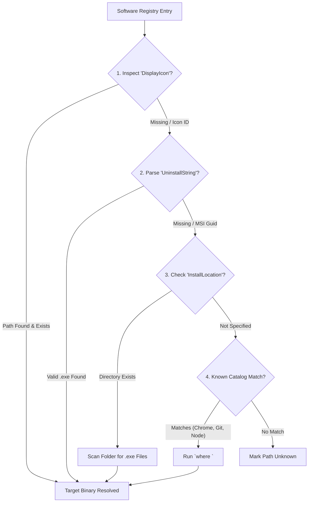
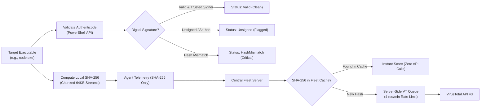

# System Revamp v2.0 — Driver Intelligence & Protection Engine

<p align="center">
  <strong>Comprehensive Specification for Hardware PnP Diagnostics, Class GUID Risk Models, Binary Authenticode Auditing, and Zero-Leak Threat Intelligence</strong>
</p>

---

## 1. PnP Hardware Driver Intelligence Engine

University computer labs and enterprise workstation fleets regularly encounter peripheral and driver degradation: faulty graphics drivers causing CAD/simulation freezes, missing Wi-Fi/NIC firmware preventing network logins, or missing chipset drivers causing thermal throttling.

The **System Revamp Driver Intelligence Engine** performs non-invasive, native hardware audits across managed endpoints to detect, classify, and score hardware failure states using official Windows Common Information Model (CIM) interfaces.

---

### 1.1 Detection Strategy & Data Acquisition

The endpoint agent avoids deprecated legacy tools (such as `wmic`) and executes modern, structured CIM queries via PowerShell:

```powershell
Get-CimInstance -ClassName Win32_PnPEntity | 
  Where-Object { $_.ConfigManagerErrorCode -ne 0 } | 
  Select-Object Name, DeviceID, ConfigManagerErrorCode, Status, ClassGuid, Manufacturer
```

On Linux workstations, the agent inspects the kernel PCI subsystem via `/sys/bus/pci/devices/` and parses `lspci -k` to detect devices without active kernel drivers or unassigned PCI class codes.

---

### 1.2 Authoritative Microsoft PnP Problem Codes

When Windows marks a device with a non-zero `ConfigManagerErrorCode`, the agent maps the numeric identifier against the official Microsoft Hardware Specification table:

| Error Code | Official Windows Description | Operational Impact | Recommended Automated Remediation |
|---|---|---|---|
| **Code 1** | `Device is not configured correctly.` | High | Re-enumerate hardware bus via `pnputil /scan-devices`. |
| **Code 3** | `Driver for this device might be corrupted.` | High | Clean reinstall of vendor driver package. |
| **Code 10** | `This device cannot start.` | High / Critical | Restart device stack or update incompatible firmware. |
| **Code 14** | `This device requires a restart.` | Medium | Schedule endpoint reboot during maintenance window. |
| **Code 18** | `Reinstall the drivers for this device.` | Medium | Invoke `pnputil /install` with staged LAN driver. |
| **Code 22** | `This device is disabled.` | Medium / Low | Dispatch `Enable-PnpDevice -InstanceId <ID> -Confirm:$false`. |
| **Code 28** | `The drivers for this device are not installed.` | Variable by Class | Trigger Windows Update driver sync (`UsoClient StartScan`). |
| **Code 31** | `Windows cannot load the drivers required.` | High | Signature validation or driver package conflict. |
| **Code 39** | `Windows cannot load the device driver.` | High | Driver binary missing or corrupted on disk. |
| **Code 43** | `Windows stopped this device due to problems.` | High | Hardware crash reported by peripheral controller. |
| **Code 48** | `Device blocked from starting.` | Critical | System security policy or hypervisor isolation block. |

---

### 1.3 Authoritative Device Setup Class GUID Risk Impact Model

Rather than applying arbitrary heuristics, System Revamp evaluates hardware severity based on standard **Microsoft Device Setup Class GUIDs**. If a device's Class GUID matches a core processing or storage component, missing drivers receive a **Critical** impact rating:

| Device Setup Class | Class GUID | System Revamp Impact | Risk Score | Example Hardware |
|---|---|---|---|---|
| **DiskDrive** | `{4d36e967-e325-11ce-bfc1-08002be10318}` | `Critical` | **95** | NVMe SSDs, SATA Disks |
| **SCSIAdapter / HDC** | `{4d36e97b-e325-11ce-bfc1-08002be10318}` | `Critical` | **95** | RAID Controllers, AHCI Chipsets |
| **System** | `{4d36e97d-e325-11ce-bfc1-08002be10318}` | `Critical` | **95** | Motherboard ACPI, Intel MEI, AMD PSP |
| **Processor** | `{50127dc3-0f36-415e-a6cc-4cb3be25f615}` | `Critical` | **95** | CPU Power Management, Microcode |
| **SecurityDevices** | `{d94ee5d8-d18d-4444-9bc0-88031d279930}` | `Critical` | **95** | Trusted Platform Modules (TPM 2.0) |
| **Net (Network/NIC)** | `{4d36e972-e325-11ce-bfc1-08002be10318}` | `High` | **75** | Intel AX201 Wi-Fi, Realtek 2.5GbE NIC |
| **Bluetooth** | `{e0cbf06c-cdb3-4647-bb8a-263b43f0f974}` | `High` | **70** | Host Bluetooth Controllers |
| **Display (GPU)** | `{4d36e968-e325-11ce-bfc1-08002be10318}` | `Medium` | **50** | NVIDIA RTX 4080, AMD Radeon Graphics |
| **Media (Audio)** | `{4d36e96c-e325-11ce-bfc1-08002be10318}` | `Medium` | **40** | High Definition Audio Bus, Realtek ALC |
| **USB Host / Hubs** | `{36fc9e60-c465-11cf-8056-444553540000}` | `Medium` | **50** | xHCI Controllers, Root Hubs |
| **HIDClass / Input** | `{745a17a0-74d3-11d0-b6fe-00a0c90f57da}` | `Medium` | **30** | Mice, Keyboards, Digitizers |
| **PrintQueue / Printer** | `{1ed2bbf9-11f0-4084-b21f-b054a77d616e}` | `Low` | **20** | Network & USB Printers |
| **Sensors** | `{5175d327-165c-4447-920f-560be9f92e2b}` | `Low` | **15** | Ambient Light & Motion Sensors |

---

## 2. Software Protection & Threat Engine

Endpoints in computer labs and enterprise environments are frequent targets for unapproved software, cracked utilities, and malicious payloads. System Revamp combines **local cryptographic binary audits** with **centralized threat intelligence** to provide real-time protection without leaking intellectual property or exceeding API quotas.

---

### 2.1 Multi-Stage Executable Path Resolution

Installed applications cataloged in the Windows Registry (`Uninstall` keys) do not always provide explicit paths to their primary executable. The endpoint agent executes a multi-tier resolution heuristic:



---

### 2.2 Dual-Layer Verification: Authenticode & VirusTotal



#### Layer 1: Local Authenticode Signature Verification (Zero Network Overhead)
On the managed endpoint, the agent queries the native Windows Authenticode validation subsystem:
- **`Valid`**: The binary has a cryptographically sound digital signature chained to a trusted Microsoft Root Authority. The signer name is recorded (e.g., `OpenJS Foundation`, `Google LLC`).
- **`Unsigned`**: The executable has no digital signature, common in custom lab scripts or internal enterprise software.
- **`HashMismatch`**: The binary was modified after signing, indicating file corruption or malware injection.
- **`NotTrusted`**: The binary is signed with an untrusted, expired, or self-signed certificate.

#### Layer 2: Centralized VirusTotal Queue (Keyless Agent Operation)
- Endpoint agents **never** store or require VirusTotal API keys.
- Agents calculate the 64-character SHA-256 string locally and transmit it to the Central Fleet Server.
- The server checks its relational `threat_reputations` database table. If already verified, the response is instantaneous.
- If uncataloged, the hash enters an asynchronous queue processed at **4 requests per minute** (conforming to VirusTotal free-tier guidelines).
- Scores:
  - `malicious > 0` $\rightarrow$ Flagged **Malicious** (Threat Score: 90+).
  - `suspicious > 0` $\rightarrow$ Flagged **Suspicious** (Threat Score: 70).
  - `harmless + undetected > 0` $\rightarrow$ Marked **Clean** (Threat Score: 10).
  - Not found in VT $\rightarrow$ Marked **Unknown** (Threat Score: 30).
