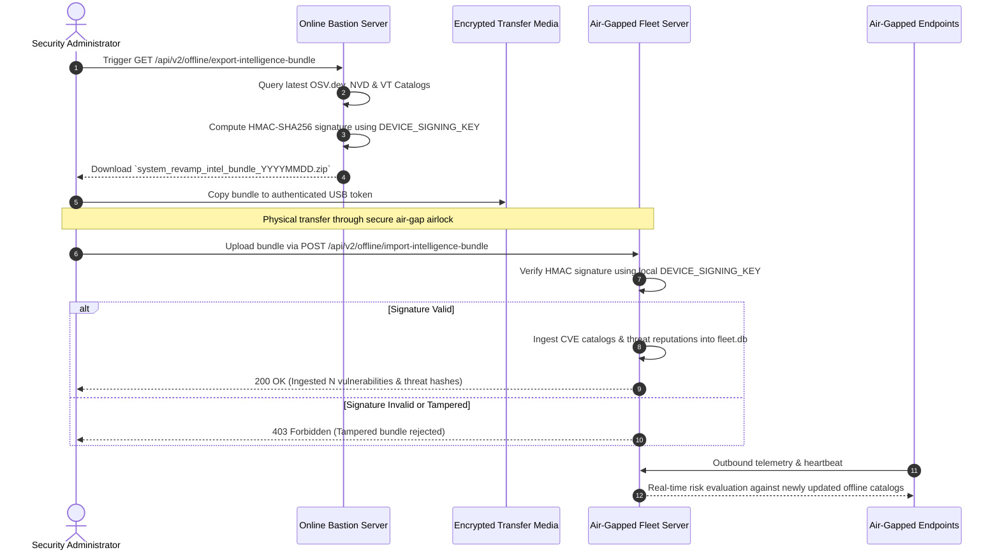
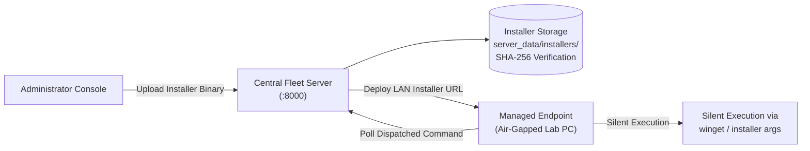
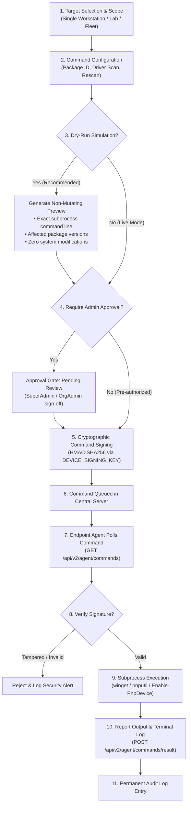

# System Revamp v2.0 — Offline Air-Gapped Sync & Remediation Pipeline

<p align="center">
  <strong>Comprehensive Operational Guide for Air-Gapped University Labs, Offline Intelligence Synchronization, and Staged Enterprise Remediation</strong>
</p>

---

## 1. Air-Gapped Operational Challenges

High-security academic workstations, research laboratories, and defense-affiliated networks are frequently isolated from the public internet (air-gapped) to prevent unauthorized exfiltration and remote compromise. However, air-gapping introduces severe operational vulnerabilities:
- Workstations cannot query public vulnerability registries (OSV.dev, NVD 2.0).
- Package managers (`winget`, `apt`, `yum`) cannot reach vendor repositories for critical security patches.
- Threat intelligence feeds (VirusTotal) cannot be accessed directly.

System Revamp v2.0 resolves this paradox through an integrated **Cryptographically Signed Offline Intelligence Synchronization** framework and a **Centralized LAN Installer Cache**.

---

## 2. Air-Gapped Intelligence Synchronization Workflow



### 2.1 Anatomy of a Signed Intelligence Bundle

The exported archive contains two critical files:
1. **`manifest.json`**: UTF-8 encoded JSON payload containing:
   - `bundle_version`: Schema version (e.g., `"2.0.0"`).
   - `created_at`: UTC timestamp of bundle creation.
   - `vulnerabilities`: Complete list of known CVEs, affected package expressions, CVSS scores, and recommended patch versions.
   - `threats`: Cached binary SHA-256 reputations, VirusTotal malicious engine counts, and detection statuses.
2. **`signature.sig`**: Hexadecimal HMAC-SHA256 digest calculated strictly over the byte contents of `manifest.json`:
   $$\text{Signature} = \text{HMAC-SHA256}(\text{DEVICE\_SIGNING\_KEY}, \text{manifest.json})$$

Any modification of single bytes inside `manifest.json` causes instant signature verification failure upon import.

---

## 3. LAN Installer Cache Architecture

In air-gapped environments, endpoints cannot download updates from external CDNs. System Revamp provides an authoritative **LAN Installer Cache** directly within the Central Fleet Server.



### 3.1 Managing Cached Installers
1. **Upload**: Administrators upload verified `.msi`, `.exe`, or `.deb` packages via the Admin Console (**Settings** $\rightarrow$ **Cached Installers**) or API:
   ```bash
   curl -X POST "https://fleet-server/api/v2/offline/installers/upload" \
     -H "Authorization: Bearer <TOKEN>" \
     -F "app_name=Node.js" \
     -F "version=22.9.0" \
     -F "installer_file=@node-v22.9.0-x64.msi"
   ```
2. **Integrity Validation**: The server computes the SHA-256 hash upon ingestion and registers the record in the `installer_cache` database table.
3. **Distribution**: When remediation commands are dispatched, endpoints retrieve installation assets directly from the high-speed local network cache.

---

## 4. Staged Enterprise Remediation Pipeline

Automated software upgrades in large computer fleets carry significant operational risk: untested versions can break specialized lab software, conflict with graphics drivers, or disrupt scheduled student exams.

System Revamp enforces a **Staged Remediation Pipeline** with cryptographic safeguards, dry-run simulations, and multi-tier approval workflows.



---

### 4.1 Allowlisted Remediation Commands

To prevent remote code execution (RCE) vulnerabilities, the server schema strictly enforces an allowlist of 5 atomic operations:

| Command Identifier | Subsystem | Action Performed | Parameters Required |
|---|---|---|---|
| `rescan` | Agent Core | Requests immediate baseline software, driver, and system spec collection. | None |
| `scan-drivers` | PnP Diagnostics | Invokes native `pnputil /scan-devices` to discover newly connected hardware. | None |
| `enable-device` | Hardware Manager | Invokes `Enable-PnpDevice -InstanceId <ID>` to re-enable disabled components. | `device_id` (String) |
| `upgrade-package` | Software Manager | Executes silent package upgrade via Windows Package Manager (`winget`). | `package_id` (Winget ID) |
| `run-protection-scan` | Threat Protection | Triggers immediate SHA-256 computation and Authenticode signature audit. | None |

---

### 4.2 Parameter Sanitization & Shell Injection Prevention

All parameters passed into command endpoints (`/api/v2/commands/queue`) undergo strict regex sanitization:
- **Rejected Metacharacters**: Any parameter containing `;`, `|`, `` ` ``, `$`, `>`, `<`, `\r`, `\n`, or `&&` is immediately rejected with HTTP `400 Bad Request`.
- **Subprocess Safety**: The endpoint agent executes all system calls using Python's `subprocess.run(list_of_args, shell=False)` with deterministic timeouts (15s to 300s), ensuring arguments cannot break out into shell execution contexts.

---

### 4.3 Cryptographic Command Signing

Every command dispatched by the server is signed using the server's private `DEVICE_SIGNING_KEY`:

$$\text{Command Signature} = \text{HMAC-SHA256}(\text{DEVICE\_SIGNING\_KEY}, \text{command\_id} + \text{command\_type} + \text{params\_json})$$

When the endpoint agent polls `/api/v2/agent/commands`, it recalculates the HMAC digest. If an adversary attempts to inject unauthorized commands via a Man-in-the-Middle (MitM) proxy, the agent rejects execution and reports a cryptographic tampering alert.
